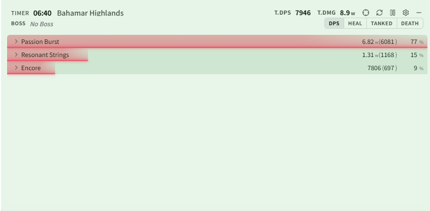
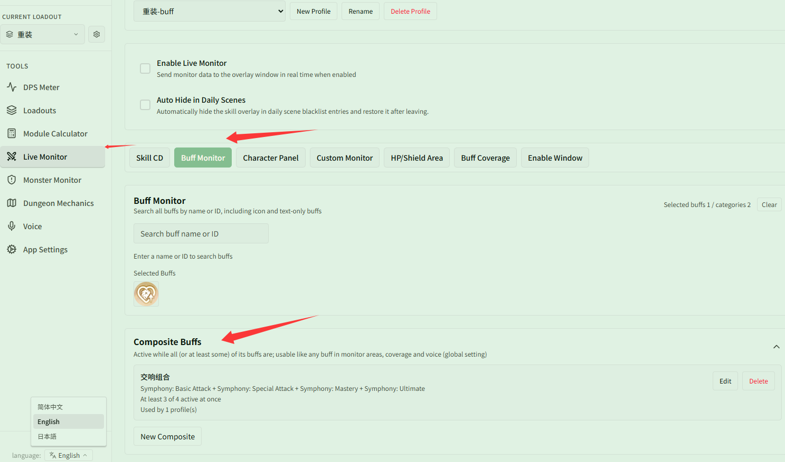
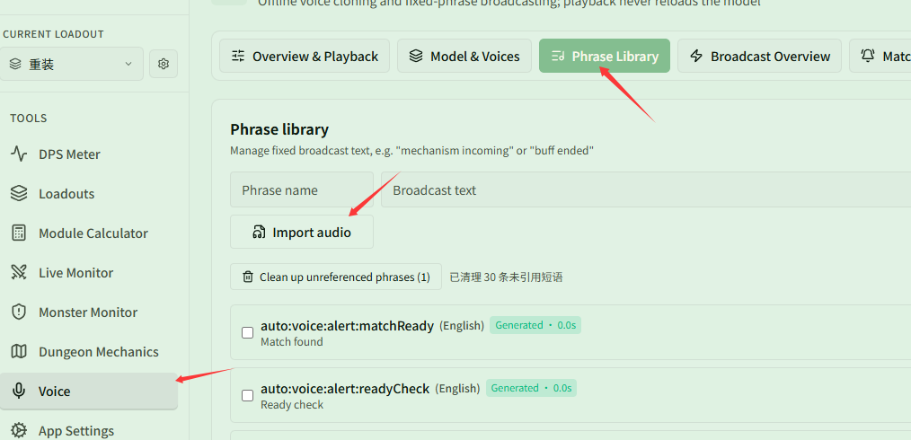

# Changelog v0.2.5

## Changes

### DPS / History

- Compact mode now applies to the player list only; skill details stay as a full table unless you enable "Also Compact Detail Pages" (DPS Meter → Themes → Compact Mode)

  

- History timeline now includes Deter Shot and Luminary Bolt
- History Buff coverage now sits between the skill lanes and the curve: full Buff names, grouping by player or by Buff, gray hatching for inactive time that coverage does not count, and the same hover, selection and zoom as the lanes; expand it from the timeline header (collapsed by default, shows you when expanded; other players can be added independently of the teammate lane picker, and you are listed first in player lists and the summary). The Buff coverage summary now has one row per Buff
- History records can have a note, shown in the history list (History detail → Edit note)
- The number of history records to keep is configurable: 200 unfavorited records by default, adjustable from 1 to 2000, applied on next launch (App Settings → General → History Retention)
- Damage element labels: Water is now Ice, Wood is now Forest
- Fixed difficulty names not being appended to scene names

### Overlay Monitor

- Added Teammate CD **[Experimental, not yet tested in real play]** (Monster Monitor → Teammate CD): players in the same team who all turn on Team Sharing share all of their skill cooldowns in real time, and each player picks which skills to show per class; shown beside each teammate's row of the in-game team panel by default (align the 5-player and 20-player panels once each), or as a list; anchored to the game server's clock
  - Team Sharing is on by default and can be turned off under App Settings → General → Team Sharing; the server only relays the data to teammates in the same team who also share, and keeps it in memory only without writing it to a database
  - The Teammate CD area is hidden by default; turn it on under Monster Monitor → Enable Window. Join the team with the app running so it can read the team order
- Added **Entity Duration** to Monster Monitor (Monster Monitor → Entity Duration): times nearby entities by id (e.g. Scythe Cart 179903) with presets / manual entries and a caster scope (self only / anyone). The timer starts when the entity appears and ends when it disappears. The optional **Merge same ID** shows one caster's entities with the same id as a single row counting down the one that expires soonest (on by default for the Scythe Cart preset). Built-in presets: Scythe Cart, Fafala Duty (zone, 10 s), Fafala Imagine (zone, 15 s)
  - The Entity Duration area is hidden by default; turn it on under Monster Monitor → Enable Window
- Removed **Duration Skills** from Live Monitor; a selected Scythe Cart is migrated automatically to Monster Monitor → Entity Duration
- Monster Monitor area visibility is now controlled from the enable window
- Monster HP values follow the abbreviation setting (Western / Chinese)
- Added Composite Buffs (Live Monitor → Buff → Composite Buffs): 2–8 Buffs that must all be present, or at least a set number of them, act as one Buff for monitor areas, coverage, and voice

  

- Teammate Buffs can override colors per entry and show downed teammates (Monster Monitor → Teammate Buffs)
- Added "100ms Precision" to Teammate Buffs: countdowns show tenths of a second and bars update every 100 ms; off by default (Monster Monitor → Teammate Buffs)
- Buff countdown alert thresholds are now typed in directly, from 0.1 to 60 seconds in 0.1-second steps (Live Monitor → Buff Monitor, Monster Monitor → Buff Monitor)
- The season node area no longer hides Symphony Buffs
- Added skill CDs for Shield Knight, Heavy Guardian, and Marksman
- Minimap now tracks Lapsis, the first boss of the S4 raid Above the Firmament, End of Day and Night
  - Giant Light Spear HP is merged into one line of percentages, and Golden Chasers show their HP percentage
  - Added the Shadow Refinement callout
- Improved overlay performance: a Monster Monitor data change no longer recomputes every panel, and progress bars now use a one-shot animation, lowering usage at high refresh rates

### Voice

- The phrase library can import any audio file (Voice → Phrase Library)

  

- Skill CD and entity duration announcements can be bound on their own, without adding the skill to Skill CD monitoring first
- Voice rules are saved with the monitoring loadout
- Fixed charge-skill CD announcements when the remaining time crosses the threshold
- Fixed the playback queue, and imported audio is now resampled in one pass

### App Settings

- Clicking an available update now downloads it silently in the background, then verifies, installs, and restarts
- Added a "User Guide" entry at the bottom of the left sidebar that opens the user guide in your language in the browser
- Fixed errors caused by missing columns in databases created by early versions (0.0.1–0.0.3); the columns are now added on startup

### Data

- Updated monster names, Buffs, skill effects, and DBM data
- Restored monster names that had been removed by mistake

## Notes

### Compatibility

- If you used 0.0.2 or 0.0.3, first launch on 0.0.4-0.2.5 requires deleting `resonance-logs-cn.db` under `%LOCALAPPDATA%\resonance-logs-cn` and restarting
- 0.2.2 and 0.2.1 went through large refactors; if existing features break, please contact me promptly
- 0.2.2 changed table fields; errors on old history records are expected, new records work normally
- Voice announcements require a separate model download; the first phrase generation may take a while, but playback after that does not reload the model

### Important

- If you modify the code and share builds without opening a PR, please change the app name, version, and other upstream identifiers so your fork is not mistaken for the original
- The close button now hides to the bottom-right; drag the hidden bar back to the corner if you have many windows
- See the HTML user guide for common questions

### Community

- QQ group: `1084866292`
- Discord: https://discord.gg/RHeX47wvDU
