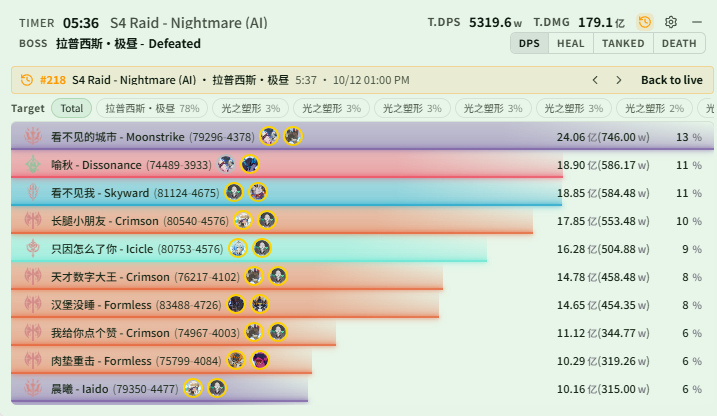
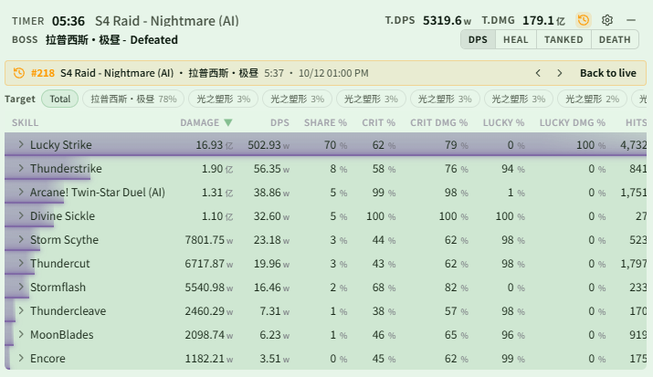

# Changelog v0.2.6

## Changes

### DPS / History

- The live window can now show history: click the History button in the header to open the history list, search by scene / boss / player / UID, or use the quick filters for the current scene, current boss, today, and favorites; once you pick a record, the DPS, HEAL, TANKED, and DEATH pages all show that encounter, and the banner at the top steps to an older / newer encounter or goes back to live. The History button is hidden by default; turn on "Show History Button" (DPS Meter → Themes → Live → Header Settings)
  - A target bar above the DPS and skill pages shows damage against a single target
  - If a new fight starts while you are viewing history, the banner shows "In combat" instead of switching back automatically; live controls such as Reset and Pause are hidden while viewing history

  

  

- History can be searched by player UID (DPS Meter → History, set the search type to UID): type the first digits of a UID to list matches, along with the names that UID has used and its encounter count; only records created from this version onward are searchable
- History search suggestions are no longer truncated; click "Show more" to see the rest

### Overlay Monitoring

- Added Monster Skills (Monster Monitor → Monster Skills): when any nearby monster casts a skill on your list, its name appears on the monster overlay and disappears after the set number of seconds, restarting on each cast; voice announcements can be bound, which is handy for skills without a DBM alert
  - The Monster Skills area is hidden by default; enable it under Monster Monitor → Enable Window
- Monster Monitor and Live Monitor tabs are now grouped, and a green dot marks tabs whose area is shown on the overlay
- Overlay edit mode adds "Undo Changes", which restores panel positions, sizes, and the overlay window to how they were when you entered edit mode
- Fixed teammate Buffs and teammate CDs not showing when the app was opened after entering a dungeon, because the party roster was incomplete

### Voice

- Custom announcement text is now saved when you finish typing (on blur or Enter) instead of turning every intermediate edit into a phrase

### App Settings

- Added Boss HP Reports (App Settings → General → Boss HP Reports), on by default

### Module Calculator

- Adapted to the module data format after the game update, fixing module values that could not be read; after updating, log in again or switch lines once to load the new module data

### Data

- Updated monster names, Buffs, monster skills, scene names, and DBM data
- Mainly adds S4 translations for the Global server; when the JP server enters S4, please contact me on Discord to send the corresponding config

## Notes

### Compatibility

- If you used 0.0.2 or 0.0.3, first launch on 0.0.4-0.2.6 requires deleting `resonance-logs-cn.db` under `%LOCALAPPDATA%\resonance-logs-cn` and restarting
- 0.2.2 and 0.2.1 went through large refactors; if existing features break, please contact me promptly
- 0.2.2 changed table fields; errors on old history records are expected, new records work normally
- Voice announcements require a separate model download; the first phrase generation may take a while, but playback after that does not reload the model

### Important

- If you modify the code and share builds without opening a PR, please change the app name, version, and other upstream identifiers so your fork is not mistaken for the original
- The close button now hides to the bottom-right; drag the hidden bar back to the corner if you have many windows
- See the HTML user guide for common questions

### Community

- QQ group: `1084866292`
- Discord: https://discord.gg/RHeX47wvDU
