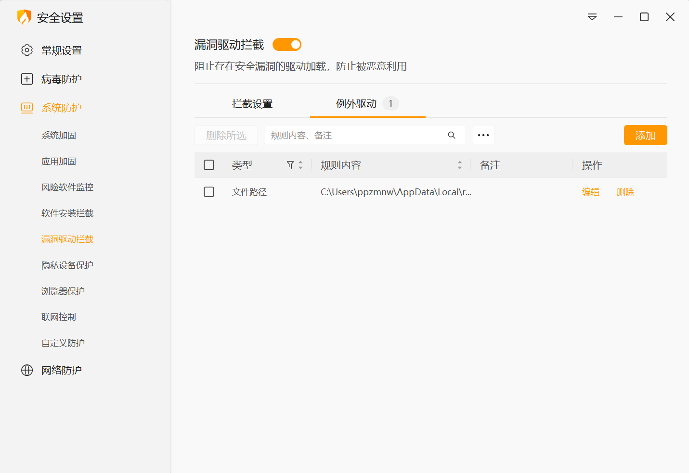

# FAQ · App Runtime

## Install & Run

### How do I keep my settings? Will they be lost after an upgrade?

**Do not delete the user settings directory** when installing a new version—your settings will be preserved. If this update has no structural frontend changes, settings remain compatible automatically.

### First launch on 0.0.7 prompts to clean the database?

> This section only concerns historical migrations from 0.0.2 / 0.0.3. New installations do not need this legacy database cleanup.

If you previously used 0.0.2 or 0.0.3, you must manually clean the old database when upgrading to 0.0.7 for the first time, or you may encounter issues:

1. Close the app
2. Delete `resonance-logs-cn.db` under `%LOCALAPPDATA%\resonance-logs-cn`
3. Restart the app

## Other

### Where are log files?

In **DPS Meter → Settings → Debug**, use **Open Logs** to open the log directory.

### How do I share my configured settings with someone else?

User config is stored under `%APPDATA%\com.resonance-logs-cn`. Zip that folder and send it to the other person; they extract it to the same path (with the app closed).

### How do I switch overlay windows?

In **DPS Meter → Settings → Shortcuts**, set a shortcut for **Toggle Overlay Window**.

## Packet Capture

### WinDivert or Npcap?

| Method | Description |
|--------|-------------|
| **WinDivert** | Built-in driver; usually no separate Npcap install. Requires administrator privileges and may be flagged or quarantined by antivirus software |
| **Npcap** | Requires installing [Npcap](https://npcap.com/) and selecting the correct network adapter in settings |

Settings path: **DPS Meter → Settings → Network**.

If you do not want to install Npcap, you can use WinDivert. If WinDivert is falsely flagged or quarantined, switch to Npcap or add the app directory and WinDivert-related files to your security software trust list.

See [Getting Started](../getting-started.md) for the full steps.

### No data / capture not working?

1. Confirm the game is running
2. Check the capture method under **DPS Meter → Settings → Network**
3. If using Npcap: confirm Npcap is installed and the correct interface is selected under **Network**
4. If using WinDivert: run as administrator and check whether a firewall or antivirus blocked or quarantined the driver
5. **Fully quit and restart the app** (required after changing capture method or network adapter)
6. Disable conflicting VPN, proxy, or other capture tools and try again

### WinDivert blocked by firewall or antivirus?

WinDivert loads a network capture driver. Some firewalls or antivirus products may treat this as risky behavior. If blocked or quarantined, capture may not start and live data will stay empty.

Try the following:

1. Allow the app through Windows Firewall, or temporarily disable the firewall to confirm interception is the cause
2. Check the antivirus quarantine area for `WinDivert.dll`, `WinDivert64.sys`, or the app install directory
3. If using Huorong (火绒), open **Protection Center → Virus Protection → Trust List**, add the app install directory to trust; if WinDivert files are already quarantined, restore them first, then add trust
4. Fully quit and restart the app
5. If quarantine keeps happening, switch to Npcap capture

