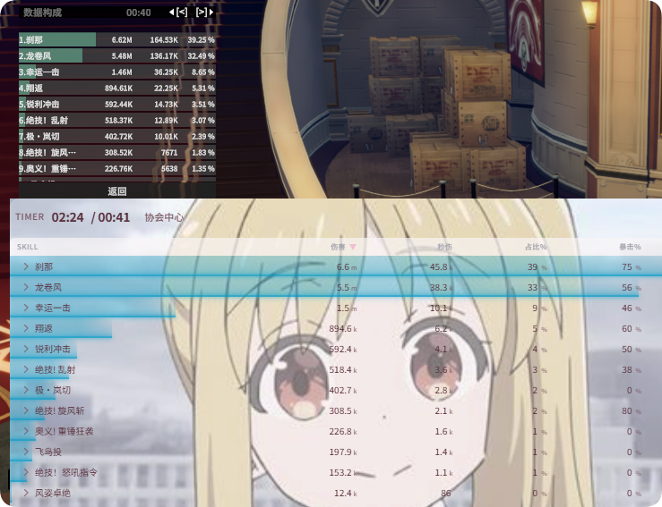
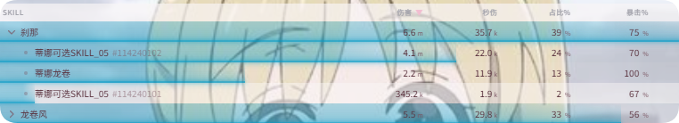

# DPS Meter

**{{ui:routes.tools.dps}}** parses the game's network data to track each party member's damage, healing, and damage taken in real time, and automatically saves every fight to history so you can review it afterwards.

## What you can use it for

- See the party's **DPS / HPS / damage taken per second** rankings and skill shares live during combat;
- Use **training dummy mode** at the training ground to test your output over a fixed duration;
- After the fight, review the second-by-second damage curve, Buff coverage, and causes of death in **History**;
- In challenge dungeons, use **Challenge Watch** to flag who got hit by a mechanic they shouldn't have;
- Freely adjust the window's colors, size, columns, and header so it fits your screen.

## Live DPS window



The tabs at the bottom of the window switch between four views:

| Tab | Content |
| --- | --- |
| **{{ui:live.tabs.dps}}** | Damage ranking; click a player to expand their skill breakdown |
| **{{ui:live.tabs.heal}}** | Healing ranking and skill breakdown |
| **{{ui:live.tabs.tanked}}** | Damage taken ranking |
| **{{ui:live.tabs.death}}** | Death log; replay the damage taken before each death |

By default the header shows the combat timer, encounter name, total damage, total DPS, Boss HP, and the **Reset / Pause / Training Dummy / Settings / Minimize** buttons. You can add, remove, and rearrange all of these in [Themes · Header Settings](./themes.md#header-settings).

### Why a skill has multiple entries

The DPS skill list aggregates damage the same way the game client does: one skill may consist of several damage sources (e.g. the main hit plus follow-up damage). Expanding the skill shows these sub-entries.



### DPS vs. True DPS

| Metric | Calculation |
| --- | --- |
| **DPS** | Total damage ÷ total combat duration |
| **True DPS (TDPS)** | Total damage ÷ active combat time (excluding long gaps such as pausing your attacks or running around) |

Combat duration is counted up to the **last hit**. Enable "Show Active Combat Time" in the header settings to see both durations at once.

## When fights are split and reset

You don't need to press Reset manually. The app automatically splits fights and saves them to history according to these rules:

| Situation | Behavior |
| --- | --- |
| **Zone change** | If the current fight has data, it is saved as a history entry; the live window keeps the old numbers and only clears them the **next time you deal damage** |
| **Master dungeon** | Trash and Boss are automatically split into two entries |
| **Raid** | One entry per Boss |
| **Wipe** | Automatically resets; a new segment starts the next time you attack the Boss |

> [!NOTE]
> The live window doesn't clear immediately after a zone change so that the numbers don't suddenly vanish. You can click **Reset** in the header at any time to start a new segment manually.

## Page structure

| Page | Content | Examples |
| --- | --- | --- |
| [History](./history.md) | History list, details, timeline, Buff coverage, death replay | [Find DPS gaps with the timeline](./history.md#example-find-dps-gaps-with-the-timeline) |
| [Challenge Watch](./challenge.md) | Flag party members hit by "forbidden damage" | [See who got hit by the Drone Cannon](./challenge.md#example-see-who-got-hit-by-the-drone-cannon-in-a-challenge-dungeon) |
| [Themes & Appearance](./themes.md) | Colors, size, compact mode, tables, header | [A transparent, minimal DPS window](./themes.md#example-a-transparent-minimal-dps-window) |
| [Display Settings](./settings.md) | Names, columns, abbreviations, refresh rate, training dummy duration | — |

The live window's own example is at the end of this page: [Test a 3-minute rotation with training dummy mode](#example-test-a-3-minute-rotation-with-training-dummy-mode).

## Examples

### Example: Test a 3-minute rotation with training dummy mode

**Scenario**: You've switched to a new set of modules and want to hit a dummy at the training ground for a fixed 3 minutes to compare DPS between the old and new setups.

#### Preparation

1. Open **{{ui:routes.tools.dps}} → {{ui:routes.dps.themes}} → {{ui:themes.tabs.live}} → {{ui:themes.header.title}}** and make sure **{{ui:themes.header.showHeaderControl}}** is checked.
2. Open **{{ui:routes.tools.dps}} → {{ui:routes.dps.settings}} → {{ui:settings.tabs.live}}**:
   - Keep **{{ui:settings.live.trainingWindow}}** at the default 3:03, or change it to your preferred duration;
   - Set **{{ui:settings.live.trainingLockPolicy}}** to **{{ui:settings.live.trainingLockPolicy.eliteDummies}}**.

#### Starting a round

1. Go to the training ground and stand in front of an elite dummy.
2. Click the **crosshair button** in the live window's header; the status changes to **Training dummy armed**.
3. Land your first hit on the dummy; it is locked automatically, the status changes to **Training dummy running**, and the timer starts.
4. When the set duration is reached, the status changes to **Segment finished**: the live window freezes and the data is saved to history at the same time.

```text
Armed ──first hit──▶ Running ──time up──▶ Finished
  ▲                                          │
  └────────────── click "Reset" ─────────────┘
```

#### Next round and comparison

- After the round finishes, attacking again does **not** start a new round automatically. Click **Reset** first to return to armed; this lets you change gear and wait for cooldowns before starting.
- You can also click **Reset** in the middle of a round to abandon it.
- Every round is saved to **{{ui:routes.dps.history}}**. You can **add it to favorites** and use "Favorites only" to compare several rounds side by side.

> [!WARNING]
> Changing zones, switching channels, or entering/leaving the guild automatically exits training dummy mode; click the crosshair again when you're back.

> [!TIP]
> Not at the training ground? Set the training lock to **{{ui:settings.live.trainingLockPolicy.firstMonster}}** to time the first monster you hit in the open world — useful for testing single-target rotations.
