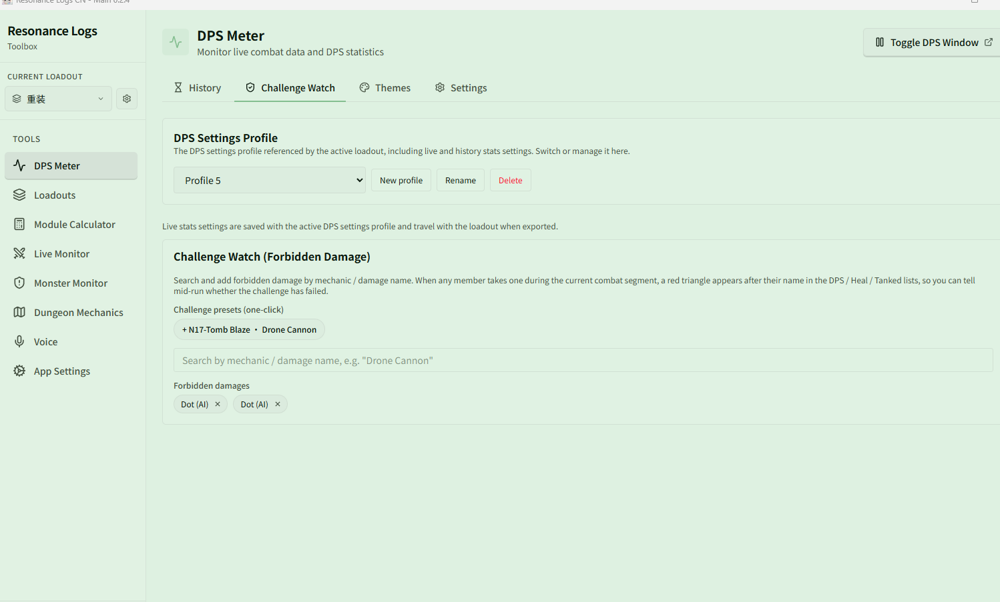
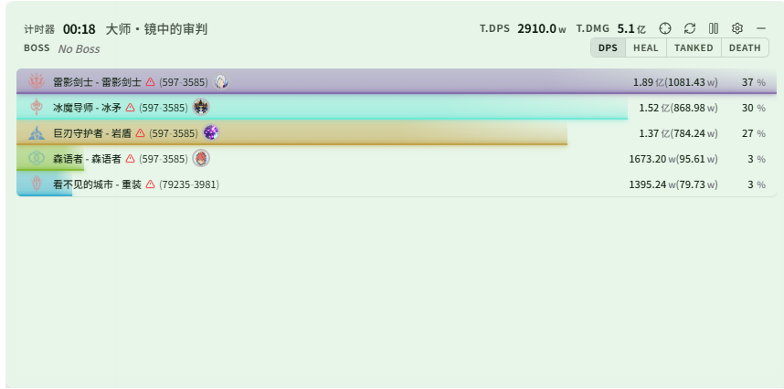

# Challenge Watch

**{{ui:routes.tools.dps}} → {{ui:routes.dps.challenge}}** lets you mark "forbidden damage": as soon as a party member takes any of this damage in the current combat segment, a **red triangle** warning appears next to their name.

It's meant for challenge objectives like "don't get hit by a certain mechanic", so you know halfway through the fight whether the challenge has already failed.

Forbidden damage is managed in **groups**, one per challenge. Groups belong to the current loadout and travel with it when you export the loadout.

## Adding forbidden damage

1. Under **{{ui:challengeWatch.presets.title}}**, click a built-in preset such as **{{ui:challengeWatch.preset.n17Fuyoupao}}**; it is added as a group under **{{ui:challengeWatch.configuredTitle}}**.
2. Or click **{{ui:challengeWatch.group.new}}** to create an empty group, give it a name, then click **{{ui:challengeWatch.group.addDamage}}** and search:
   - by mechanic or damage name, e.g. "Drone Cannon";
   - by damage ID, with prefix matching, e.g. "#110098" (the `#` is optional); when there are many results, click "Show more" to page through them;
   - type a full ID and press Enter to add a damage the tables don't name.
3. Every damage in a group shows as "name #ID", so different damages that share a name stay distinguishable. Click × to remove one.



## My presets

Click **{{ui:challengeWatch.group.saveAsPreset}}** on a group and it appears under **{{ui:challengeWatch.presets.mine}}**, ready to add in one click from any loadout.

- A preset is only a template: adding it gives you an independent group, and later changes to the preset don't affect groups already added.
- After editing a group that came from one of your presets, click **{{ui:challengeWatch.group.updatePreset}}** to save the changes back into the preset.
- Deleting one of your presets doesn't delete the groups already added from it.

## Where the warning appears

The red triangle appears after the party member's name in the DPS, healing, and damage-taken lists of the live window. Hover over it to see the damage they took, listed by group, each with its name, ID and hit count, for example:

```
Took forbidden damage
N17-Tomb Blaze · Drone Cannon
· Funnel Laser Line (Cursed Radiant Tomb) #110098140104 ×2
· Floating Cannon Surrounding Laser Fire #110098130103 ×1
```



The warning only applies to the **current combat segment**; it's re-evaluated after the fight is split or reset.

## Examples

- [See who got hit by the Drone Cannon in a challenge dungeon](./examples/challenge-hits.md)
