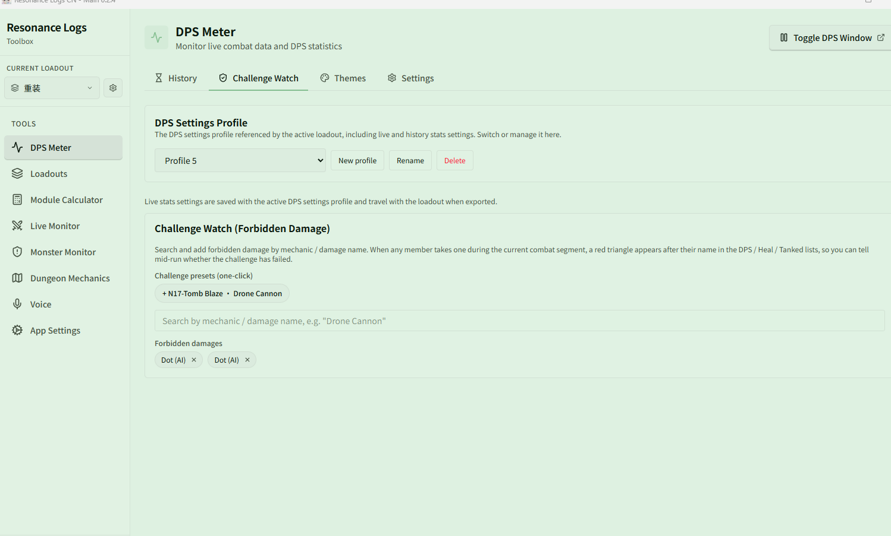

# See who got hit by the Drone Cannon in a challenge dungeon

Related page: [Challenge Watch](../challenge.md)

**Scenario**: N17 Tomb Blaze has a "don't get hit by the Drone Cannon" challenge objective, and you want to know halfway through the fight whether the challenge has already failed, instead of finding out at the end.

## Setup

1. Open **{{ui:routes.tools.dps}} → {{ui:routes.dps.challenge}}**.
2. Click the preset **{{ui:challengeWatch.preset.n17Fuyoupao}}**; or click **{{ui:challengeWatch.group.new}}**, then use **{{ui:challengeWatch.group.addDamage}}** to search for "Drone Cannon" or a damage ID and add it manually.
3. Confirm that it appears as a group under **{{ui:challengeWatch.configuredTitle}}**.

## In combat

Once combat starts, as soon as any party member is hit by the Drone Cannon, a **red triangle** appears after their name in the live window. Hover over it to see exactly which damage hit them: its name, ID and hit count.

When you see the red triangle, you can decide whether to restart right away and save time.

## Other challenges

The same approach works for any "don't get hit by a certain mechanic" challenge: create a group, then search by mechanic, damage name or ID and add it. Click **{{ui:challengeWatch.group.saveAsPreset}}** on groups you use often so you can add them in one click from other loadouts too. Delete the group when you no longer need it, to avoid false alarms in normal fights.
