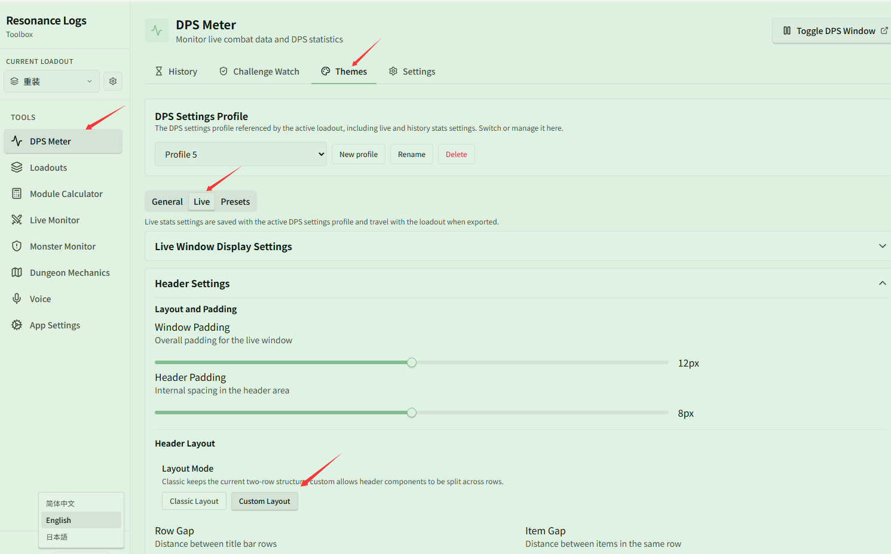
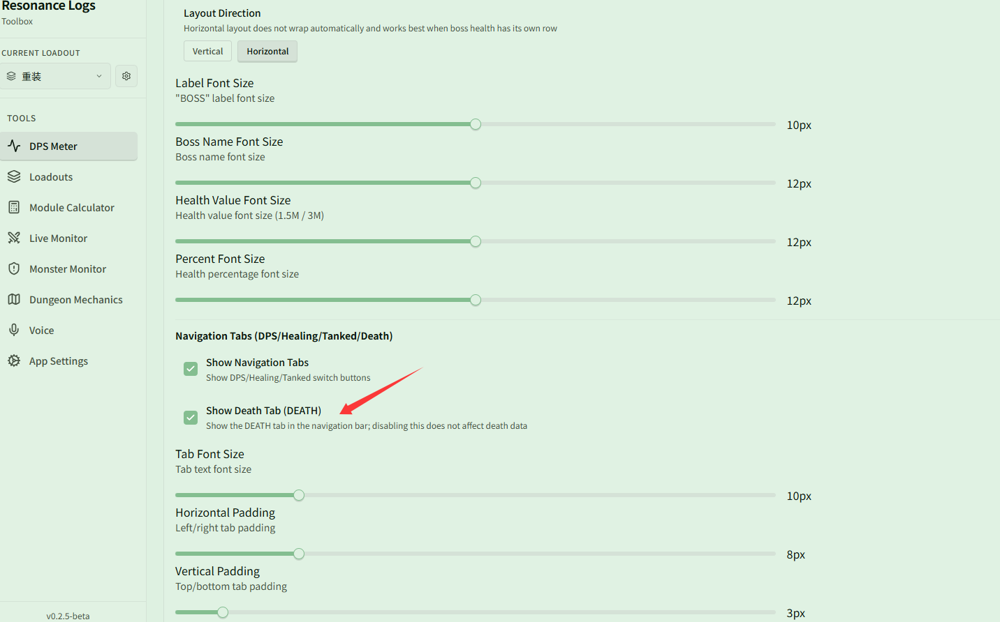

# Custom header layout and death replay

Related page: [Themes & Appearance](../themes.md)

**Scenario**: You want to customize the header layout of the live DPS window and switch to the DEATH tab at any time during combat to view party members' death statistics and death replays.

## Step 1: Switch to custom layout

In **{{ui:routes.tools.dps}} → {{ui:routes.dps.themes}} → {{ui:themes.tabs.live}}**, find **{{ui:themes.header.title}}**, and under **{{ui:themes.header.layout}}**, set **{{ui:themes.header.layoutMode}}** to **{{ui:themes.header.layoutMode.custom}}**.

After switching to custom layout, you can freely distribute components such as the timer, encounter name, training dummy status, total damage, total DPS, Boss HP, control buttons, and navigation tabs across multiple rows, and adjust their left/right alignment, order, and spacing.

## Step 2: Enable the DEATH tab

In **{{ui:themes.header.title}}**, scroll down to **{{ui:themes.header.navigationTabs}}**, and check **{{ui:themes.header.showDeathTab}}**.

Once enabled, the **DEATH** tab appears in the live DPS window navigation bar. Clicking this tab during combat or after a wipe allows you to view party death counts, total damage taken, and death replay details such as lethal damage sources.

