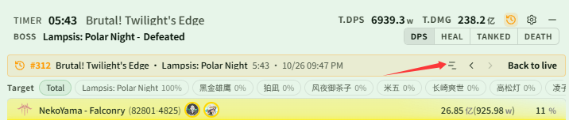
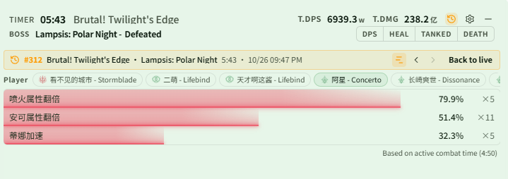

# Check a history fight's Buff coverage in the live window

Related page: [History](../history.md#view-history-in-the-live-window)

**Scenario**: You just finished a raid run and want to see right away how well your teammates' key boosts (such as attribute doublers or Tina's haste) were kept up, so you can adjust the rotation for the next run. You don't want to switch back to the main window and dig through the history details; you want to check it in the live window.

## Step 1: Set up (once)

1. Open **{{ui:routes.tools.skillMonitor}} → {{ui:skillMonitor.tabs.buffCoverage}}** and add the Buffs to track to the watch list, see [Buff Coverage](../../monitor/buff-coverage.md#adding-watched-buffs). Only fights after they are added are recorded.
2. Turn on **{{ui:themes.header.showHistoryButton}}** under **{{ui:routes.tools.dps}} → {{ui:routes.dps.themes}} → {{ui:themes.tabs.live}} → {{ui:themes.header.title}}**.

## Step 2: Open the fight you just finished

After the fight, click the History button in the live window header (tooltip **{{ui:live.header.tooltip.history}}**), use **{{ui:live.history.quick.currentBoss}}** to list this Boss's records, and click the top one. A history banner appears at the top of the live window with the scene, Boss, duration and end time.

## Step 3: Open the coverage page

Click the coverage button in the banner (tooltip **{{ui:live.history.banner.coverage}}**).

## Step 4: Pick a player

The **{{ui:live.coverage.playersLabel}}** strip at the top selects yourself by default. Click a teammate to list one Buff per row:

- The bar length and percentage are the coverage, calculated over **active combat time** (shown at the bottom right of the page), so gaps such as boss invulnerability and phase transitions do not drag the number down;
- ×N on the right is how many times the Buff was triggered in this fight;
- Hover over a row to see the Buff ID, covered time / active time and trigger count.

In the image below, "阿星 - Concerto" is selected. Active time was 4:50; the first Buff was up 79.9% of the time (5 triggers) while the third only reached 32.3%, so that is the one to watch next run.

How the strip and rows are ordered:

- Players are listed as yourself → healers → tanks → DPS, with players of the same class next to each other; teammates with no watched Buff recorded in this fight are left out;
- Buffs follow the order of the **{{ui:skillMonitor.tabs.buffCoverage}}** list; Buffs the player never had in this fight are greyed out with "—" and sink to the end;
- The bar colour follows the selected player's class, and player names follow the live window's name display settings.

## Step 5: Compare with the previous run

- Use **{{ui:live.history.banner.older}}** / **{{ui:live.history.banner.newer}}** in the banner to switch fights. You stay on the coverage page and the selected teammate is kept; if that fight does not include them, you are shown instead.
- Press the coverage button again to return to the meter tab you came from (DPS, HEAL and so on); click **{{ui:live.history.banner.backToLive}}** to return to live data.

> [!TIP]
> To find where the coverage dropped, open the Buff coverage timeline in the main window's history details, see [Review your team's boost coverage](../../monitor/examples/buff-coverage.md).

> [!NOTE]
> - The coverage page is only available while viewing history. To watch your own coverage during combat, use the Buff Coverage area of the live monitor overlay.
> - If a new fight starts while you are viewing history, the banner shows **{{ui:live.history.banner.liveFighting}}** and does not switch back to live on its own.
