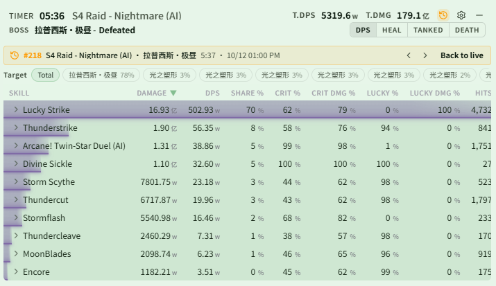

# Apply the recommended style in one click

Related page: [Themes & Appearance](../themes.md)

**Scenario**: After many tweaks, your DPS window's colors, columns and header have become a mess. You want the complete style the developer recommends and then fine-tune from there; the game overlay panels should get one matching color scheme too.

## Step 1: Apply the recommended style

1. Open **{{ui:routes.tools.dps}} → {{ui:routes.dps.themes}}** and switch to **{{ui:themes.tabs.presets}}**.
2. Click **{{ui:themes.presets.reference.name}}** under **{{ui:themes.presets.reference.title}}** at the top.
3. The confirmation lists what will be overwritten: colors, table, header, display format, columns and history display. The forbidden damages of Challenge Watch are kept. Confirm.

> [!NOTE]
> The recommended style is written into the current loadout's DPS settings profile. If several loadouts share that profile, the confirmation lists them and they all change together.

## Result

The live window and history details switch to the recommended colors, columns and header layout:

## Step 2: Fine-tune

Starting from the recommended style, adjust opacity, font size and so on in **{{ui:themes.tabs.general}}** and **{{ui:themes.tabs.live}}**, or add and remove columns in [Display Settings](../settings.md). To go back to the recommended style, just apply it again.

## Step 3 (optional): One color scheme for the game overlay

**{{ui:hudScheme.open}}** at the top of the **{{ui:routes.tools.skillMonitor}}** and **{{ui:routes.tools.monsterMonitor}}** pages applies one color scheme ({{ui:hudScheme.scheme.vivid.name}}, {{ui:hudScheme.scheme.ice.name}}, {{ui:hudScheme.scheme.amber.name}}, {{ui:hudScheme.scheme.jade.name}}, {{ui:hudScheme.scheme.violet.name}}, {{ui:hudScheme.scheme.muted.name}}) to the current loadout's game overlay panels. Only the colors of names, values and progress bars change; font sizes, spacing and backgrounds stay. Semantic colors such as HP, stun and Boss warnings are kept in every scheme.

> [!TIP]
> On a fresh install, the DPS window already uses the recommended style and the game overlay uses the "{{ui:hudScheme.scheme.vivid.name}}" scheme.
