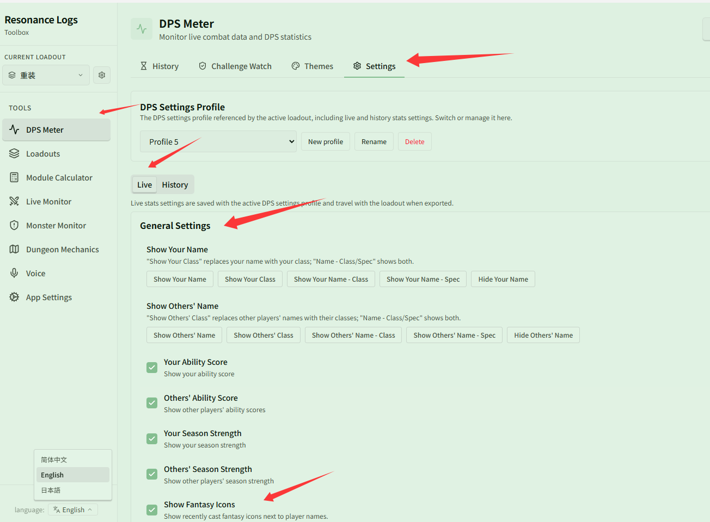
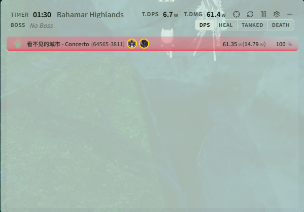

# Customize displayed columns in tables

Related page: [Display Settings](../settings.md)

**Scenario**: You want to customize the data columns shown in the skill details table of the live DPS window or history records (for example, keeping only damage, DPS, and crit rate), set custom header names for columns, and enable additional information such as player specs, ability scores, season strength, and fantasy icons.

## Step 1: Navigate to the table's column configuration

Go to **{{ui:routes.tools.dps}} → {{ui:routes.dps.settings}}**.

Select either the **{{ui:settings.tabs.live}}** or **{{ui:settings.tabs.history}}** tab based on what you want to change:
- **Live and History are configured separately**: column configurations under **{{ui:settings.tabs.live}}** only affect the live overlay window; to change columns in history detail pages, switch to the **{{ui:settings.tabs.history}}** tab (only death replay columns are shared between Live and History).

Scroll down to **{{ui:settings.common.columns.dpsSkills}}** (or player, healing, damage taken columns):

## Step 2: Toggle columns, reorder, and set custom headers

- **Show / Hide**: Click the switch next to each column to toggle its visibility.
- **Reorder**: Use the up and down arrows to change the column order from left to right.
- **Custom header names**: Enter a custom header name in the input box on the right (leave empty to use the default name for the current language). Click the reset button to restore the default name at any time.

## Step 3: Configure general display info (Spec, score/strength, fantasy icons)

In **{{ui:settings.tabs.live}} → {{ui:settings.common.general}}**, you can also enrich the information shown in player rows:
- **Name and Spec**: select "**{{ui:settings.common.name.option.yourNameSpec}}**" under **{{ui:settings.common.name.your}}** / **{{ui:settings.common.name.others}}** to display class specializations beside player names.
- **Ability Score and Season Strength**: checking **{{ui:settings.common.ability.your}}**, **{{ui:settings.common.seasonStrength.your}}**, etc. displays their score and strength in parentheses after their name (e.g. `(64565-3811)`).
- **Show Fantasy Icons**: checking **{{ui:settings.live.fantasyCastIcons}}** displays icons of recently cast Fantasies next to player names.

## Final look

Once configured, the live DPS window displays your selected columns, and player rows will show spec, ability score, season strength, and recently cast fantasy icons:

