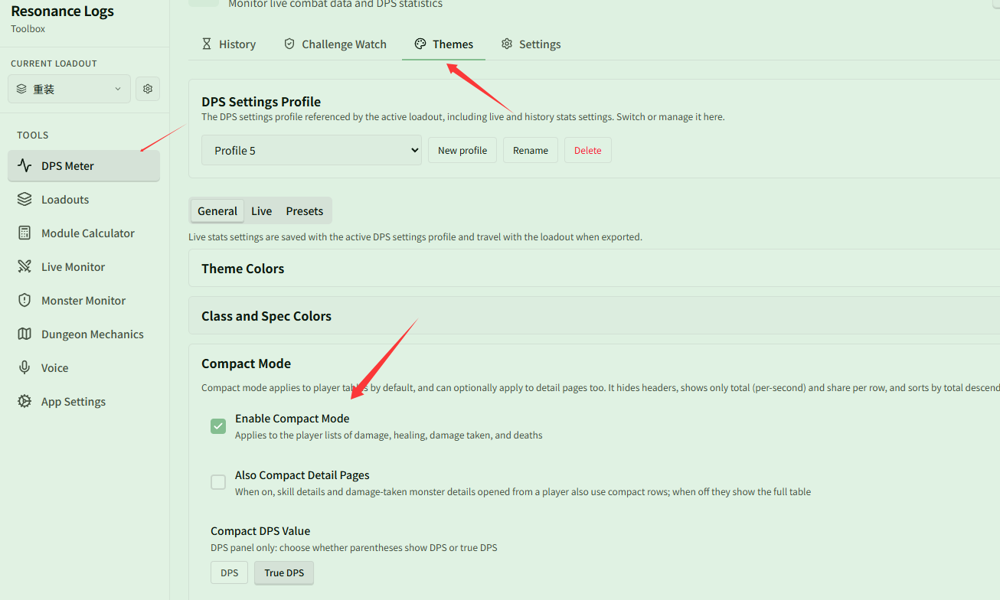
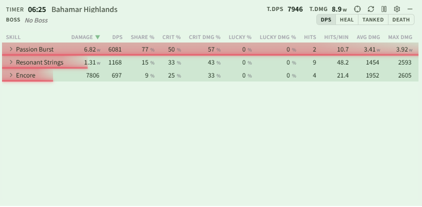

# A transparent, minimal DPS window

Related page: [Themes & Appearance](../themes.md)

**Scenario**: You just want a small semi-transparent window in a corner of the screen showing everyone's DPS and share — no table headers, and nothing that gets in the way of playing.

## Step 1: Turn on compact mode

In **{{ui:routes.tools.dps}} → {{ui:routes.dps.themes}} → {{ui:themes.tabs.general}}**, find **{{ui:themes.compact.title}}**, turn on **{{ui:themes.compact.enable}}**, and set the parentheses type to **{{ui:themes.compact.option.tdps}}** (or **{{ui:themes.compact.option.dps}}**). Each row in the player list now shows only the name, total (DPS/True DPS), and share.

By default, compact mode only applies to player lists. Clicking a player to view skill details (or damage-taken monster details) will still show the full table:

If you want detail pages to be compact as well, check **{{ui:themes.compact.includeDetails}}**. Detail pages will then also use the compact single-row format without table headers:

## Step 2: Make the background transparent

In **{{ui:themes.tabs.general}} → {{ui:themes.section.colorThemes}} → {{ui:themes.section.customColorTheme}}**, find **Background (Live)** and set its transparency to 30%–50%.

If the text is hard to read against bright scenes, raise **{{ui:themes.table.rowGlowOpacity}}** a bit to make the colored bars more solid.

## Step 3: Turn on clickthrough

Go to **{{ui:themes.tabs.live}} → Live Window Display Settings → {{ui:themes.liveDisplay.clickthrough}}**. From then on, the mouse passes straight through the window.

> [!IMPORTANT]
> Once clickthrough is on, you can no longer drag or reset the window with the mouse. We recommend binding "Toggle Clickthrough" and "Reset Encounter" in [App Settings · Shortcuts](../../app/README.md#shortcuts) first, and using the shortcuts when needed.

## Restoring the original look

Turn off **{{ui:themes.compact.enable}}** in **{{ui:themes.tabs.general}} → {{ui:themes.compact.title}}** and restore the background transparency, or select presets in **{{ui:themes.tabs.presets}}** to restore the default appearance.
