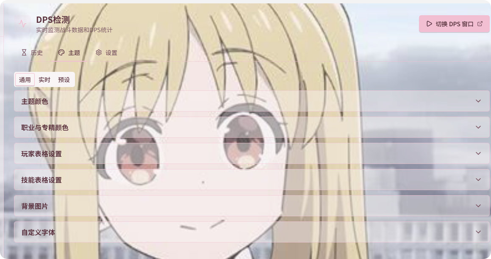
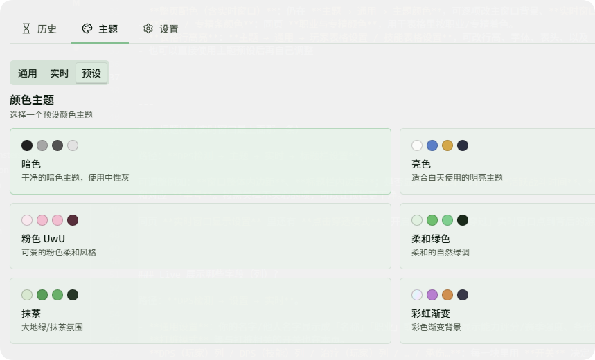
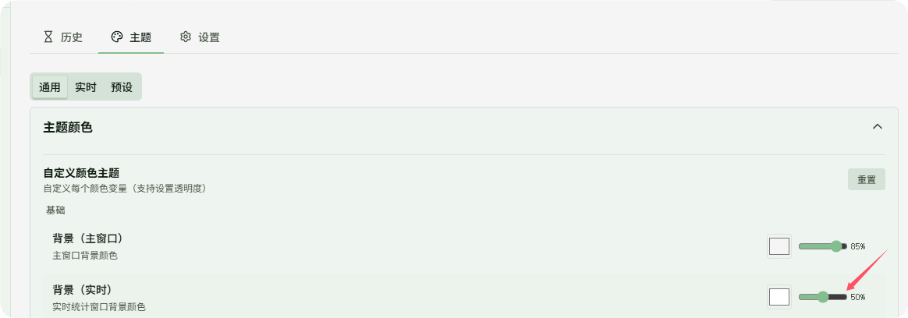
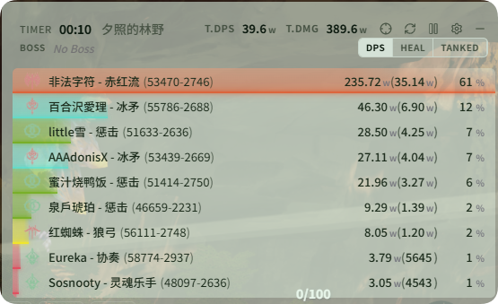
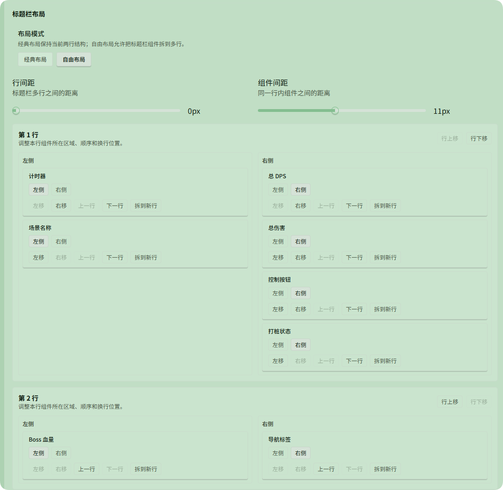
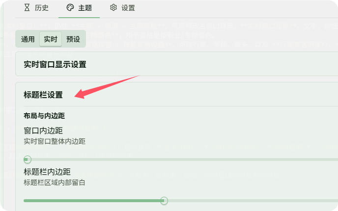

# Themes & Appearance

**{{ui:routes.tools.dps}} → {{ui:routes.dps.themes}}** determines what the live DPS window "looks like": color scheme, size, table style, and header layout. The page has three tabs: **{{ui:themes.tabs.general}}**, **{{ui:themes.tabs.live}}**, and **{{ui:themes.tabs.presets}}**.

> [!TIP]
> The quickest way is to pick a color preset and a size preset in **{{ui:themes.tabs.presets}}** first, then fine-tune in the other tabs.

## Presets

### Color presets

| Preset | Style |
| --- | --- |
| **{{ui:themes.preset.color.dark.name}}** | Default dark theme, suits most situations |
| **{{ui:themes.preset.color.light.name}}** | Light background |
| **{{ui:themes.preset.color.pink.name}}** / **{{ui:themes.preset.color.green.name}}** / **{{ui:themes.preset.color.matcha.name}}** | Soft color schemes |
| **{{ui:themes.preset.color.rainbow.name}}** | Colorful gradient rows |

Color presets apply to the live window of the **current loadout**.

### Size presets

| Preset | Effect |
| --- | --- |
| **{{ui:themes.preset.size.compact.name}}** | No padding and no header, leaving only the table itself |
| **{{ui:themes.preset.size.small.name}}** / **{{ui:themes.preset.size.medium.name}}** / **{{ui:themes.preset.size.large.name}}** | Row height, font size, and icons get progressively larger |

## Colors

In **{{ui:themes.tabs.general}} → {{ui:themes.section.colorThemes}}**:

- **{{ui:themes.section.customColorTheme}}**: edit colors one by one, including background, **Background (Live)**, text, buttons, borders, table text, K/M/% suffixes, and tooltips. Every item supports transparency.
- **{{ui:themes.section.classSpecColors}}**: the colors used to tint table rows by class / spec.

Lower the transparency of **Background (Live)** to get a semi-transparent window; see [Example: A transparent, minimal DPS window](./examples/transparent-window.md).

> [!NOTE]
> These colors only affect the DPS window. The main window's own color scheme, background image, and font are set in [App Settings · Appearance](../app/README.md#appearance).

## Tables

**{{ui:themes.table.playerSettings}}** and **{{ui:themes.skillTable.settings}}** control how each row looks:

- Row height, font size, icon size;
- Row highlight mode (Gradient (Underline) / Gradient / Solid), **{{ui:themes.table.rowGlowOpacity}}**, row corner radius;
- Whether the table header is shown, plus its height, font size, and color;
- Font size of the K/M/% suffixes.

## Compact mode

With **{{ui:themes.compact.enable}}** turned on, player tables hide headers, showing only total (DPS) and share per row, sorted by total in descending order. You can also turn on **{{ui:themes.compact.includeDetails}}** to apply the same format to detail pages. For the DPS panel you can choose whether the value in parentheses shows **{{ui:themes.compact.option.dps}}** or **{{ui:themes.compact.option.tdps}}**.

## Header Settings

**{{ui:themes.tabs.live}} → {{ui:themes.header.title}}** manages the bar at the top of the window:

- **Layout Mode**: **{{ui:themes.header.layoutMode.classic}}** keeps a fixed two-row layout; **{{ui:themes.header.layoutMode.custom}}** lets you freely distribute the timer, encounter name, training dummy status, total damage, total DPS, Boss HP, navigation tabs, and control buttons across multiple rows, and adjust their order and spacing.
- **Boss HP**: choose **{{ui:themes.header.bossHealthLayout.vertical}}** or **{{ui:themes.header.bossHealthLayout.horizontal}}**; horizontal suits narrow windows, giving HP a row of its own.
- **Buttons**: individually toggle the Reset, Pause, **{{ui:themes.header.showHeaderControl}}**, Settings, and Minimize buttons.
- **Timer**: **{{ui:themes.header.showActiveTimer}}** shows the active time used by True DPS next to the timer.
- **Navigation tabs**: you can turn off **{{ui:themes.header.showDeathTab}}** without affecting the death data itself.
- Font sizes of each item, and window and header padding.

## Clickthrough

When **{{ui:themes.tabs.live}} → Live Window Display Settings → {{ui:themes.liveDisplay.clickthrough}}** is enabled, the mouse passes through the DPS window to the game behind it. When you need to interact with the window again, turn it off with a [shortcut](../app/README.md#shortcuts) or the tray menu item **Disable Clickthrough**.

## Examples

- [A transparent, minimal DPS window](./examples/transparent-window.md)
- [Custom header layout and death replay](./examples/header-death.md)