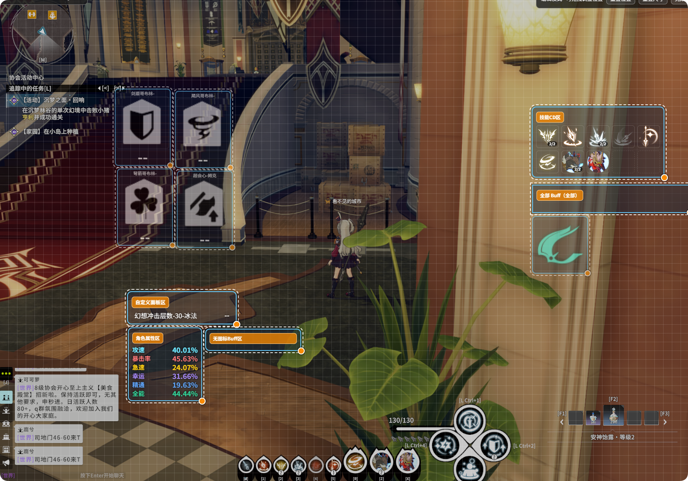
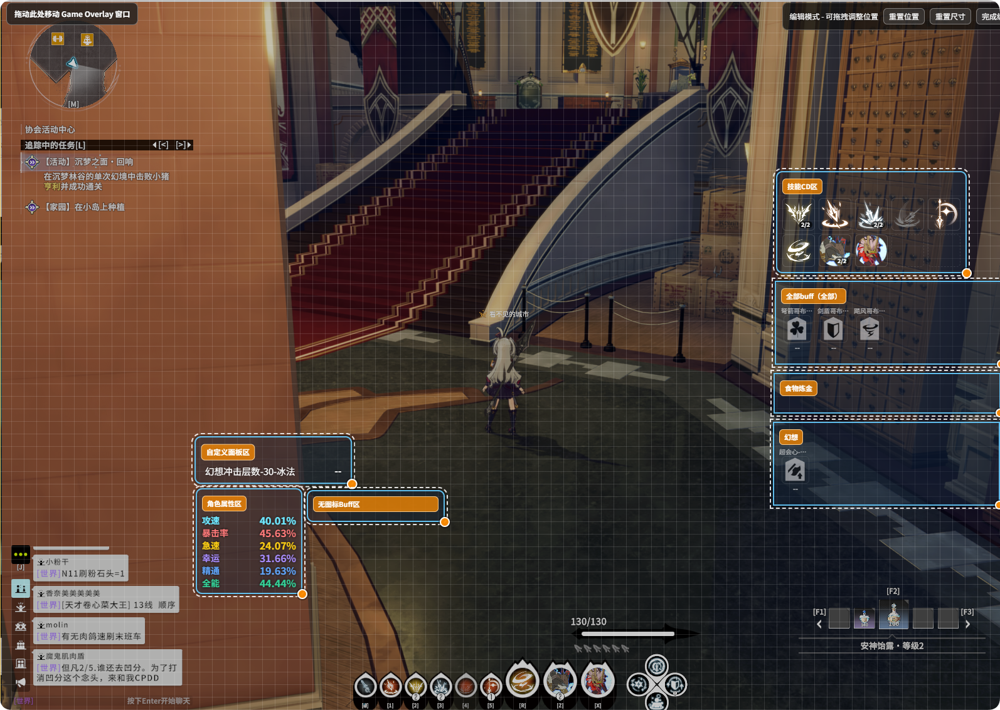

# Buff Monitor

**{{ui:routes.tools.skillMonitor}} → {{ui:skillMonitor.tabs.buff}}** monitors the Buffs **on yourself**: duration and stacks, alerts when they are about to end, and voice reminders when they are gained or lost.

> [!TIP]
> Want to watch Debuffs on the boss instead (for example, a vulnerability you applied)? That belongs to [Monster Monitor · Buff Monitor](../monster/buff.md).

## Adding Buffs

Type a **name or ID** in the search box and click a result to add it to **{{ui:skillMonitor.buff.selectedTitle}}**. Results are paginated when there are many; even if an ID is not in the built-in table, you can still add it directly by ID.

Not sure what a Buff is called? Turn on **{{ui:skillMonitor.buff.all.title}}** first, and the overlay will show every Buff you currently have. Once you find the one you want, add it precisely, then turn "Monitor All" off.

### Category quick watch

**{{ui:skillMonitor.buff.category.title}}** lets you watch all **Food** or **Alchemy** Buffs at once, which is handy for checking whether you have eaten and taken potions before entering a dungeon.

## Display modes

Choose one of the two in **{{ui:skillMonitor.buff.display.title}}**:

| Mode | Characteristics |
| --- | --- |
| **{{ui:skillMonitor.buff.display.individual}}** | Each Buff gets its own icon that can be moved and resized separately |
| **{{ui:skillMonitor.buff.display.grouped}}** | Several Buffs go into one group and are laid out together in rows and columns |

### Grouped mode

In **{{ui:skillMonitor.buff.group.title}}**:

- **{{ui:skillMonitor.buff.group.new}}** / **{{ui:skillMonitor.buff.group.delete}}**; pick Buffs for each group separately, or set it to **{{ui:skillMonitor.buff.group.monitorAll}}**;
- Add or remove the Food and Alchemy categories for a group in one click;
- Each group can set icon size, rows and columns, spacing, and whether to show the name, remaining time and stacks;
- **{{ui:skillMonitor.buff.group.previewTitle}}** lets you check the result first.

### Buffs without icons

Buffs without an icon are shown as a line of text plus a progress bar. You can choose **{{ui:skillMonitor.buff.display.modernText}}** or **{{ui:skillMonitor.buff.display.classicText}}**, and limit how many are shown at most.

### Buffs that change with stacks

Some Buffs change their icon automatically with the stack count. For example, Wind Knight's "Chasing Step" shows a single icon at 1 stack and a double icon at 2 stacks, with no extra setup needed.

## Names and icons

| Setting | What it does | Scope |
| --- | --- | --- |
| **{{ui:skillMonitor.buff.alias.title}}** | Gives an alias to a Buff with an unclear name, for example showing "[热枕]" as "Life Fluctuation" | Global, does not change with profiles |
| **{{ui:skillMonitor.buff.icon.title}}** | Picks a custom image as the Buff's icon | Global |

Buff aliases are also used as the display names of Buff effects in the [factor zone](./custom-panel.md#factor-zone).

Buffs that come from a Fantasy are shown as "Name | Tier n" when the Fantasy's tier can be detected.

## Priority

- **{{ui:skillMonitor.buff.priority.globalTitle}}**: display order in individual mode;
- **{{ui:skillMonitor.buff.priority.groupTitle}}**: order within each group in grouped mode.

## Countdown alerts

**{{ui:skillMonitor.buff.alert.title}}** sets a threshold for a Buff: when the remaining time is ≤ the set number of seconds, it is highlighted in the chosen color, optionally **flashing**. Good for watching boosts that are about to drop.

## Voice announcements

In the **{{ui:skillMonitor.buff.voice.title}}** section, search for a monitored Buff and add a rule. You can choose three events, **on gain / x seconds left / on expiry**, and the text can be generated automatically, written yourself, or taken from the phrase library. See [Voice](../voice/README.md#binding-announcements-on-feature-pages) for details.

## Common Buff reference

You can type the search names in the table below directly into the search box:

| Type | Fantasy | Search name | Buff ID |
| --- | --- | --- | --- |
| Boost | Bandit Chief | Fiery Battle Will (Bandit Chief) | 2110065 |
| Boost | Tata | Heart of Flames (Tata) | 2110061 |
| Boost | Tina | Lower CD | 2110034 |
| Boost | Basilisk | Highland Blood (Basilisk) | 2110125 |
| Boost | Catagriff | Mechanical Power (Catagriff) | 2110140 |
| Fantasy CD | Catagriff | Mechanical Failure (Catagriff CD) | 2110049 |
| Fantasy CD | Tina | Time Stasis (Tina CD) | 2110056 |
| Fantasy CD | Tata | Exhausted: Flame Devour (Tata CD) | 2110055 |
| Fantasy CD | Revive type | Weakened: Wish Sealed (Revive CD) | 2110057 |
| Fantasy CD | Basilisk | Element Stasis (Basilisk CD) | 2110050 |

For vulnerabilities and damage boosts placed on monsters (such as Venom Vulnerability (Poison Hive) and Enchantment (Lorola)), see [Monster Monitor · Buff Monitor](../monster/buff.md#common-debuff-reference).

## Examples

### Example: Voice reminder when Tina's CD is ready

**Scenario**: You are the one who uses Tina for the party. You want the overlay to show Tina's cooldown and to hear "Tina CD is ready" when the CD ends, so you do not have to keep watching it.

#### Step 1: Monitor the Tina CD Buff

After you use Tina, a Buff representing the cooldown stays on you.

1. Open **{{ui:routes.tools.skillMonitor}} → {{ui:skillMonitor.tabs.buff}}**.
2. Search for **Time Stasis (Tina CD)** (ID 2110056) and add it to the selected Buffs.
3. You can also add **Lower CD** (ID 2110034) to see whether the boost from Tina is still active.

#### Step 2: Give it a recognizable name (optional)

In **{{ui:skillMonitor.buff.alias.title}}**, search for "Time Stasis (Tina CD)" and set its alias to "Tina".

#### Step 3: Highlight it when it is about to end

In **{{ui:skillMonitor.buff.alert.title}}**, add an alert for it: highlight in green and flash when ≤ 5 seconds remain, reminding you to get ready to use it.

#### Step 4: Voice reminder on expiry

1. First make sure a model is installed in [Voice](../voice/README.md) and **{{ui:voice.overview.enabled}}** is on.
2. Go back to **{{ui:skillMonitor.tabs.buff}}**, expand **{{ui:skillMonitor.buff.voice.title}}**, then search for and add "Time Stasis (Tina CD)".
3. Check **Broadcast on expiry**, choose **Custom text** for the text, and enter "Tina CD is ready".
4. Click **Preview**; if it says the audio is waiting to be generated, go to **{{ui:routes.tools.voice}} → {{ui:voice.tabs.bindings}}** and click **{{ui:voice.bindings.generateMissing}}**.

Sample generated with a fine-tuned Japanese voice:

<audio controls src="../../../shared/audio/voice/ja_01_tina_cd.wav"></audio>

> [!TIP]
> Want the announcement to include Tina's tier? Put `${remodelLevel}` (or `${阶数}`) in the text, e.g. "Tina ${remodelLevel} ready"; when announced, the placeholder is automatically replaced with the Fantasy's current tier (e.g. tier 5). See [Voice · Fantasy tier placeholder](../voice/playback.md#fantasy-tier-placeholder).
