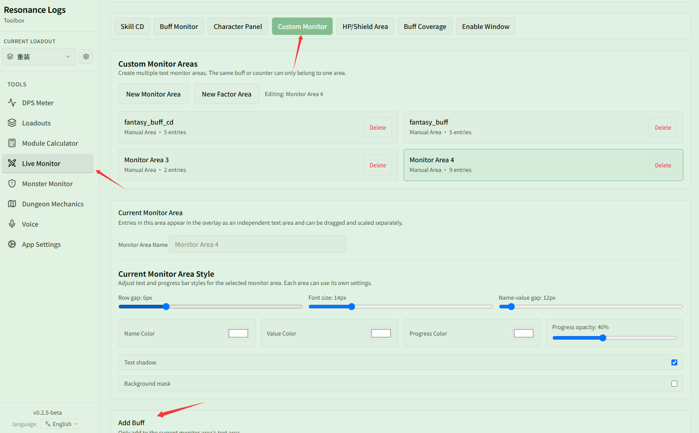

# Track the 3-stack "Attribute Symphony" buff with composite buffs

Related page: [Buff Monitor](../buff.md)

**Scenario**: Some mechanics trigger special effects only when multiple buffs are active at once — for example, "Attribute Symphony" provides an extra 20% damage bonus when 3 stacks are up. You want the overlay to show the buff only when at least 3 stacks are active, or track its coverage after combat.

## Step 1: Create a composite buff

Open **{{ui:routes.tools.skillMonitor}} → {{ui:skillMonitor.tabs.buff}}** and scroll down to **{{ui:skillMonitor.buff.composite.title}}**:

1. Click **{{ui:skillMonitor.buff.composite.new}}**;
2. Enter a name (e.g., "Symphony Combo");
3. Search for and add the 4 member buffs: "Symphony: Basic Attack", "Symphony: Special Attack", "Symphony: Mastery", and "Symphony: Ultimate";
4. Set **{{ui:skillMonitor.buff.composite.condition}}** to "At least 3 of 4 active at once";
5. Click **{{ui:skillMonitor.buff.composite.save}}** to save.

## Step 2: Add it to a monitor area

Once saved, a composite buff acts like any normal buff across the app:

1. Switch to **{{ui:skillMonitor.tabs.customPanel}}** and select a custom monitor area;
2. Scroll to the bottom of the section to **{{ui:skillMonitor.customPanel.addBuff}}**, type "Symphony Combo" into the search box (labeled as "Composite buff" in results), and click to add it;
3. During combat, whenever at least 3 of the 4 symphony buffs are active, the monitor area displays "Symphony Combo" with its remaining duration and stack count.

## Optional: Track in Buff Coverage

Composite buffs can also be added under **{{ui:skillMonitor.tabs.buffCoverage}}**:
- Search for and add "Symphony Combo" in **{{ui:skillMonitor.tabs.buffCoverage}}**;
- During combat and in history details, the app tracks how long you maintained at least 3 symphony stacks and calculates its uptime, helping you review your 20% damage boost coverage.
