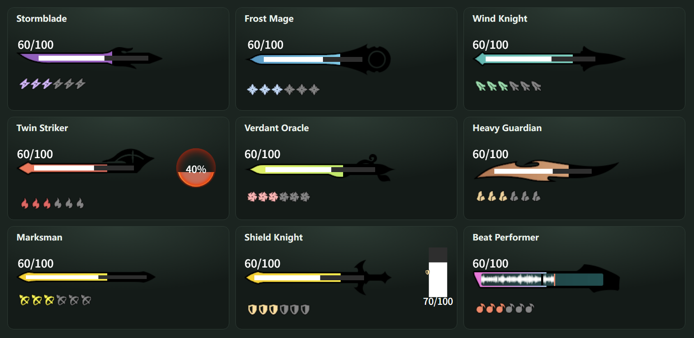
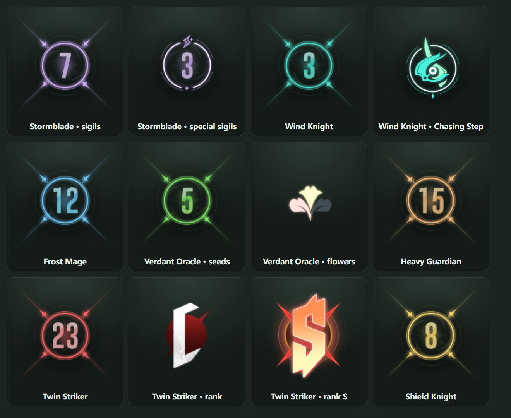
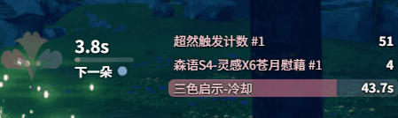

# Keep an eye on class resources with resource sections

Related page: [Enable Window & Layout](../overlay.md)

**Scenario**: The game's weapon resource bar is far from your character. You want the bar and resource points right next to your character, keeping only the parts you need. If you play a Verdant Oracle with the Lifebind specialization, you also want to see when the next of the "three healing flowers" grows.

## Step 1: Check the profile class

Resources follow **{{ui:skillMonitor.profile.title}} → {{ui:skillMonitor.profile.classLabel}}** at the top of the page; they are not picked from the character you are logged in with. Make sure the class you want is selected there and change it if needed.

> [!NOTE]
> Changing the class clears the monitored skills and skill voices of the current configuration; the confirmation shows how many. Resource layouts and other monitor content are kept.

## Step 2: Turn on the Resource Monitor Area

1. Open **{{ui:routes.tools.skillMonitor}} → {{ui:skillMonitor.tabs.overlay}}** and turn on the **Resource Monitor Area**.
2. **{{ui:skillMonitor.overlay.resourceSections}}** below lists the class's resource parts: resource bar, resource points, shield bar, class counter and so on (Twin Striker also has the Crimson Mark orb). Keep only the parts you need and hide the rest.

The class counter follows the game HUD: stack numbers, wind marks, rank letters, flowers and so on.

## Step 3: Place them

1. Click **{{ui:skillMonitor.layout.editOverlayLayout}}** at the top of the page. Every resource part can be dragged and scaled on its own.
2. Put the resource bar under your character and the resource points next to it. If the numbers are too small, make them bigger in **{{ui:skillMonitor.overlay.resourceTextStyle}}**.
3. Leave edit mode when you are done; the overlay becomes click-through again.

## Lifebind: the three-flower countdown

The Lifebind "three healing flowers" are a resource section of their own: they show the countdown until the next flower grows (45 seconds at most) and the color of the next flower. They are hidden when there is no such countdown, for example in another specialization.

1. Set the profile class to **Verdant Oracle** and keep only the flower section in **{{ui:skillMonitor.overlay.resourceSections}}**.
2. The flower countdown doesn't change color on its own. To highlight it when a flower is about to grow, open **{{ui:skillMonitor.tabs.buff}} → {{ui:skillMonitor.buff.alert.title}}**, search for `2202716` (the flower countdown) and add an alert, for example red within the last 10 seconds. With Verdant Oracle as the profile class, this Buff can get an alert without being added to the monitor first.

> [!TIP]
> The built-in "Lifebind" loadout is already set up this way: only the flower countdown, turning red within the last 10 seconds. Add it from the [preset loadouts](../../app/loadouts.md#preset-loadouts).
