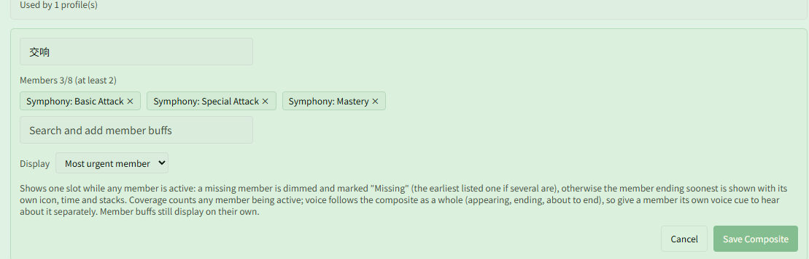

# Show only the Attribute Symphony that needs refreshing with "most urgent member"

Related page: [Buff Monitor](../buff.md)

**Scenario**: "Attribute Symphony" comes in several kinds (Basic Attack, Special Attack, Mastery, Ultimate), each with its own timer, and you need to keep some of them up. Monitoring each one separately leaves several countdowns on screen at once, and it is hard to tell at a glance which one to refresh. You want a single row instead: the missing one if any is missing, otherwise the one running out first.

## Step 1: Create a "most urgent member" composite

Open **{{ui:routes.tools.skillMonitor}} → {{ui:skillMonitor.tabs.buff}}** and scroll down to **{{ui:skillMonitor.buff.composite.title}}**:

1. Click **{{ui:skillMonitor.buff.composite.new}}** and enter a name (交响 in the screenshots);
2. Search for and add the members you want to keep up, for example "Symphony: Basic Attack", "Symphony: Special Attack" and "Symphony: Mastery". Add only the kinds you need to maintain;
3. Set **{{ui:skillMonitor.buff.composite.mode}}** to **{{ui:skillMonitor.buff.composite.modeMostUrgent}}**;
4. Click **{{ui:skillMonitor.buff.composite.save}}**.

> [!TIP]
> Members keep the order you added them in. When several are missing at once, the one listed first is shown, so add the member you most want to refresh first.

## Step 2: Add it to Custom Monitor

1. Switch to **{{ui:skillMonitor.tabs.customPanel}}** and select a custom monitor area;
2. In **{{ui:skillMonitor.customPanel.addBuff}}** at the bottom, type the composite's name into the search box (results mark it as "Composite buff") and click to add it.

You can also add it to the selected Buffs on **{{ui:skillMonitor.tabs.buff}}**; it works the same way.

## What you see in combat

While every member is active, the row shows the member with the least time left, named "composite · member". Below, Basic Attack has 2.0 seconds left, so it is the one to refresh:

When a member is missing, the row is dimmed and marked "Missing". Below, Basic Attack has dropped off:

Once every member is gone, the row is hidden.

## Optional: highlight or voice cue when one is about to drop

- **Highlight**: in **{{ui:skillMonitor.buff.alert.title}}**, set a threshold on the composite itself, for example turn red at ≤ 2 seconds. Whichever member is currently shown, the row lights up as it is about to run out;
- **Voice**: the composite's voice cues follow the composite as a whole (the first member appearing, the last member disappearing, the last member about to run out), so switching which member is shown does not trigger anything. To hear a cue for one member (for example "Basic attack" with 1 second left), give that member its own cue in **{{ui:skillMonitor.buff.voice.title}}**.

> [!NOTE]
> **{{ui:skillMonitor.buff.voice.title}}** only finds Buffs that this profile displays somewhere. A member that is not displayed on its own in any area cannot be found there.

## FAQ: why do I still see several rows?

The composite takes one row, but it does not hide its member Buffs. If the members are also added on their own to another area (for example, the custom monitor of the Vanguard [preset loadout](../../app/loadouts.md#preset-loadouts) already lists the four Attribute Symphony buffs), each still shows its own row. To see a single row, remove those member entries from that area.

Voice cues already set up on a member keep working after you remove its entry; they just no longer appear in the **{{ui:skillMonitor.buff.voice.title}}** list on the Buff page.

## Want the uptime of "3 at once"?

Coverage for a most-urgent composite counts the time any member is active, so it cannot tell you how long the 3-stack effect lasted. To review that uptime, create another composite with a condition of at least 3, as in [Track the 3-stack "Attribute Symphony" buff with composite buffs](./attribute-symphony.md). The two composites can be used side by side.
