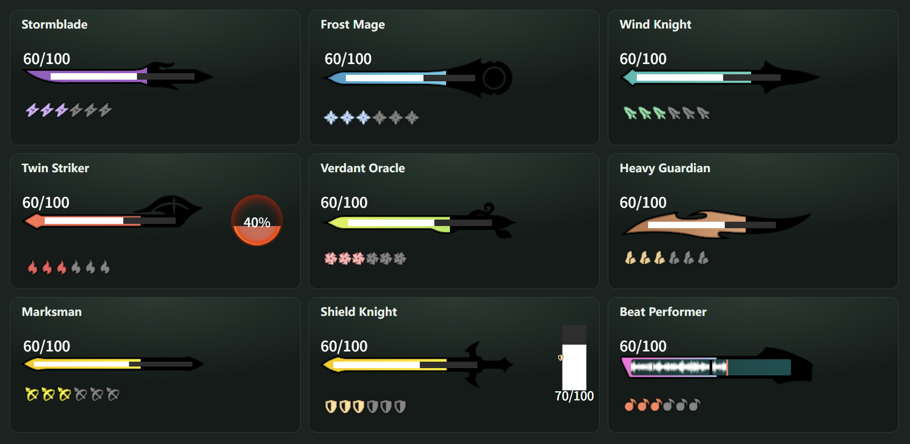
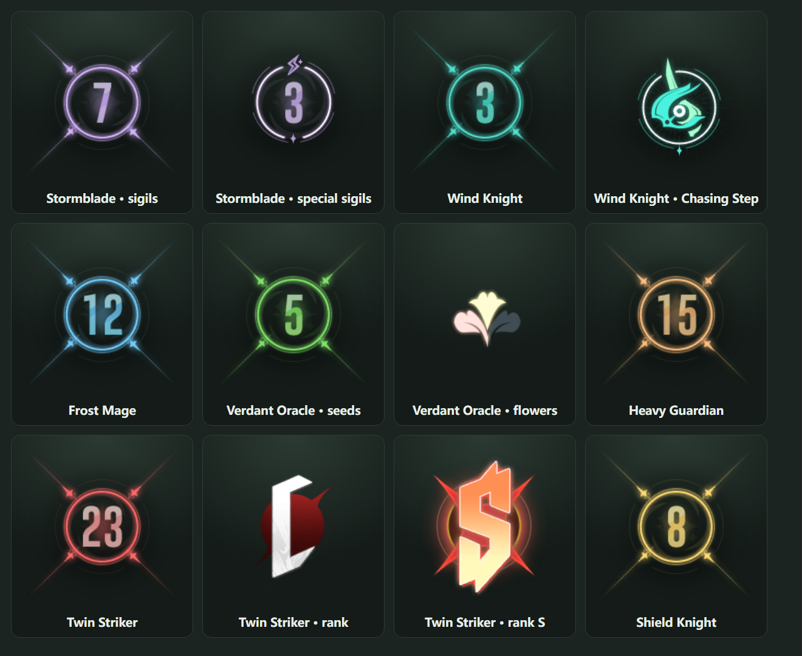
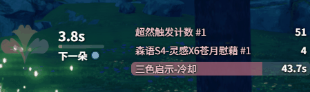
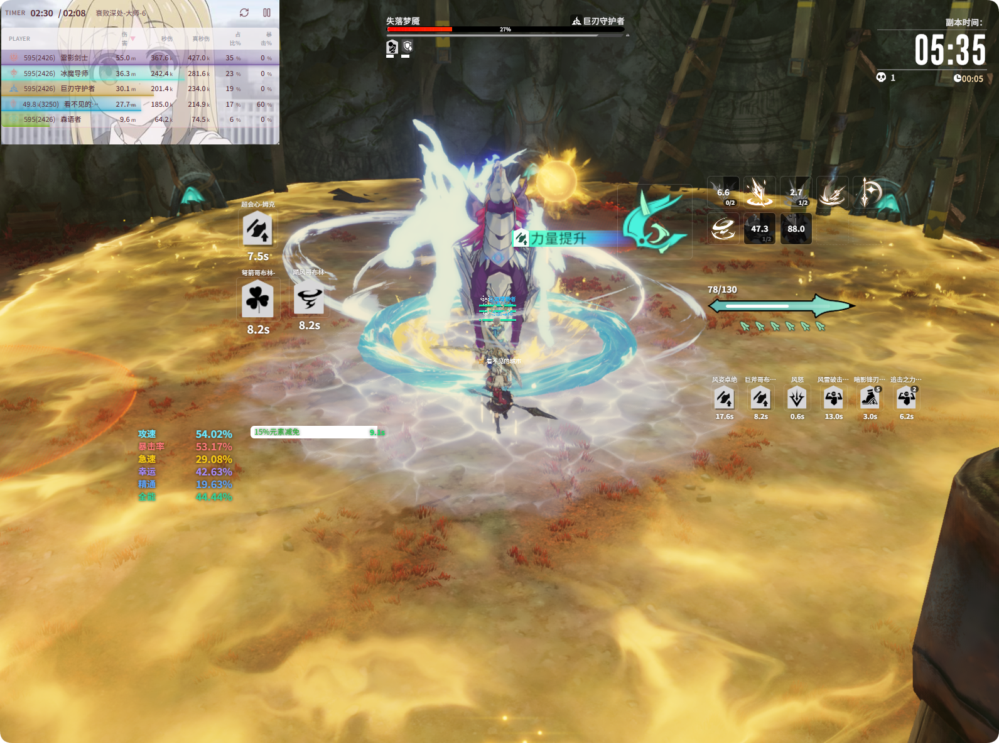

# Enable Window & Layout

**{{ui:routes.tools.skillMonitor}} → {{ui:skillMonitor.tabs.overlay}}** decides which areas are shown in the live monitor overlay. Every switch is **saved per profile**, so different class profiles can show different areas.

## Overlay areas

| Area | Content source |
| --- | --- |
| **Skill CD Area** | [Skill CD](./skill-cd.md); each skill area is a separate area |
| **Resource Monitor Area** | Energy, stacks and other resources of the current class |
| **Character Attribute Area** | [Character Panel](./panel-attr.md) |
| **Custom Monitor Area** | [Custom Monitor](./custom-panel.md); each monitor area is a separate area |
| **HP/Shield Area** | [HP/Shield Area](./shield.md) |
| **Buff Coverage Area** | [Buff Coverage](./buff-coverage.md) |

Buff icons (each Buff in individual mode, each group in grouped mode) appear in the overlay as separate areas; whether they are shown depends on what you select in [Buff Monitor](./buff.md).

### Resource sections

**{{ui:skillMonitor.overlay.resourceSections}}** splits the current class's resources into several small blocks, each of which can be **shown / hidden and dragged separately**. They follow the game's own resource HUD; below is an example for each class (the values are only for illustration):

- **Resource bar**: the game's weapon resource bar. The coloured bar on the frame is the remaining time of the class buff; the thin white bar and the numbers are the current energy. Twin Striker's crimson orb, Marksman's wolf / hawk frames and Beat Performer's performance bar are shown here too.
- **Resource points**: the row of points under the bar (for example Wind Knight's battle spirit or Frost Mage's frost ice). Points that need a buff stay hidden without it; above six points only one is shown, with the count next to it.
- **Shield bar**: Shield Knight's vertical shield bar during "Radiant Shield" (right of the Shield Knight bar above).
- **Class counter**: the game HUD's class counter, such as stack numbers, Wind Knight's wind mark, Stormblade's special thunder sigil, Twin Striker's rank letter and Verdant Oracle's flowers.

- The "three healing flowers" countdown of the Verdant Oracle's Lifebind specialization is also a separate section.

**{{ui:skillMonitor.overlay.resourceTextStyle}}** (below the section toggles) sets the size and colour of the numbers on the resource bar, resource points and shield bar (for example `100/400`); the size is saved when you release the slider. The class counter uses the game's digit images and is not affected.

### Text style

**{{ui:skillMonitor.overlay.sharedTextStyle}}** adjusts the text size and color on skill, resource and Buff icons all at once.

## Editing the layout

1. Click **{{ui:skillMonitor.layout.editOverlayLayout}}** at the top of the page; a border appears around each area in the overlay.
2. Drag an area to move it, and drag its edges or corners to resize it.
3. Exit editing when you are done; the overlay goes back to click-through.

> [!TIP]
> Once you are happy with the layout, you can use the game's own hide-UI feature to put away the game UI and keep only the overlay, placing skill CDs and resources near your character in your peripheral vision. You can bind the hotkey **Minimize/Restore DPS & Overlay Windows** to put away all overlays at once when you need a screenshot or during cutscenes. See [Example: Hide all overlays with one key](../app/examples/combat-shortcuts.md).

