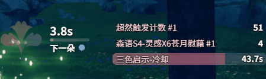
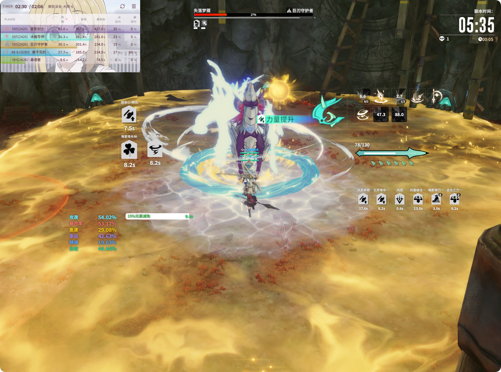

# Enable Window & Layout

**{{ui:routes.tools.skillMonitor}} → {{ui:skillMonitor.tabs.overlay}}** decides which areas are shown in the live monitor overlay. Every switch is **saved per profile**, so different class profiles can show different areas.

## Overlay areas

| Area | Content source |
| --- | --- |
| **Skill CD Area** | [Skill CD](./skill-cd.md); each skill area is a separate area |
| **Resource Monitor Area** | Energy, stacks and other resources of the current class |
| **Character Attribute Area** | [Character Panel](./panel-attr.md) |
| **Custom Monitor Area** | [Custom Monitor](./custom-panel.md); each monitor area is a separate area |
| **HP/Shield Area** | [HP/Shield Area](./shield.md) |
| **Buff Coverage Area** | [Buff Coverage](./buff-coverage.md) |

Buff icons (each Buff in individual mode, each group in grouped mode) appear in the overlay as separate areas; whether they are shown depends on what you select in [Buff Monitor](./buff.md).

### Resource sections

**{{ui:skillMonitor.overlay.resourceSections}}** splits the current class's resources into several small blocks, each of which can be **shown / hidden and dragged separately**. For example, the "three healing flowers" countdown of the Verdant Oracle's Lifebind specialization is a separate section.

### Text style

**{{ui:skillMonitor.overlay.sharedTextStyle}}** adjusts the text size and color on skill, resource and Buff icons all at once.

## Editing the layout

1. Click **{{ui:skillMonitor.layout.editOverlayLayout}}** at the top of the page; a border appears around each area in the overlay.
2. Drag an area to move it, and drag its edges or corners to resize it.
3. Exit editing when you are done; the overlay goes back to click-through.

> [!TIP]
> Once you are happy with the layout, you can use the game's own hide-UI feature to put away the game UI and keep only the overlay, placing skill CDs and resources near your character in your peripheral vision. You can bind the hotkey **Minimize/Restore DPS & Overlay Windows** to put away all overlays at once when you need a screenshot or during cutscenes. See [Example: Hide all overlays with one key](../app/examples/combat-shortcuts.md).

