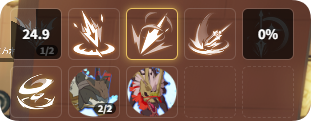

# Skill CD

**{{ui:routes.tools.skillMonitor}} → {{ui:skillMonitor.tabs.skillCd}}** shows the skills you pick as icons in the overlay, with their remaining cooldown in real time.

## Choosing skills

1. Pick a class in **{{ui:skillMonitor.skillCd.class.title}}**; that class's skills are listed below.
2. In **{{ui:skillMonitor.skillCd.skills.title}}**, check the skills to monitor, up to **10** (about 2 rows × 5 columns in the overlay).
3. **{{ui:skillMonitor.skillCd.resonance.title}}** are not listed automatically; add them by searching for their name in the search box.
4. **{{ui:skillMonitor.skillCd.preview.title}}** shows how they will be arranged in the overlay, in the order you checked them.

## Skill transforms

Some skills turn into another form under certain Buffs, and the CD icon and name switch along with them automatically. For example, Wind Knight's "Falcon Toss" shows as "Azure Sever" under a specific Buff, and Frost Mage's "Blizzard" shows as "Instant Blizzard" under the no-cast-time Buff.

## Voice announcements

In the **{{ui:skillMonitor.skillCd.voice.title}}** section, you can set up three events for monitored skills:

| Event | When |
| --- | --- |
| **On cast** | The skill goes on cooldown |
| **When ready** | The cooldown ends |
| **x seconds before ready** | The cooldown is about to end, so you can get ready |

For charge-based skills, **every charge that comes back** counts as the cooldown ending, so "When ready" and "x seconds before ready" play for each charge. Announcements require a model to be installed and enabled in [Voice](../voice/README.md). Un-monitoring a skill deletes its voice settings too (in the current profile only).

> [!NOTE]
> "Duration skills" (such as Scythe Cart) that used to be configured here have moved to [Monster Monitor · Entity Duration](../monster/entity-duration.md). Old profiles are migrated automatically.
