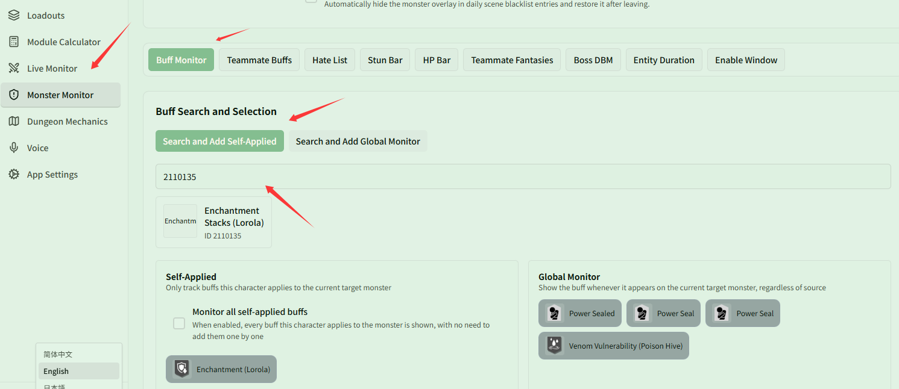

# Monitor Lorola fantasy buffs and stacks

Related page: [Target Buffs](../buff.md)

**Scenario**: You bring the Fantasy "Lorola", which applies both a base damage amplification debuff ("Enchantment (Lorola)") and a stacking debuff ("Enchantment Stacks (Lorola)") to the Boss. You want to track both debuffs' remaining duration and stacks in the overlay to optimize your burst rotation.

## Step 1: Search and add Lorola buffs to self-applied

1. Open **{{ui:routes.tools.monsterMonitor}} → {{ui:monsterMonitor.tabs.buff}}**.
2. Keep **{{ui:monsterMonitor.buffSearch.self}}** selected (to track only your own debuffs and avoid confusion if teammates also use Lorola).
3. Search for ID `2110111` or **Enchantment (Lorola)** and add it.
4. Search for ID `2110135` or **Enchantment Stacks (Lorola)** and add it.

Once added, both buffs appear under the **{{ui:monsterMonitor.buffGroups.self.title}}** list.

## Step 2: Set priority and alerts (optional)

- **Priority**: In **{{ui:monsterMonitor.priority.title}}**, move "Enchantment Stacks (Lorola)" higher up so that its stacks are prioritized when space is limited.
- **Alerts & Voice**: In **{{ui:monsterMonitor.alert.title}}**, set a countdown highlight alert for "Enchantment (Lorola)", or configure an expiry reminder in **{{ui:monsterMonitor.buffVoice.title}}**.
