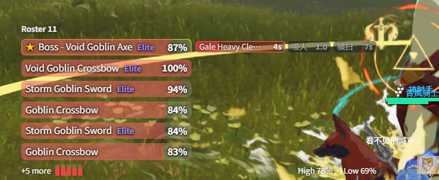

# See every monster's HP when you pull a pack

Related page: [Battle Roster](../roster.md)

**Scenario**: You are the tank and pull big packs in dungeons. The HP bar only shows your current target; you want the HP of every monster in the fight, which ones are not on you and whom they are hitting. You also want to know in advance when an elite's dangerous skill is about to come back.

## Step 1: Turn on the Battle Roster

1. **{{ui:routes.tools.monsterMonitor}} → {{ui:monsterMonitor.tabs.overlay}}**, turn on the **Battle Roster** (off by default).
2. Click **{{ui:monsterMonitor.actions.editLayout}}** and drag the roster to one side of the screen.

## Step 2: Set up the tank view

Open **{{ui:monsterMonitor.tabs.roster}}**:

1. Turn on **{{ui:monsterMonitor.roster.tankMode}}**: the header counts the monsters that are not on you and whom they are attacking; those monsters all get their own row with the target at the end.
2. Turn on **{{ui:monsterMonitor.roster.notAttackingMeFirst}}** so monsters targeting someone else come first and you can pull them back.
3. With many monsters of the same name, turn on **{{ui:monsterMonitor.roster.showDistance}}** to tell them apart by distance.

## Step 3: Block monsters you don't need

After one pull, click mechanic markers, scene objects and other monsters whose HP you don't care about in **{{ui:monsterMonitor.roster.recentTitle}}** to block them. Blocking works by monster ID across all profiles and dungeons.

## Step 4: Watch dangerous skills

1. In **{{ui:monsterMonitor.roster.skills.title}}**, click **{{ui:monsterMonitor.roster.skills.fromRecent}}**, open the elite you just fought and tick its dangerous skill. The cooldown, opening cast window and cast time are listed next to it.
2. Expand **{{ui:monsterMonitor.roster.skills.voiceTitle}}** under that skill, turn on **{{ui:voice.binding.event.readyIn}}** with 3 seconds and tick **{{ui:voice.binding.countdown}}**.
3. Open **{{ui:routes.tools.voice}} → {{ui:voice.tabs.bindings}}** and click **{{ui:voice.bindings.generateMissing}}**.

## Result

The main target is pinned to the top, Bosses and monsters with watched skills get their own rows, and the remaining small monsters are combined into small bars on the last row. The grey countdown at the end of a row is the skill cooldown; 3 seconds before it is ready you hear the cue and the count.

> [!NOTE]
> A skill cooldown is the earliest the skill can be used: the monster may wait longer once it is over, and script-triggered skills cannot be predicted. It is most accurate for skills cast on a fixed cycle.
