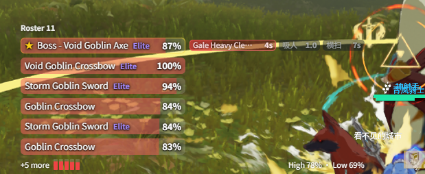

# Battle Roster

**{{ui:routes.tools.monsterMonitor}} → {{ui:monsterMonitor.tabs.roster}}** is the battle roster area of the monster overlay. Unlike the [HP bar](./status.md#hp-bar), which follows your current target, it covers **every** monster you and your teammates are fighting.

## What it shows

Lists the HP of each monster in combat with you or a teammate:

- your **target** is pinned to the top and marked with ★;
- every **boss** gets its own row;
- the first few **normal and elite monsters** in rank order get rows too (5 by default). They are ranked by HP%, highest first, or with the monsters not attacking you first;
- the rest are folded into one strip of mini bars that shows the highest and lowest HP among them. However many there are, none is hidden.

Bars update live; the order changes at most once per second so rows do not jump around. A monster that dies or resets leaves the roster right away.

| Setting | Effect |
| --- | --- |
| **{{ui:monsterMonitor.roster.normalRows}}** | How many normal and elite monsters get their own row, 0–20 |
| **{{ui:monsterMonitor.roster.tankMode}}** | The header counts the monsters not attacking you and whom they attack; each of them gets a row that names its target |
| **{{ui:monsterMonitor.roster.notAttackingMeFirst}}** | Monsters targeting someone else come first, then those attacking you or with no known target, each group by HP. The rows go to the monsters ranked first |
| **{{ui:monsterMonitor.roster.showHpValue}}** | Shows the HP value next to the percentage |
| **{{ui:monsterMonitor.roster.showDistance}}** | Shows the ground distance to you, to tell same-name monsters apart |

**{{ui:monsterMonitor.roster.panelWidth}}** in **{{ui:monsterMonitor.roster.styleTitle}}** sets the width of the HP column (120–400 px, 240 by default); the skill column adds to that width on the right. Long names end in an ellipsis. When space is limited, percentages, HP values and the mini bars below wrap onto additional lines to avoid clipping.

## Watched skills

Pick the monster skills you care about in **{{ui:monsterMonitor.roster.skills.title}}**. The roster then shows their state **at the end of the monster's row**, without repeating its name:

- monsters that can cast them are listed right below your target, always with their own row (not counted against the rows of normal and elite monsters), ordered by HP;
- a blocked monster that can cast a watched skill gets a slim row with only its skill cells, and is not counted;
- each skill has one cell, in the order of your watch list.

| State | Look | Meaning |
| --- | --- | --- |
| Cooling down | Gray countdown | Earliest time the skill can come. Counted from the battle-start window before the first cast, then from each cast |
| Ready | Amber | Cooldown over: may be cast at any moment |
| Casting | Red bar + seconds left | Cast bar running; dangerous casts flash. Ends early when the monster casts something else |
| Just cast | Red ⚡ | An instant skill was cast |
| Unpredictable | — | No cooldown data; only casts are shown |

To add skills:

- **{{ui:monsterMonitor.roster.skills.fromRecent}}**: open a monster you just fought and tick its skills; cooldown, battle-start window and cast time are listed beside them;
- or search by skill name or id;
- each skill can have a **{{ui:monsterMonitor.roster.skills.label}}** and a custom cooldown; leave it empty to use the game table.

> [!NOTE]
> The cooldown is a lower bound: in captured logs monsters never recast sooner, but the AI may wait longer once it is over. Skills triggered by scripts (several monsters casting at once, for example) cannot be predicted, and an interrupted cast can have a longer cooldown, so "Ready" may show early.

### Voice broadcast

Each watched skill can expand **{{ui:monsterMonitor.roster.skills.voiceTitle}}** to set up **{{ui:voice.binding.event.onCast}}**:

- It plays only when a monster on the roster casts the skill; a cast-bar skill plays when its bar starts;
- Several monsters casting the same skill at the same moment play it once;
- It keeps playing while the roster panel is hidden or **{{ui:monsterMonitor.enabled}}** is off;
- Removing the watched skill also removes its voice binding.

Mechanic objects outside the hate lists are not on the roster, so they are never announced here. Set those skills up in [Monster Skills](./monster-skill.md), which covers any nearby monster.

## Blocking monsters

Mechanic markers, scene objects and other monsters whose HP does not matter can be blocked under **{{ui:monsterMonitor.roster.blockTitle}}**. Blocking works by monster id and applies to every profile and dungeon; blocked monsters are left out of the roster and its counts. Common mechanic monsters such as invisible carriers and field markers are already blocked; you do not need to add them.

- **{{ui:monsterMonitor.roster.recentTitle}}**: monsters that joined the roster since the app started, with name, type, max HP and dungeon. Click one to block it; the list is cleared on restart;
- or search every monster by name or monster id.

> [!NOTE]
> **Battle Roster** is off by default; turn it on in [Enable Window](./overlay.md). The roster is only tracked while it is on, or while a watched skill has a voice broadcast.
