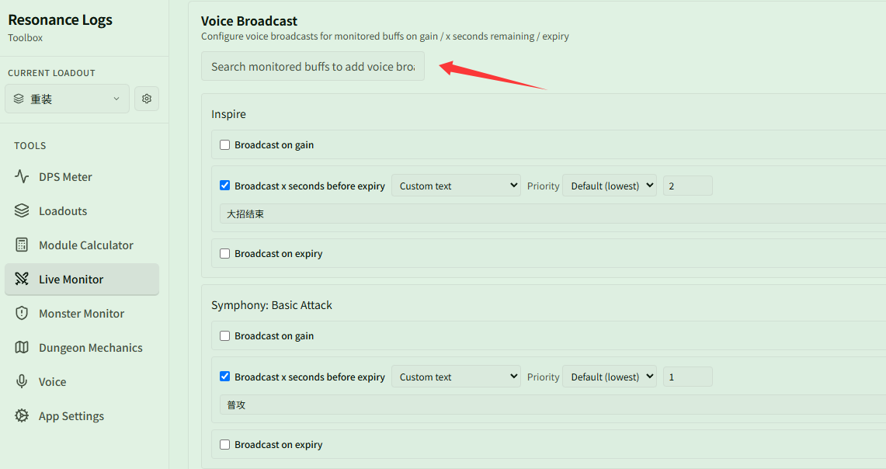
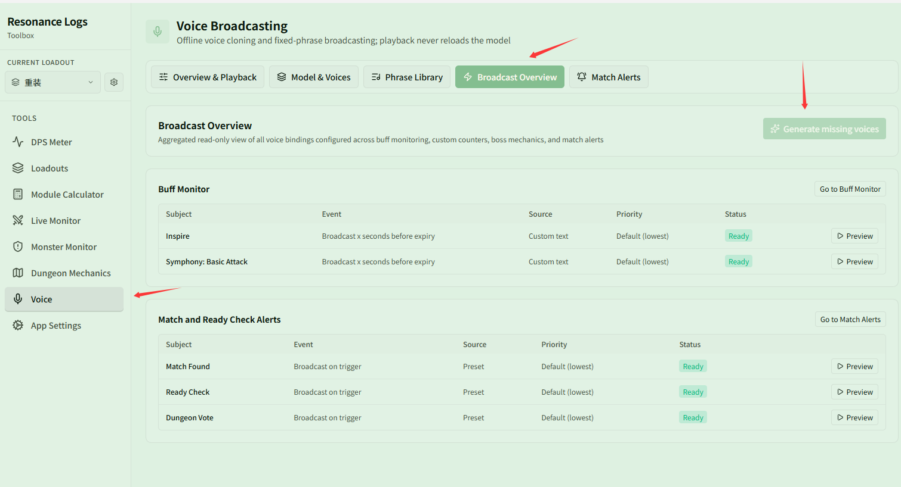

# Set up a voice announcement for a buff and generate it

Related page: [Voice Announcements](../README.md)

**Scenario**: You want a custom voice announcement to play right before important buffs expire (for example, announcing "Ultimate ending" 2 seconds before "Inspire" expires, or "Basic attack" 1 second before "Symphony: Basic Attack" expires), and generate all missing audio in one click.

## Step 1: Bind a voice announcement on the buff page

1. Open **{{ui:routes.tools.skillMonitor}} → {{ui:skillMonitor.tabs.buff}}** and scroll down to the **{{ui:skillMonitor.buff.voice.title}}** section.
2. In the search box, search for a monitored buff (e.g. "Inspire" or "Symphony: Basic Attack") and add it to the list.
3. Check **{{ui:voice.binding.event.expiring}}**, and set how many seconds before expiry to announce (e.g. 2s or 1s).
4. Set the text source to **{{ui:voice.binding.source.custom}}**, and type your prompt (e.g. "Ultimate ending" or "Basic attack").
5. Keep priority at default or adjust as needed.

## Step 2: Generate missing voices in the Broadcast Overview

Newly configured or customized announcements need offline audio generated:

1. Open **{{ui:routes.tools.voice}} → {{ui:voice.tabs.bindings}}**.
2. You will see the newly configured entries in the list, with status pending generation.
3. Click **{{ui:voice.bindings.generateMissing}}** in the upper right corner; the app will batch-generate the audio in the background.
4. When finished, the status will show **{{ui:voice.bindings.status.ready}}**. Click **{{ui:voice.bindings.tryPlay}}** on the right to test it.

