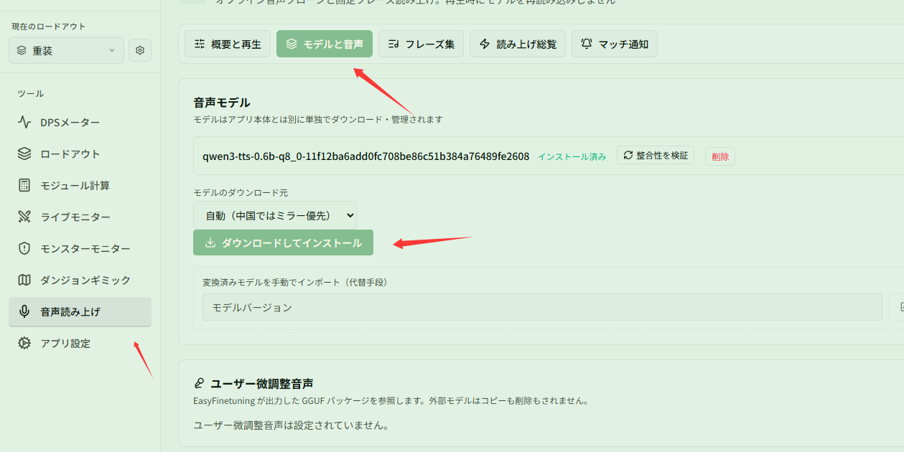
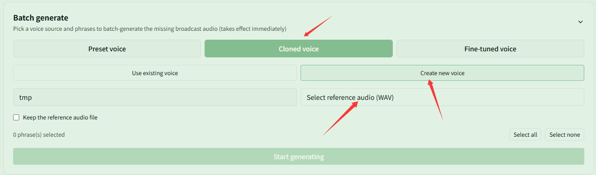

# Download models, clone voices, and import audio phrases

Related page: [Voices and phrases](../voices.md)

**Scenario**: You want to personalize your voice experience: install the offline model and generate speech using preset voices or a newly cloned custom voice, or directly import existing sound effects and recordings as fixed phrases.

## Step 1: Download and install the voice model

In **{{ui:routes.tools.voice}} → {{ui:voice.tabs.model}}**, verify the model download source and click **{{ui:voice.model.install}}**. Once the model is installed, the app can perform offline voice cloning and synthesis.

## Step 2: Select or create a voice to generate speech (preset or cloned)

Go to **{{ui:routes.tools.voice}} → {{ui:voice.tabs.phrases}}** and expand the **{{ui:voice.phrases.generate.title}}** panel below:
- **Use preset voice (default)**: keep **{{ui:voice.phrases.generate.presetSource}}** selected. The system automatically selects standard speech matching the current UI language. Simply select phrases and generate without extra setup;
- **Create a new cloned voice**: switch to **{{ui:voice.phrases.generate.cloneSource}}**, click **{{ui:voice.phrases.generate.createNew}}**, enter a **{{ui:voice.phrases.generate.newProfileName}}**, and click **{{ui:voice.phrases.generate.pickReference}}** to select a clean 5–10 second voice clip (WAV format; optionally check **{{ui:voice.phrases.generate.keepReference}}**);
- Select the phrases you want to generate and click **{{ui:voice.phrases.generate.start}}** to batch-generate audio.

## Step 3: Directly import any audio as a phrase

If you do not want to use TTS synthesis, or prefer to play existing sound effects or recordings directly:
1. In the phrase management section at the top of **{{ui:voice.tabs.phrases}}**, enter a **{{ui:voice.phrases.namePlaceholder}}** and phrase text;
2. Click **{{ui:voice.phrases.import.newButton}}** and select an audio file (supports wav / mp3 / flac / ogg / m4a, 0.2–30 seconds);
3. The phrase status will show as **{{ui:voice.phrases.status.imported}}**. Imported audio works without voice models and can be directly referenced on any feature page using **{{ui:voice.binding.source.phrase}}**.

