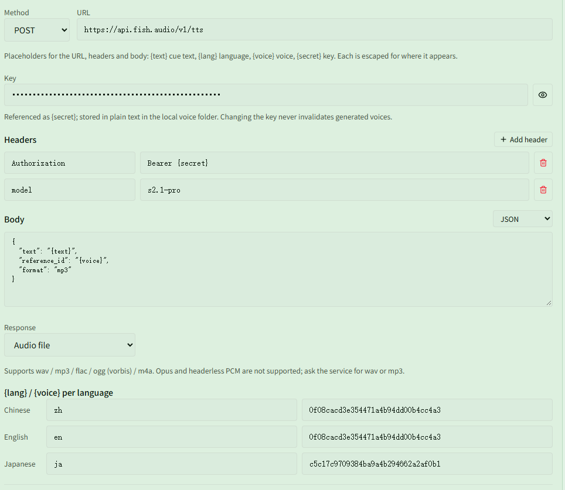

# Generate cues with an online Fish Audio voice

Related page: [Voices and phrases](../voices.md#method-5-http-voice-service)

**Scenario**: you'd rather not install the voice model (or your GPU is modest and local generation is slow), and want to use a ready-made voice from the [Fish Audio](https://fish.audio) voice library instead. Most cues should use one main voice; only the "Tina's ready" cue should switch to a Japanese voice speaking Japanese.

Each line is requested once at generation time and saved locally, so cues play in game without any network access. HTTP services don't need the voice model, but **{{ui:voice.overview.enabled}}** in **{{ui:voice.tabs.overview}}** still has to be on.

## Step 1: Get a key and voice IDs

1. Sign in to Fish Audio, create a key on the **API Keys** page and copy it. The API is billed by usage; see the official site for pricing.
2. Open the voice you want in the voice library. The address looks like `https://fish.audio/m/0f08cacd3e354471a4b94dd00b4cc4a3`; the string after `/m/` is the voice ID.
3. Find a Japanese voice the same way and note its ID, for example `c5c17c9709384ba9a4b294662a2af0b1`.

> [!TIP]
> The two IDs in this example are only for illustration. Replace them with the voices you picked.

## Step 2: Add the service

Open **{{ui:routes.tools.voice}} → {{ui:voice.tabs.model}}**, choose the preset **{{ui:voice.http.preset.openaiCompatible}}** in **{{ui:voice.http.title}}** and click **{{ui:voice.http.add}}**. The preset already uses POST, a JSON body and `Bearer {secret}` authentication, so only these fields need changing:

| Field | Value |
| --- | --- |
| {{ui:voice.http.form.name}} | `fish audio` |
| {{ui:voice.http.form.concurrency}} | `2` (default) |
| {{ui:voice.http.form.method}} | POST |
| {{ui:voice.http.form.url}} | `https://api.fish.audio/v1/tts` |
| {{ui:voice.http.form.secret}} | The key from step 1 |
| {{ui:voice.http.form.headers}} | Keep `Authorization` = `Bearer {secret}`; click **{{ui:voice.http.form.addHeader}}** and add `model` = `s2.1-pro` |
| {{ui:voice.http.form.body}} | Encoding JSON, content below |
| {{ui:voice.http.form.response}} | **{{ui:voice.http.form.response.audioBytes}}** |

Body:

```json
{
  "text": "{text}",
  "reference_id": "{voice}",
  "format": "mp3"
}
```

- `{text}` becomes the phrase text and `{voice}` the voice ID filled in per language below. Quotes and line breaks are escaped automatically.
- Use `mp3` or `wav` for `format`. Fish Audio can also return `opus` and `pcm`, but the app doesn't support those formats.
- The `model` header picks the model. See the [Fish Audio API reference](https://docs.fish.audio/api-reference/endpoint/openapi-v1/text-to-speech) for the available values.

At the bottom of the form, fill in `{lang}` and `{voice}` per language:

| Language | `{lang}` | `{voice}` |
| --- | --- | --- |
| {{ui:voice.language.zhCN}} | `zh` | `0f08cacd3e354471a4b94dd00b4cc4a3` |
| {{ui:voice.language.enUS}} | `en` | `0f08cacd3e354471a4b94dd00b4cc4a3` |
| {{ui:voice.language.jaJP}} | `ja` | `c5c17c9709384ba9a4b294662a2af0b1` |

This body doesn't use `{lang}`, so any value will do. If you only have one main voice, you can use the same ID for several languages.



## Step 3: Test and save

1. In **{{ui:voice.http.form.test}}**, choose **{{ui:voice.language.enUS}}**, keep the default text and click **{{ui:voice.http.form.testButton}}**. If you hear the line and a success message with its length appears below, the setup works.
2. Switch to **{{ui:voice.language.jaJP}}**, enter a Japanese line (such as "ティナ、準備完了") and test again to confirm the Japanese voice is used.
3. Click **{{ui:voice.http.form.save}}**.

When a test fails, the status code and reason returned by the service appear below the form:

| Message | Cause |
| --- | --- |
| `HTTP 401` | Wrong key, or the `Authorization` value isn't `Bearer {secret}` (with one space after `Bearer`) |
| `HTTP 402` | Not enough balance on your Fish Audio account |
| Other `HTTP 4xx` | The voice ID or body is wrong; fix it according to the returned reason |
| Audio decoding fails | `format` is set to `opus` or `pcm`; change it back to `mp3` |
| Connection failed or timed out | This computer can't reach `api.fish.audio`; check your network |

## Step 4: Use Fish Audio by default

1. Open **{{ui:voice.tabs.phrases}}**, choose **{{ui:voice.phrases.generate.httpSource}}** in **{{ui:voice.phrases.generate.title}}**, then pick "fish audio".
2. Tick the phrases to generate and click **{{ui:voice.phrases.generate.start}}**.
3. This choice is remembered. Clicking **{{ui:voice.bindings.generateMissing}}** in **{{ui:voice.tabs.bindings}}** later also generates with Fish Audio.

Each phrase uses the row for its own language. With the app in English, auto-generated and custom-text cues are English phrases, so they all use the English row's voice.

## Step 5: Give only the Tina cue a Japanese voice

1. Open **{{ui:routes.tools.skillMonitor}} → {{ui:skillMonitor.tabs.buff}}**, expand **{{ui:skillMonitor.buff.voice.title}}** and find "Time Stasis (Tina CD)" (set up as in [Voice reminder when Tina's CD is ready](../../monitor/examples/tina-cd.md)).
2. In **{{ui:voice.binding.event.lost}}**, choose **{{ui:voice.binding.source.custom}}** and enter "ティナ、準備完了".
3. Set **{{ui:voice.binding.generationSource}}** to "fish audio" and **{{ui:voice.binding.generationLanguage}}** to **{{ui:voice.language.jaJP}}**.
4. Click **{{ui:voice.binding.generate}}**, then **{{ui:voice.binding.tryPlay}}** once it's done.

This cue uses the Japanese row's `{lang}` and `{voice}`; every other cue is still generated with the step 4 setting. **{{ui:voice.binding.source.auto}}** cues can pick their own **{{ui:voice.binding.generationSource}}** too, but only **{{ui:voice.binding.source.custom}}** can change **{{ui:voice.binding.generationLanguage}}**, which is why this step uses custom text. To undo it, set **{{ui:voice.binding.generationSource}}** back to **{{ui:voice.binding.generationDefault}}**.

## Notes

- Each phrase is one request. Text containing `${remodelLevel}` expands into several phrases (one per tier), with one request each; see [Fantasy tier placeholder](../playback.md#fantasy-tier-placeholder).
- After changing a voice ID, `model`, the body or the URL, audio generated with this service shows **{{ui:voice.phrases.status.stale}}** and needs regenerating. Changing only the key doesn't.
- Batch generation stops immediately on `HTTP 401` or `HTTP 402`, keeping the audio already generated. `HTTP 429` / `HTTP 503` (service busy) are retried automatically; if they happen often, set **{{ui:voice.http.form.concurrency}}** to `1`.
- Services and keys stay on this computer and aren't included when you [share a loadout](../../app/examples/share-loadout.md). After a teammate imports the loadout, the step 5 cue's **{{ui:voice.binding.generationSource}}** shows **{{ui:voice.binding.generationUnavailable}}**; they need to add their own service and pick it again.
