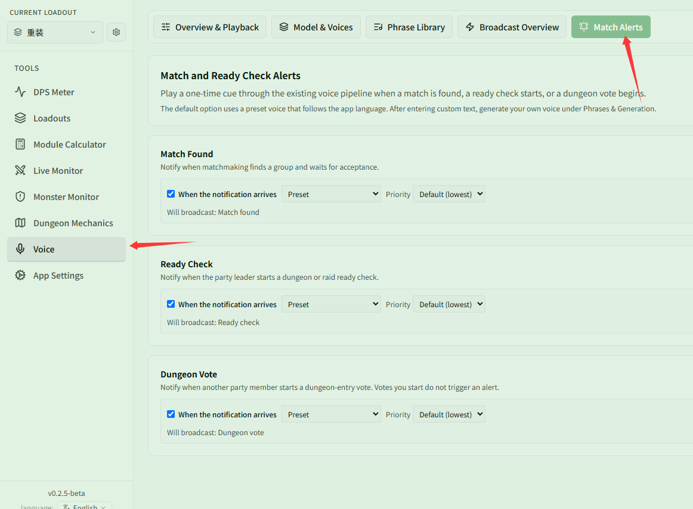

# Hear "match found" while queueing AFK

Related page: [Playback and alerts](../playback.md)

**Scenario**: you are queueing for a dungeon and have tabbed out to watch a video. You want a voice alert when a match is found, the party leader starts a ready check, or there is a vote to enter the dungeon, so you don't miss the confirmation.

## Step 1: Turn on voice

In **{{ui:routes.tools.voice}} → {{ui:voice.tabs.overview}}**, turn on **{{ui:voice.overview.enabled}}** and set the volume loud enough to hear while you are tabbed out of the game.

## Step 2: Turn on preset voice alerts

Open **{{ui:voice.tabs.alerts}}** and turn on each of:

- **{{ui:voice.alerts.matchReady.title}}**
- **{{ui:voice.alerts.readyCheck.title}}**
- **{{ui:voice.alerts.teamVote.title}}**

**Preset audio works out of the box**: The app comes with preset audio for all three alerts. Keeping the dropdown set to "Preset" allows immediate playback without downloading models or generating audio.

## Step 3: Customize text (optional)

If you want a more personalized or conspicuous announcement (such as "Come back and confirm"), switch the dropdown to "Custom text" and type your prompt. When using custom text, go to **{{ui:voice.tabs.bindings}}** and click **{{ui:voice.bindings.generateMissing}}** to generate the audio.

## Step 4: Set the priority

Queue alerts usually happen outside combat and won't clash with combat announcements, so the default is fine. If you often queue while fighting trash mobs, you can set them to **{{ui:voice.binding.priority.high}}** so other announcements don't drown them out.

> [!NOTE]
> The alerts rely on network notifications pushed by the game, so the app must keep running (hiding it to the tray is fine).
