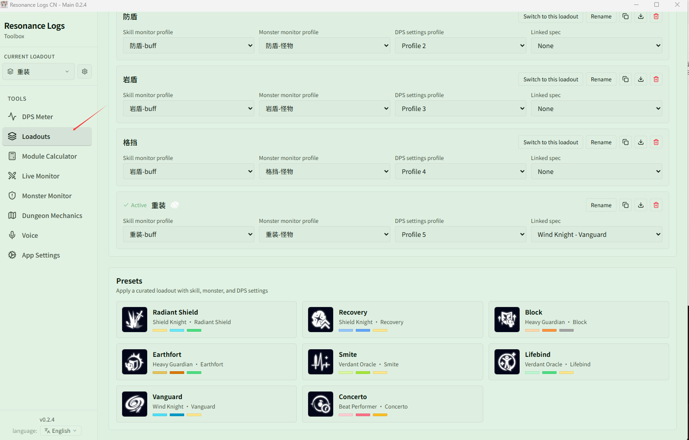
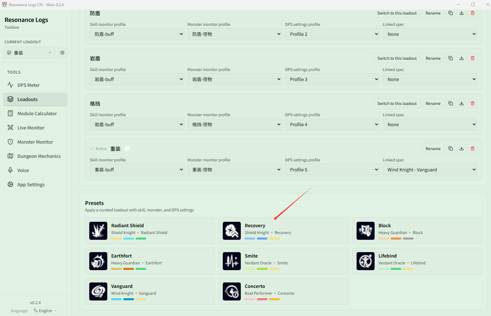
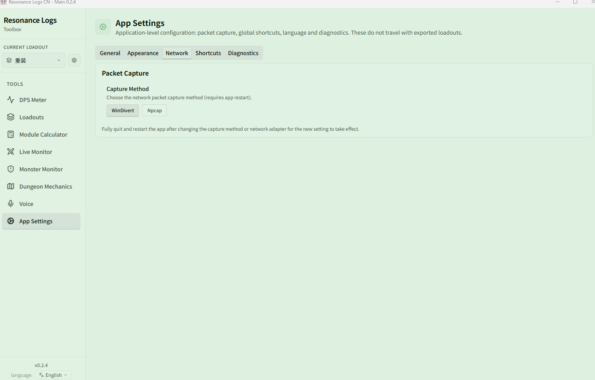

# Getting Started

Follow this page and in about 5 minutes you'll go from installing the app to seeing your first combat data.

## 1. Install the app

Get the latest Windows x64 installer from the [download page](https://github.com/fudiyangjin/resonance-logs-cn/releases/latest) and install it.

- To upgrade, just install over the existing version. **Do not delete the user settings directory** — your loadouts, themes and history are all kept.
- Later versions can be updated in-app with one click; see [Updates, Tray & Config Recovery](../features/app/update.md).

After the first launch, you can switch the interface language in **{{ui:routes.tools.appSettings}} → {{ui:appSettings.tabs.general}}** (简体中文 / English / 日本語). We recommend matching your game client's language, since Buff and skill names switch along with it.

## 2. Pick a starter loadout

The first time you open the app, **{{ui:loadout.firstRun.title}}** pops up. If your class spec is in the list (e.g. Radiant Shield, Recovery, Block, Earthfort, Smite, Lifebind, Vanguard, Concerto), just select it to get a complete, ready-made set of skill CD, Buff, Monster Monitor and DPS settings. Otherwise click **{{ui:loadout.firstRun.skip}}** and build your own later in [Loadouts](../features/app/loadouts.md).

## 3. Set up packet capture

The app tracks combat by reading the game's network traffic, so you need to choose a capture method first. Open **{{ui:routes.tools.appSettings}} → {{ui:appSettings.tabs.network}}** and pick one:

| Method | Preparation | Best for |
| --- | --- | --- |
| **WinDivert** (try this first) | Nothing extra to install; run the app as administrator | Most users |
| **Npcap** | Install [Npcap](https://npcap.com/) and select your network adapter under **Network Device** | When WinDivert is blocked by security software, or you need to pick a specific adapter |

With Npcap, select the Ethernet or Wi-Fi adapter that actually carries the game traffic — not Loopback, VirtualBox, VMware or other virtual adapters. If you use a game accelerator or VPN, first check which adapter the game traffic actually goes through.

> [!WARNING]
> After changing the capture method or adapter, you must **fully quit and restart** the app for it to take effect. Clicking the main window's close button only hides it to the system tray by default; right-click the tray icon in the bottom-right corner, choose **Quit**, then open the app again.

## 4. Verify your first combat data

1. Launch the game and go somewhere you can fight (for example, the training dummies in the training ground).
2. Deal some damage. The **Live DPS window** appears on screen showing your name and damage.
3. If you opened the app while the game was already running, **change zones once** (teleport, enter/leave a dungeon, or switch channels) so the game resends your full character data.

If you see data, everything is ready. If not, work through [No data / packets not captured?](../faq/app-runtime.md#no-data--packets-not-captured) step by step.

> [!TIP]
> The game only pushes data that **changes**. Whenever skill CDs, character attributes or Buffs look incomplete, change zones once — that usually fixes it.

## 5. What's next

| I want to… | Go to |
| --- | --- |
| Understand the DPS window and review a fight | [DPS Meter](../features/dps/README.md) |
| Show my own skill CDs, Buffs and factors on screen | [Live Monitor](../features/monitor/README.md) |
| Watch Debuffs, threat and mechanic countdowns on the Boss | [Monster Monitor](../features/monster/README.md) |
| See positioning and target callouts in dungeons | [Dungeon Mechanics](../features/minimap/README.md) |
| Get voice reminders for key events | [Voice Announcements](../features/voice/README.md) |
| Calculate the best module combination | [Module Calculator](../features/module-calc/README.md) |
| Save / switch / share a complete setup | [Loadouts](../features/app/loadouts.md) |

If you're not familiar with the interface yet, read the [Interface Tour](./interface.md) first, or just follow [Example: Preparing for your first dungeon](./examples/first-dungeon.md).

## Examples

- [Preparing for your first dungeon](./examples/first-dungeon.md)