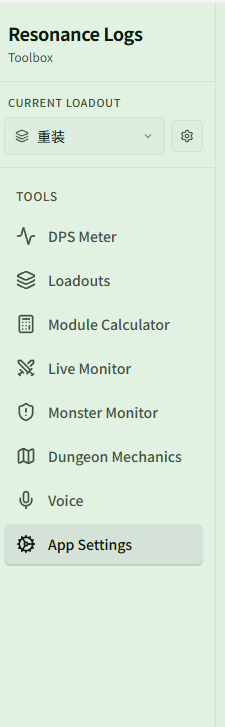
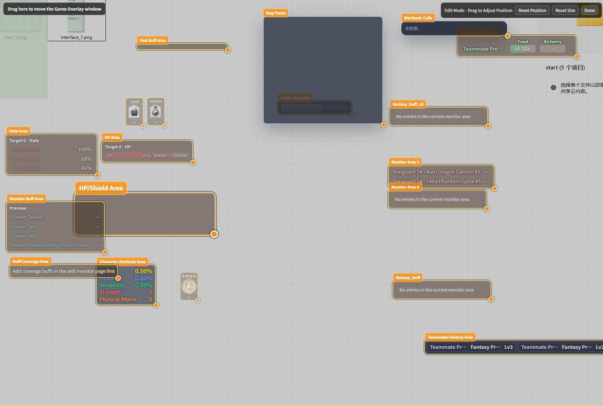

# Interface Tour

Resonance Logs CN consists of one **main window** and several **in-game overlays**: the main window is where you configure things, and the overlays display data on top of the game.

## Main window

From top to bottom, the sidebar contains:

| Entry | What it's for | Docs |
| --- | --- | --- |
| **{{ui:loadout.sidebar.label}}** | Switch your whole setup in one click (skill monitoring + monster monitoring + DPS settings) | [Loadouts](../features/app/loadouts.md) |
| **{{ui:routes.tools.dps}}** | Live damage / healing / damage-taken stats, history review, themes | [DPS Meter](../features/dps/README.md) |
| **{{ui:routes.tools.loadouts}}** | Create, duplicate, import and export loadouts | [Loadouts](../features/app/loadouts.md) |
| **{{ui:routes.tools.moduleCalc}}** | Calculate the best module combination | [Module Calculator](../features/module-calc/README.md) |
| **{{ui:routes.tools.skillMonitor}}** | Overlay for your own skill CDs, Buffs, factors and character attributes | [Live Monitor](../features/monitor/README.md) |
| **{{ui:routes.tools.monsterMonitor}}** | Buffs on your target, threat, Boss DBM, entity timers | [Monster Monitor](../features/monster/README.md) |
| **{{ui:routes.tools.minimap}}** | Dungeon minimap and mechanic callouts | [Dungeon Mechanics](../features/minimap/README.md) |
| **{{ui:routes.tools.voice}}** | Voice model, voices, phrases and announcement overview | [Voice Announcements](../features/voice/README.md) |
| **{{ui:routes.tools.appSettings}}** | Language, appearance, packet capture, shortcuts, diagnostics | [App Settings](../features/app/README.md) |

When a new version is available, an **Update available** button appears at the bottom of the sidebar; see [Updates, Tray & Config Recovery](../features/app/update.md).

## In-game overlays

Each type of overlay is its own transparent window that can be toggled, moved and resized independently:

| Overlay | What it shows | Where to toggle it |
| --- | --- | --- |
| **Live DPS window** | Party damage / healing / damage taken / death lists | Shortcut, or tray **Show Live Meter** |
| **Live Monitor overlay** | Skill CDs, resources, character attributes, custom monitor areas, shields, coverage | Top of the {{ui:routes.tools.skillMonitor}} page |
| **Monster overlay** | Target Buffs, teammate Buffs, threat, stun, HP, Boss DBM, entity timers | Top of the {{ui:routes.tools.monsterMonitor}} page |
| **Dungeon Mechanics overlay** | Minimap, mechanic callouts | Top of the {{ui:routes.tools.minimap}} page |

> [!TIP]
> The overlay-style windows all have an "Edit Layout" mode: once you enter it, each area shows a border and you can drag it to move or drag a corner to resize. When you finish editing, the overlay goes back to click-through so it won't get in the way of your gameplay.

## System tray

By default, clicking the main window's close button **does not quit** the app — it hides it to the tray in the bottom-right corner. Right-click the tray icon to:

| Menu item | What it does |
| --- | --- |
| **Show Settings** | Reopen the main window |
| **Show Live Meter** | Show the Live DPS window |
| **Reset All Windows** | Restore all windows to their default position and size (use this when an overlay ends up off-screen) |
| **Disable Clickthrough** | Turn off click-through on the DPS window |
| **Quit** | Fully quit the app |

To make the close button quit directly, change it in **{{ui:routes.tools.appSettings}} → {{ui:appSettings.tabs.general}}**; see [App Settings](../features/app/README.md).
