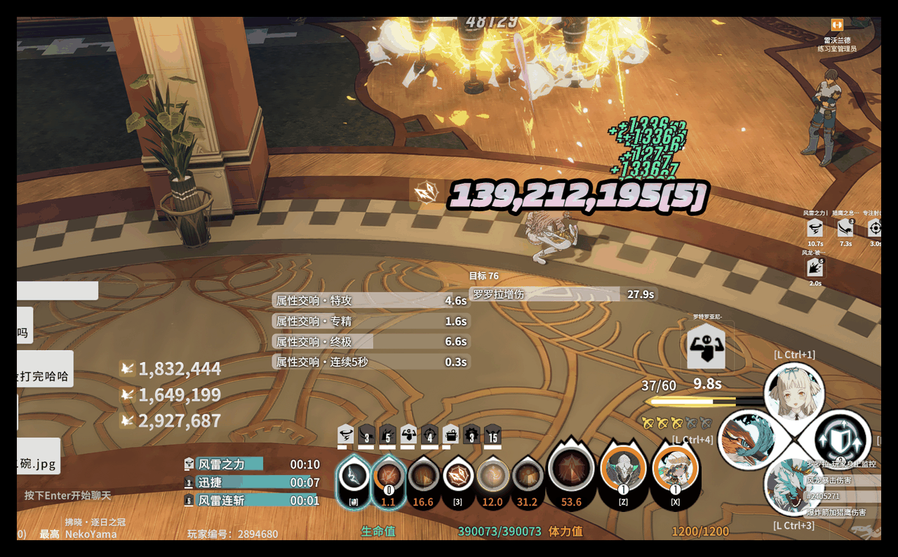
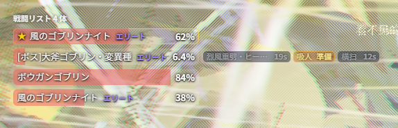
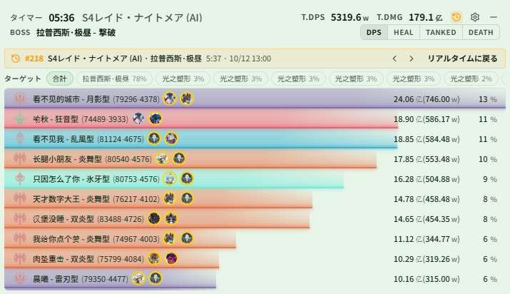

# Changelog v0.2.10

## 更新内容

### 修正

- ゲームデータ更新後に食事・錬金の分類が一致しなくなっていた問題を修正しました。名前が「料理」または「薬剤」の Buff は再び食事・錬金に分類され、分類で追加すると選択できます
- エンティティ持続の音声を含むプロファイルをエクスポートしたあとインポートできなくなっていた問題を修正しました。モンスター ID で保存した音声はインポートできます。以前の `モンスターID:self`、`モンスターID:any` の形式も引き続きインポートできます
- 戦闘リストの HP バー列の幅を調整できるようになりました（モンスターモニター › 戦闘リスト › 戦闘リストパネルスタイル › パネル幅、120～400、初期値 240）。長い名前は省略記号で表示します。幅が足りないときは、割合、HP、一番下の小さなバーが折り返され、切れません

### スキルダメージ表示

- 「スキルダメージ表示」ページを追加しました（メインウィンドウのサイドバー › スキルダメージ表示）。指定した自分のスキルのヒットごとのダメージ数値をゲームオーバーレイに表示します（[@nekoyama32767](https://github.com/nekoyama32767)）。
  - スキルはスキルグループ単位で管理し、グループごとに独立した表示エリアを持ちます。表示位置は編集モードでドラッグできます。スキル名・別名・ダメージ ID で検索して追加でき、同名で ID が異なるものは別々に追加できます。
  - スキルの表示形式はスキル名・スキルアイコン・表示しないから選べます。プリセットアイコンはスキルアイコンとタレントアイコンに分かれ、クラスごとのタブで並びます。タレントアイコンはさらに汎用と各専門に分かれ、「共通」タブもあります。アイコンの背景色と不透明度も設定できます。
  - ダメージ数値は、フォント（システムフォント、または .woff2 / .woff / .ttf / .otf ファイルをアップロード）、文字サイズ、文字の太さ、斜体に加え、塗りの色（単色 / グラデーション）、光彩（内側）、輪郭、光彩（外側）、影を設定できます。数値形式は整数・桁区切り・万 / 亿・K / M / B に対応しています。
  - アニメーションは「ポップ」または「上に浮かびフェードアウト」から選べ、表示時間・徐々に縮小・同時表示数・後続数値のスクロール方向を設定できます。「アニメーションをテスト」でプレビューできます。
  - 「複数ヒットの合計ダメージを表示」をオンにすると、同じスキルの同一バッチ内の複数ヒットを合計して表示し、オフのときはそのバッチで最大の 1 ヒットだけを表示します。「グループ内の同時ダメージを合算」をオンにすると、グループ内のスキルの同一バッチのダメージを合算し、グループ名で表示します。
  - ダメージ表示プロファイルはロードアウトに合わせて切り替わります。ロードアウト ページで各ロードアウトの「ダメージ表示プロファイル」を選べます。アップロードしたフォントは 1 つだけ保存され、すべてのスキルグループで共有されます。
  - 日常シーンで自動的に非表示にできます。

  

- DPS のスキル内訳に「ID」列を追加しました。スキルダメージ ID を表示するので、追加したいスキルを調べるのに使えます。初期状態では非表示で、DPSメーター › 設定 でオンにできます。

### モンスターモニター

- 「戦闘リスト」を追加しました（モンスターモニター › 戦闘リスト）。自分と味方が交戦しているすべてのモンスターの HP を一覧表示します。モンスターモニター › ウィンドウを有効化 で「戦闘リストエリア」をオンにすると表示されます。
  - メインターゲットは ★ 付きで一番上に固定され、Boss はすべて 1 行ずつ表示されます。通常モンスターとエリートは HP 順に上位数体（初期値 5 体）を 1 行ずつ表示し、残りは最後の 1 行に小さなバーとしてまとめ、その中の最高 / 最低 HP を表示します。モンスターがどれだけ多くても隠れることはありません。
  - 「タンクモード」：自分を狙っていないモンスターの数と、それらが誰を攻撃しているかをヘッダーに表示し、それらのモンスターをすべて 1 行ずつ表示して行末にターゲットを示します。「自分を攻撃していないモンスターを優先」をオンにすると、他の人を狙っているモンスターが上に並びます。
  - HP の数値と自分からの水平距離も表示でき、同名のモンスターを見分けやすくなります。
  - ギミック用のマーカーやオブジェクトなど HP を気にしなくてよいモンスターは、モンスター ID で非表示にできます。すべてのプロファイルとダンジョンに適用されます。「今回遭遇したモンスター」から選ぶか、名前や ID で検索してください。透明モンスターや床マーカーなどよくあるギミック用オブジェクトは、最初から非表示になっています。
- 戦闘リストで「注目スキル」を設定できるようになりました。気になるモンスタースキルを選ぶと、そのモンスターの行末にスキルの状態を表示します。灰色のカウントダウンはクールダウン中、琥珀色は使用可能、赤は詠唱中または発動直後です。
  - 注目スキルを使えるモンスターはメインターゲットの下に並び、常に 1 行ずつ表示されます。通常モンスター・エリートの表示数には数えません。
  - クールダウンは初期状態ではゲームのテーブルの値を使い、秒数を自分で入力することもできます。「今回遭遇したモンスター」でモンスターを開くとスキルを直接チェックでき、クールダウン、開戦後の初回発動ウィンドウ、詠唱時間がそれぞれ表示されます。

  

- エンティティ持続にデバッグ用のスイッチ「自分が出したすべてのエンティティを表示」を追加しました（モンスターモニター › エンティティ持続）。オンにすると、エンティティ監視エリアのリスト項目の後に、自分が出したもののうち監視リストにないエンティティを `名前#ID ×数` の形式で表示し、右側に出現してからの秒数（`+12s` など）を表示します。これを見ながらエンティティ ID と持続時間を入力できます。ID をリストに追加すると、その行はそのままカウントダウンに切り替わります。
- モンスタースキルの監視リストの上限を 32 件から 128 件に増やしました。
- モンスターが戦闘を離れてリセットされた後も、ヘイトリストに古い内容が残る問題を修正しました。

### 色の設定

- すべての色設定を「色見本 + 色の値」の 1 行に変更し、`#38BDF8`、`38bdf8`、`rgb(56, 189, 248)` を直接入力できるようにしました。展開するとパレット、現在のプリセットで使っている色、最近使った色から選べるので、複数の箇所をまったく同じ色にそろえられます。
- ライブモニターとモンスターモニターのページ上部に「配色プリセット」を追加しました。ビビッド・アイス・アンバー・ジェイド・バイオレット・シンプルの 6 種類の配色を、現在のロードアウトのゲームオーバーレイのパネルに適用できます。
  - 変わるのは名前・数値・プログレスバーの色だけで、文字サイズ・間隔・背景はそのままです。Buff 警告のハイライト色と味方 Buff の列ごとの色も保持されます。
  - HP・スタン・Boss 予兆・戦闘リストは、どの配色でも赤・青・琥珀といった意味のある色を保持します。
  - 各パネルのスタイル設定から、そのパネルだけに配色を適用することもできます。
  - 初期設定の白のままのパネルがあると、ページ上部にお知らせが表示されます。そこから配色を適用することも、今後表示しないようにすることもできます。
- DPSメーター › テーマ › プリセット に「おすすめスタイル」を追加しました。おすすめの配色・テーブル・ヘッダー・表示形式・列・履歴表示をワンクリックで適用します。チャレンジ監視は保持されます。

  

- 新規インストールでは、おすすめの DPS スタイルと「ビビッド」のオーバーレイ配色が初期状態になり、新しく作る DPS プロファイルもおすすめスタイルになります。プリセットのロードアウトにも、すべてのパネルの配色を設定しました。

### DPS / 履歴

- 履歴詳細のタイムラインは、設定したクラス色 / 専門色をどこでも使うようになり、テーブルと色がそろいました。自分も専門色で表示し、瞬間 / 平均の曲線は線の種類で区別します。同じ専門などで色が重なるプレイヤーは、明るさと色相を自動的にずらします。履歴のプレイヤーテーブルも専門色で表示するようにしました。
- 履歴詳細でプレイヤーのスキル・被ダメージ・死亡の詳細を見ているとき、右クリックで 1 階層ずつ戻れるようになりました。概要ページで右クリックしても一覧には戻りません。
- 履歴詳細で、タイムラインで選んだ味方の詠唱レーン、味方の曲線、平均曲線の表示、Buff 欄の展開 / グループ分け / プレイヤーの選択、バフ稼働率のまとめを開いているかどうかを記憶するようになりました。別の戦闘に切り替えても、再起動しても保持されます。

### ダンジョンギミック

- S4「蒼穹の上、昼夜の果て」（テスト機能）：1 ボス目の符文輪盤に、3 つのリングを区切る赤い円を 2 本描くようにしました。通常のナイトメアと連戦の両方で表示されます。

### ゲームデータ

- ゲームのデータテーブルを更新しました。英語・日本語の Buff、スキル、モンスター、シーン名はゲームの公式テキストを優先して使うようになり、機械翻訳の名前を減らしました。

## ドキュメント

- 「戦闘リスト」の説明を追加しました。注目スキル、音声読み上げ、モンスターの非表示についても説明しています。
- エンティティ持続に、デバッグ用スイッチ「自分が出したすべてのエンティティを表示」の使い方を追記しました。「鎌車の残り時間を表示する」の例は、先にデバッグ用スイッチでエンティティ ID と持続時間を確認する手順に変更しました。

## 注意事項

- 戦闘リストエリアは初期状態ではオフです。モンスターモニター › ウィンドウを有効化 でオンにしてください。注目スキルの音声読み上げだけを設定している場合も、パネルがオフのままバックグラウンドで集計します。
- 注目スキルの音声読み上げは、戦闘リストにいるモンスターだけが対象です。ヘイトリストに入らないギミック用オブジェクトは戦闘リストに載らないため、そのスキルは モンスターモニター › モンスタースキル で音声を設定してください。
- 注目スキルのクールダウンは「最短でいつ使えるか」の下限です。使用可能になっても、モンスターの AI がすぐに使うとは限りません。スクリプトで発動するスキル（複数のモンスターが同時に使うものなど）は予測できず、発動時の通知だけになります。詠唱が中断された後は、実際のクールダウンが長くなることがあります。
- 「自分が出したすべてのエンティティを表示」は、自分が出したエンティティだけを表示します。スイッチをオンにする前から存在していたエンティティは、オンにした時点から秒数を数えます。このスイッチはプロファイルに保存され、ロードアウトのエクスポートにも含まれるので、設定が終わったらオフにしてください。
- 既存の色設定は自動では変更されません。配色を変えたい場合は「配色プリセット」か「おすすめスタイル」を使ってください。どちらも対応する色設定を上書きし、同じプロファイルを共有しているロードアウトもまとめて変わります（確認画面にそれらのロードアウトが表示されます）。

### 互換性

- 0.0.2 または 0.0.3 を使用していた場合、0.0.4〜0.2.10 を初めて使う際は `%LOCALAPPDATA%\resonance-logs-cn` 配下の `resonance-logs-cn.db` を削除してからアプリを再起動してください
- 0.2.2 と 0.2.1 は大規模な再構築を行っています。既存機能に問題があれば速やかにご連絡ください
- 0.2.2 はテーブルフィールドを変更しています。古い履歴レコードのエラーは想定どおりで、新しい記録は正常です
- 音声読み上げはモデルを別途ダウンロードする必要があります。初回のフレーズ生成には時間がかかることがありますが、生成後の再生ではモデルを再読み込みしません。HTTP 音声サービスではモデルは不要です

### 特に注意

- コードを改変して PR せずに配布する場合は、アプリ名・バージョンなど本家の識別情報を必ず変更し、誤解を招かないようにしてください
- 閉じるボタンは右下に隠れます。ウィンドウが多い場合は隠れバーを右下へドラッグして表示できます
- よくある質問は利用マニュアルの HTML を参照してください

### コミュニティ

- QQ グループ：`1084866292`
- Discord：https://discord.gg/RHeX47wvDU
