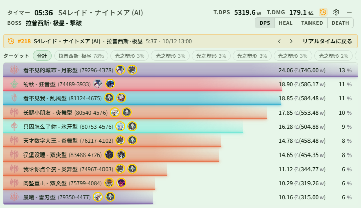
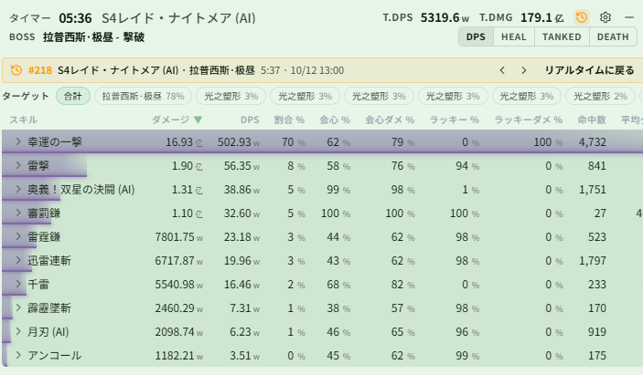

# Changelog v0.2.6

## 更新内容

### DPS / 履歴

- リアルタイムウィンドウで履歴を直接表示できるようになりました：ヘッダーの履歴ボタンから履歴一覧を開き、シーン / ボス / プレイヤー / UID で検索、または現在のシーン・現在のボス・今日・お気に入りで絞り込めます。選択すると DPS・HEAL・TANKED・DEATH の各ページにその戦闘のデータが表示され、上部のバナーで前後の戦闘への切り替えやリアルタイムへの復帰ができます。履歴ボタンは既定で非表示のため、「履歴ボタンを表示」を有効にしてください（DPSメーター → テーマ → ライブ → ヘッダー設定）
  - DPS ページとスキルページ上部のターゲットバーで、特定のターゲットへのダメージだけを表示できます
  - 履歴の表示中にリアルタイムで新しい戦闘が始まると、バナーに「戦闘中」と表示されます（自動では戻りません）。履歴の表示中はリセット・一時停止などのリアルタイム操作ボタンを非表示にします

  

  

- 履歴をプレイヤー UID で検索できるようになりました（DPSメーター → 履歴、検索タイプで UID を選択）：UID の先頭数桁を入力すると候補が表示され、その UID が使った名前と戦闘数も確認できます。このバージョン以降に作成された記録のみ対象です
- 履歴検索の候補を省略しなくなりました。多い場合は「さらに表示」で続きを表示します

### オーバーレイ監視関連

- モンスタースキルを追加（モンスターモニター → モンスタースキル）：近くのモンスターがリストのスキルを使うと、モンスターオーバーレイにスキル名を表示し、設定した秒数で消えます。再使用でタイマーをリセットします。音声読み上げも設定でき、DBM 警告のないスキルの監視に便利です
  - モンスタースキル領域は既定で非表示です。モンスターモニター → ウィンドウを有効化 で表示してください
- モンスターモニターとライブモニターのタブをグループ表示に変更し、オーバーレイに表示中の領域はタブに緑の点が付きます
- オーバーレイの編集モードに「今回の変更を取り消す」を追加：パネルの位置・サイズとオーバーレイウィンドウを編集開始時の状態に戻します
- ダンジョンに入った後で logs を起動するとパーティ情報が不完全になり、味方 Buff・味方 CD が正しく表示されない問題を修正

### 音声

- カスタム読み上げテキストは入力完了時（フォーカスが外れたとき / Enter）に保存するように変更し、入力途中の文字列がフレーズとして生成されないようにしました

### アプリ設定

- ボス HP 報告を追加（アプリ設定 → 一般 → ボス HP 報告）。既定でオンです

### モジュール計算

- ゲーム更新後のモジュールデータに対応し、モジュールの数値が読み取れない問題を修正。更新後、一度ログインし直すかチャンネルを切り替えると新しいモジュールデータを取得します

### データ

- モンスター名、Buff、モンスタースキル、シーン名、DBM の設定データを更新
- 主に Global サーバーの S4 翻訳を追加。JP サーバーで S4 が始まったら、対応する設定の送付について Discord でご連絡ください

## 注意事項

### 互換性

- 0.0.2 または 0.0.3 を使用していた場合、0.0.4〜0.2.6 を初めて使う際は `%LOCALAPPDATA%\resonance-logs-cn` 配下の `resonance-logs-cn.db` を削除してからアプリを再起動してください
- 0.2.2 と 0.2.1 は大規模な再構築を行っています。既存機能に問題があれば速やかにご連絡ください
- 0.2.2 はテーブルフィールドを変更しています。古い履歴レコードのエラーは想定どおりで、新しい記録は正常です
- 音声読み上げはモデルを別途ダウンロードする必要があります。初回のフレーズ生成には時間がかかることがありますが、生成後の再生ではモデルを再読み込みしません

### 特に注意

- コードを改変して PR せずに配布する場合は、アプリ名・バージョンなど本家の識別情報を必ず変更し、誤解を招かないようにしてください
- 閉じるボタンは右下に隠れます。ウィンドウが多い場合は隠れバーを右下へドラッグして表示できます
- よくある質問は利用マニュアルの HTML を参照してください

### コミュニティ

- QQ グループ：`1084866292`
- Discord：https://discord.gg/RHeX47wvDU
