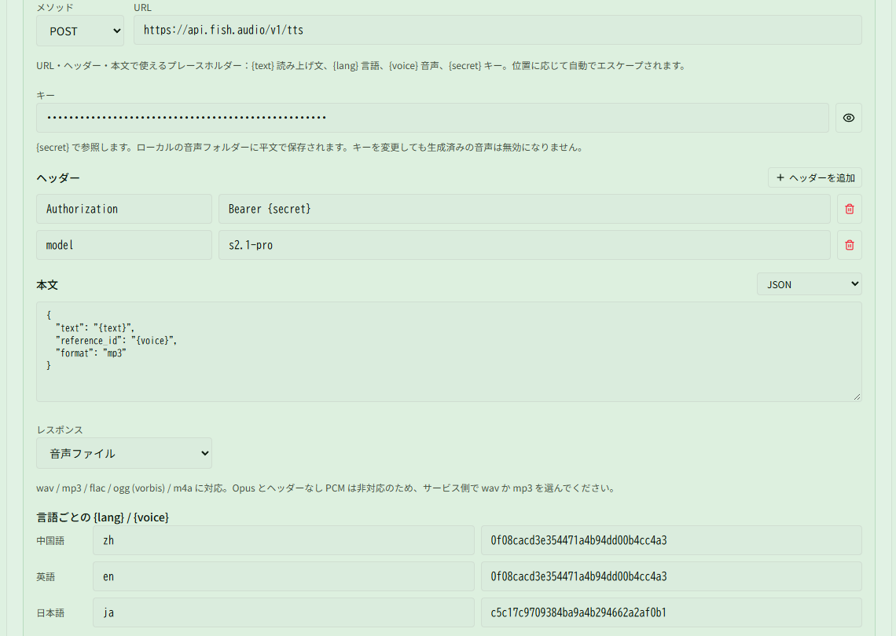

# Changelog v0.2.7

## 更新内容

### カスタム監視

- カスタムカウンターを刷新しました。スキルの発動 / 命中、Buff の取得 / 消費、移動距離、戦闘リソースなどを加算元にでき、各スロットに目標値、表示形式、リセット動作、一時停止、クールダウンを設定できます。
- プリセットからコピーでき、スキル・ダメージ・Buff を名前または ID で検索できます。保存したカウンターはカスタムパネルに追加でき、目標到達時の音声も設定できます。
- 因子区とシーズンノード区が自動同期されます。S4 以降は有効なシーズンノード Buff を直接表示できます。旧カスタムカウンター規則は移行時に整理され、対応するパネル項目と音声設定も削除されます。

### スキル CD と音声

- スキル CD を複数の独立した領域に分けられます。領域ごとに名前、位置、サイズ、1～10 行 / 列、アイコン間隔を設定でき、ドラッグ交換、キーボード移動、コンパクト配置、ロードアウトの入出力に対応します。
- 攻撃・生存・補助・図鑑に分類した職責スキルを追加し、チャージ表示、アイコン、データを追加しました。
- 幻想スキルを CD 表示と音声読み上げに個別追加できます。職業・幻想・職責スキルは合計 10 枠を共有し、音声だけを設定する場合は CD 表示に追加する必要がありません。
- スキルアイコンに属性色の背景とスキル変化表示を追加しました。味方の CD も同じ表示になります。

### モンスター監視とミニマップ

- モンスタースキル監視が、近くにいる任意のモンスターのリスト内スキルを監視できるようになりました（[@nekoyama32767](https://github.com/nekoyama32767)）。表示時間、順序、別名、音声を設定できます。モンスタースキル区は既定で非表示です。
- ミニマップが新しいパーティマーク情報を解析し、マークされた味方に対応するアイコンを表示します。マーク表示設定も追加しました。
- S4「蒼穹の上、昼夜の果て」の一部ギミックとアイコンを追加しました（テスト機能）。

### 音声

- HTTP 音声サービスを追加しました。OpenAI 互換 API、Google Cloud TTS、自作の GET 中継サービスに対応し、URL、ヘッダー、本文、レスポンス形式、`{text}`、`{lang}`、`{voice}`、`{secret}` を設定できます。
- サービスを追加した後、フレーズ生成または読み上げ設定で HTTP と該当サービスを選択してください。選択しない場合はプリセット音声が使われます。保存前にリクエストをテストでき、生成した音声はローカルに保存されるため、再生時の通信やローカル音声モデルは不要です。

### モジュール計算とビルド

- Windows の CUDA ビルドを改善し、MSVC と MinGW の CMake キャッシュを分離、PATH の変更を検知し、CMake の診断を見やすくしました。CUDA が使えない場合は CPU にフォールバックします（[@nekoyama32767](https://github.com/nekoyama32767)）。
- モジュール計算の特殊属性文字列を更新し、コンパイラーによる文字コード差を避けました。

## ドキュメント

- HTTP 音声サービスの設定例と使い方を追加しました。
- リアルタイム DPS ウィンドウから履歴を開き、絞り込み、戦闘を切り替える方法を追加しました。
- カスタムカウンター、スキル CD、職責スキル、モンスタースキルの説明を更新しました。

## 注意事項

- 旧カスタムカウンター規則は移行時に新方式へ置き換えられます。旧パネル項目と音声設定は引き継がれません。
- リモートの HTTP サービスにはフレーズの文が送信されます。キーはローカルの音声フォルダーに保存され、共有ロードアウトには含まれません。
- プリセット・クローン・微調整音色には音声モデルが必要ですが、HTTP 音声サービスでは不要です。

### 互換性

- 0.0.2 または 0.0.3 を使用していた場合、0.0.4〜0.2.7 を初めて使う際は `%LOCALAPPDATA%\resonance-logs-cn` 配下の `resonance-logs-cn.db` を削除してからアプリを再起動してください
- 0.2.2 と 0.2.1 は大規模な再構築を行っています。既存機能に問題があれば速やかにご連絡ください
- 0.2.2 はテーブルフィールドを変更しています。古い履歴レコードのエラーは想定どおりで、新しい記録は正常です
- 音声読み上げはモデルを別途ダウンロードする必要があります。初回のフレーズ生成には時間がかかることがありますが、生成後の再生ではモデルを再読み込みしません。HTTP 音声サービスではモデルは不要です

### 特に注意

- コードを改変して PR せずに配布する場合は、アプリ名・バージョンなど本家の識別情報を必ず変更し、誤解を招かないようにしてください
- 閉じるボタンは右下に隠れます。ウィンドウが多い場合は隠れバーを右下へドラッグして表示できます
- よくある質問は利用マニュアルの HTML を参照してください

### コミュニティ

- QQ グループ：`1084866292`
- Discord：https://discord.gg/RHeX47wvDU
