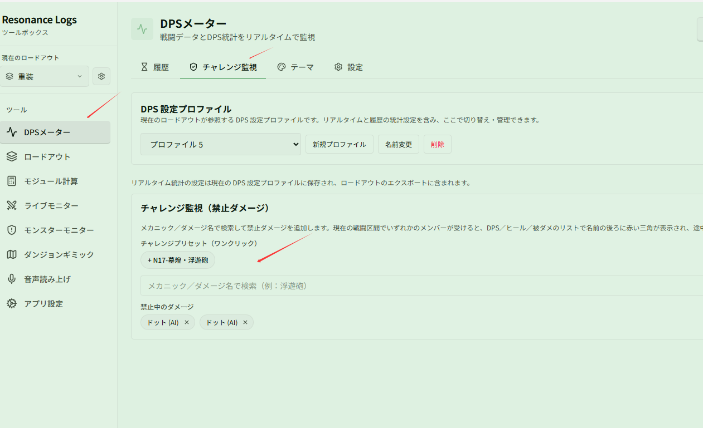

# チャレンジ監視

**{{ui:routes.tools.dps}} → {{ui:routes.dps.challenge}}** では「禁止ダメージ」を登録できます。メンバーが現在の戦闘区間でこれらのダメージを受けると、名前の横に**赤い三角**の警告が表示されます。

「特定のギミックに当たってはいけない」というチャレンジ目標向けで、戦闘の途中でチャレンジがすでに失敗しているかどうかがわかります。

禁止ダメージはチャレンジごとの**グループ**で管理します。グループは現在の装備セットに属し、装備セットをエクスポートすると一緒に含まれます。

## 禁止ダメージを追加する

1. **{{ui:challengeWatch.presets.title}}** で内蔵プリセット（例：**{{ui:challengeWatch.preset.n17Fuyoupao}}**）をクリックすると、グループとして **{{ui:challengeWatch.configuredTitle}}** に追加されます。
2. または **{{ui:challengeWatch.group.new}}** で空のグループを作って名前を付け、**{{ui:challengeWatch.group.addDamage}}** から検索します。
   - ギミック名やダメージ名で検索（例：「浮遊砲」）；
   - ダメージ ID で前方一致検索（例：「#110098」、`#` は省略可）。結果が多いときは「さらに表示」でページを送ります；
   - 完全な ID を入力して Enter を押すと、名前の付いていないダメージも直接追加できます。
3. グループ内の各ダメージは「名前 #ID」で表示されるため、同じ名前の別ダメージも区別できます。× で削除します。



## マイプリセット

グループの **{{ui:challengeWatch.group.saveAsPreset}}** を押すと、そのグループが **{{ui:challengeWatch.presets.mine}}** に表示され、どの装備セットからもワンクリックで追加できます。

- プリセットはテンプレートです。追加すると独立したグループになり、あとでプリセットを変更しても追加済みのグループには影響しません。
- マイプリセットから追加したグループを編集したら、**{{ui:challengeWatch.group.updatePreset}}** で変更をプリセットに保存できます。
- マイプリセットを削除しても、追加済みのグループは削除されません。

## 警告が表示される場所

赤い三角は、ライブウィンドウの DPS・回復・被ダメージの各リストで、該当メンバーの名前の後ろに表示されます。マウスを重ねると、受けたダメージがグループごとに名前・ID・命中回数付きで表示されます。例：

```
禁止ダメージを受けた
N17-墓煌・浮遊砲
・ファンネルレーザー直線（呪われし煌墓） #110098140104 ×2
・浮遊砲の包囲レーザー射撃 #110098130103 ×1
```


警告は**現在の戦闘区間**のみが対象で、戦闘の区切りやリセットの後は改めて判定されます。

## 例

- [チャレンジダンジョンで浮遊砲を受けたのは誰か確認する](./examples/challenge-hits.md)
