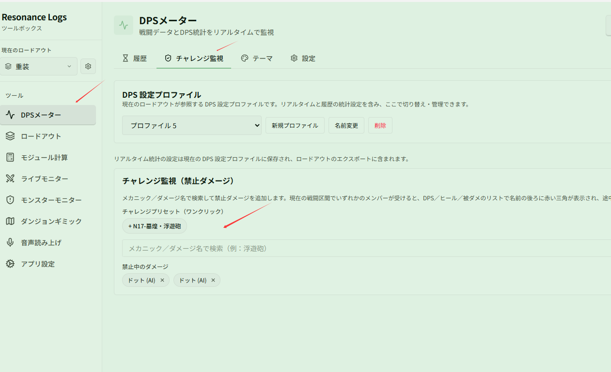

# チャレンジダンジョンで浮遊砲を受けたのは誰か確認する

関連ページ：[チャレンジ監視](../challenge.md)

**シナリオ**：N17 墓煌には「浮遊砲に当たらない」というチャレンジ目標があります。戦闘が終わってから気づくのではなく、途中でチャレンジが失敗しているかどうかを知りたい場合です。

## 設定

1. **{{ui:routes.tools.dps}} → {{ui:routes.dps.challenge}}** を開きます。
2. プリセット **{{ui:challengeWatch.preset.n17Fuyoupao}}** をクリックするか、検索ボックスに「浮遊砲」と入力して手動で追加します。
3. **{{ui:challengeWatch.configuredTitle}}** に表示されていることを確認します。

## 実戦

戦闘に入ったあと、いずれかのメンバーが浮遊砲に当たると、ライブウィンドウでそのメンバーの名前の後ろに**赤い三角**が表示されます。マウスを重ねると、命中したダメージ名を確認できます。

赤い三角が見えたら、すぐにやり直すかどうかを判断して時間を節約できます。

## ほかのチャレンジ

「特定のギミックを受けてはいけない」チャレンジなら、同じ方法が使えます。検索ボックスでギミック名やダメージ名を検索して追加するだけです。不要になったら一覧から削除し、通常の戦闘で誤って警告が出ないようにしましょう。
