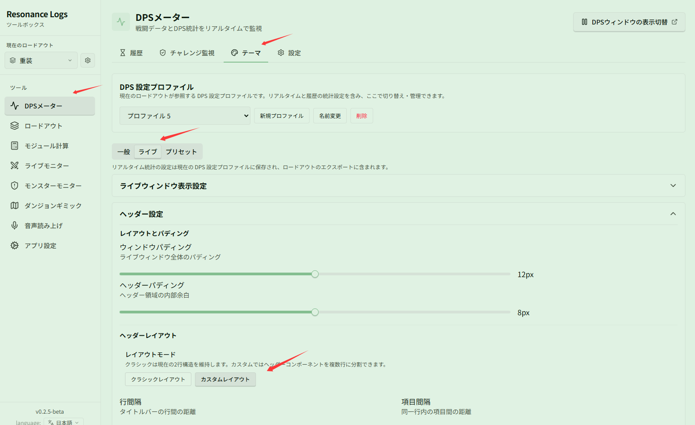
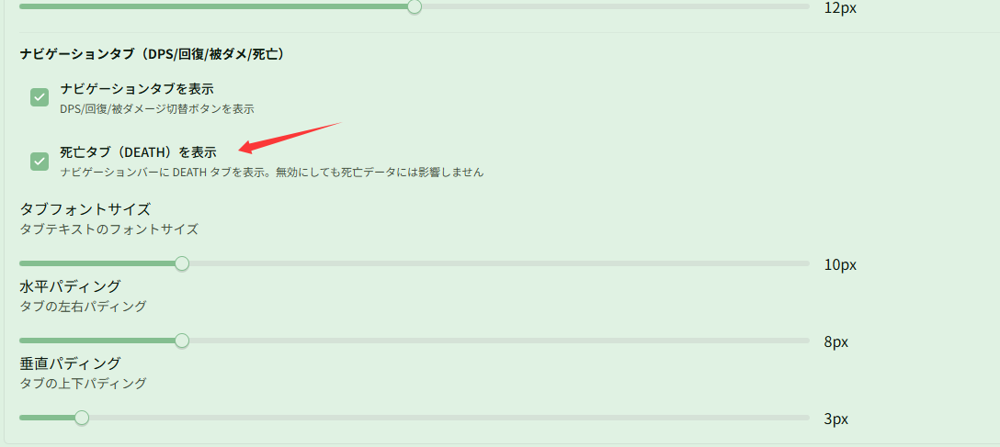

# ヘッダーのカスタムレイアウトと死亡リプレイ

関連ページ：[テーマと外観](../themes.md)

**シナリオ**：ライブ DPS ウィンドウのヘッダーレイアウトを自由にカスタマイズし、戦闘中にいつでも DEATH タブに切り替えてメンバーの死亡統計や死亡リプレイを確認したい場合です。

## ステップ 1：カスタムレイアウトに切り替える

**{{ui:routes.tools.dps}} → {{ui:routes.dps.themes}} → {{ui:themes.tabs.live}}** の **{{ui:themes.header.title}}** で、**{{ui:themes.header.layout}}** の **{{ui:themes.header.layoutMode}}** を **{{ui:themes.header.layoutMode.custom}}** に切り替えます。

カスタムレイアウトに切り替えると、タイマー、エンカウント名、訓練用ダミー状態、総ダメージ、総 DPS、Boss HP、操作ボタン、ナビゲーションタブなどのコンポーネントを複数行に自由に配置し、左右の揃え位置、順序、間隔を調整できます。

## ステップ 2：死亡タブ（DEATH）を有効化する

**{{ui:themes.header.title}}** で下にスクロールして **{{ui:themes.header.navigationTabs}}** を見つけ、**{{ui:themes.header.showDeathTab}}** をオンにします。

有効にすると、ライブ DPS ウィンドウのナビゲーションバーに **DEATH** タブが表示されます。戦闘中や全滅後にこのタブをクリックすると、メンバーの死亡回数、総被ダメージ、致命傷を与えたスキルや被ダメージ履歴などの死亡リプレイ情報を直接確認できます。

