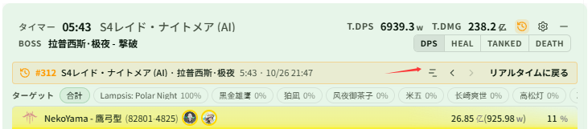
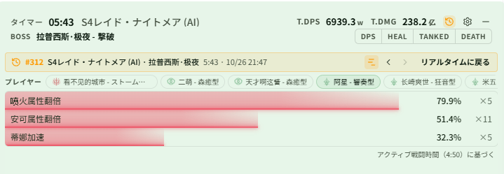

# リアルタイムウィンドウで履歴戦闘のバフ稼働率を確認する

関連ページ：[履歴](../history.md#リアルタイムウィンドウで履歴を見る)

**シナリオ**：レイドを 1 回終えたところで、味方の重要な強化 Buff（属性倍化やティナの加速など）がどれだけ維持できていたかをすぐに確認し、次の回のローテーションを調整したい。メインウィンドウに戻って履歴の詳細を開くのではなく、リアルタイムウィンドウのまま確認したい。

## ステップ 1：準備（最初の 1 回だけ）

1. **{{ui:routes.tools.skillMonitor}} → {{ui:skillMonitor.tabs.buffCoverage}}** を開き、集計する Buff を監視リストに追加します。[バフ稼働率](../../monitor/buff-coverage.md#監視を追加する) を参照してください。追加した後の戦闘から記録されます。
2. **{{ui:routes.tools.dps}} → {{ui:routes.dps.themes}} → {{ui:themes.tabs.live}} → {{ui:themes.header.title}}** で **{{ui:themes.header.showHistoryButton}}** を有効にします。

## ステップ 2：終えたばかりの戦闘を開く

戦闘が終わったら、リアルタイムウィンドウのヘッダーにある履歴ボタン（ツールチップ **{{ui:live.header.tooltip.history}}**）をクリックし、**{{ui:live.history.quick.currentBoss}}** でこの Boss の記録に絞り込んで、一番上の戦闘をクリックします。リアルタイムウィンドウの上部に履歴バナーが表示され、シーン、Boss、戦闘時間、終了時刻が出ます。

## ステップ 3：稼働率ページを開く

バナーの稼働率ボタン（ツールチップ **{{ui:live.history.banner.coverage}}**）をクリックします。

## ステップ 4：プレイヤーを選んで確認する

ページ上部の **{{ui:live.coverage.playersLabel}}** 欄では、最初は自分が選ばれています。味方をクリックすると、1 行に 1 つずつ Buff が表示されます：

- バーの長さとパーセントが稼働率です。**アクティブ戦闘時間**で計算するため（ページ右下にこの戦闘のアクティブ時間が表示されます）、Boss の無敵や場面転換の空白で数値が下がることはありません；
- 右側の ×N はこの戦闘での発動回数です；
- 行にマウスを合わせると、Buff ID、維持時間 / アクティブ時間、発動回数が表示されます。

下図では「阿星 - 響奏型」を選んでいます。アクティブ時間 4:50 のうち、1 つ目の Buff は 79.9%（発動 5 回）維持できていますが、3 つ目は 32.3% しかないので、次の回はそこを重点的に見直せます。

プレイヤー欄と各行の並び順：

- プレイヤーは自分 → ヒーラー → タンク → アタッカーの順に並び、同じクラスの人は隣り合います。この戦闘で監視中の Buff が 1 つも記録されなかった味方は表示されません；
- Buff は **{{ui:skillMonitor.tabs.buffCoverage}}** のリストの順に並びます。この戦闘で一度も付かなかった Buff はグレー表示で「—」となり、最後に並びます；
- バーの色は選んだプレイヤーのクラスに合わせ、プレイヤー名はリアルタイムウィンドウの名前表示設定に従います。

## ステップ 5：前の回と比べる

- バナーの **{{ui:live.history.banner.older}}** / **{{ui:live.history.banner.newer}}** で戦闘を切り替えます。稼働率ページのままで、選んだ味方もそのまま保たれます。切り替えた戦闘にその味方がいない場合は、自分が表示されます。
- 稼働率ボタンをもう一度押すと、開く前の統計ページ（DPS、HEAL など）に戻ります。**{{ui:live.history.banner.backToLive}}** でリアルタイムのデータに戻ります。

> [!TIP]
> どこで途切れたかを知りたい場合は、メインウィンドウの履歴詳細にある Buff カバータイムラインを開いてください。[パーティの強化 Buff 稼働率を振り返る](../../monitor/examples/buff-coverage.md) を参照してください。

> [!NOTE]
> - 稼働率ページは履歴を見ているときだけ使えます。戦闘中に自分の稼働率を見るには、ライブモニターのオーバーレイのバフ稼働率エリアを使ってください。
> - 履歴を見ている間に新しい戦闘が始まると、バナーに **{{ui:live.history.banner.liveFighting}}** と表示されますが、自動ではリアルタイムに戻りません。
