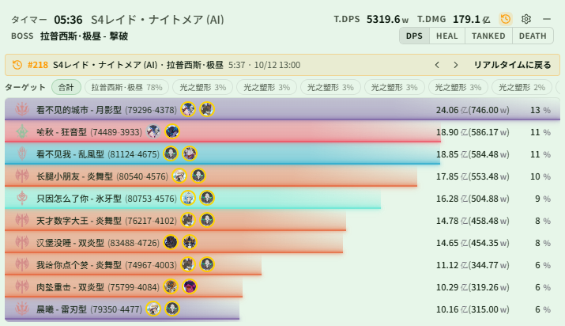

# おすすめスタイルをワンクリックで適用する

関連ページ：[テーマと外観](../themes.md)

**シナリオ**：DPS ウィンドウの配色、列、ヘッダーをいじっているうちにまとまりがなくなってしまいました。開発者がすすめる一式のスタイルをそのまま使い、そこから微調整したいとします。ゲームオーバーレイの各パネルも、まとめて統一した配色にしたいところです。

## ステップ 1：おすすめスタイルを適用する

1. **{{ui:routes.tools.dps}} → {{ui:routes.dps.themes}}** を開き、**{{ui:themes.tabs.presets}}** に切り替えます。
2. 一番上の **{{ui:themes.presets.reference.title}}** にある **{{ui:themes.presets.reference.name}}** をクリックします。
3. 確認画面に、上書きされる設定（配色、テーブル、ヘッダー、表示形式、列、履歴の表示）が表示されます。チャレンジ監視の禁止ダメージは保持されます。確認して適用します。

> [!NOTE]
> おすすめスタイルは、現在のロードアウトの DPS 設定プロファイルに書き込まれます。複数のロードアウトがこのプロファイルを共有している場合は、確認画面にそれらが表示され、まとめて変わります。

## 結果

ライブウィンドウと履歴の詳細が、おすすめの配色、列、ヘッダー配置に切り替わります。

## ステップ 2：必要に応じて微調整する

おすすめスタイルをもとに、**{{ui:themes.tabs.general}}**、**{{ui:themes.tabs.live}}** で透明度や文字サイズなどを調整したり、[表示設定](../settings.md) で列を増減したりします。おすすめスタイルに戻したいときは、もう一度適用するだけです。

## ステップ 3（任意）：ゲームオーバーレイの配色をまとめて変える

**{{ui:routes.tools.skillMonitor}}** と **{{ui:routes.tools.monsterMonitor}}** のページ上部にある **{{ui:hudScheme.open}}** で、現在のロードアウトのゲームオーバーレイのパネルに 1 つの配色（{{ui:hudScheme.scheme.vivid.name}}・{{ui:hudScheme.scheme.ice.name}}・{{ui:hudScheme.scheme.amber.name}}・{{ui:hudScheme.scheme.jade.name}}・{{ui:hudScheme.scheme.violet.name}}・{{ui:hudScheme.scheme.muted.name}}）を適用できます。変わるのは名前・数値・進捗バーの色だけで、文字サイズ、間隔、背景はそのままです。HP、スタン、Boss の予告などの意味のある色は、どの配色でも保持されます。

> [!TIP]
> 新規インストール時は、DPS ウィンドウは最初からおすすめスタイルで、ゲームオーバーレイは「{{ui:hudScheme.scheme.vivid.name}}」の配色です。
