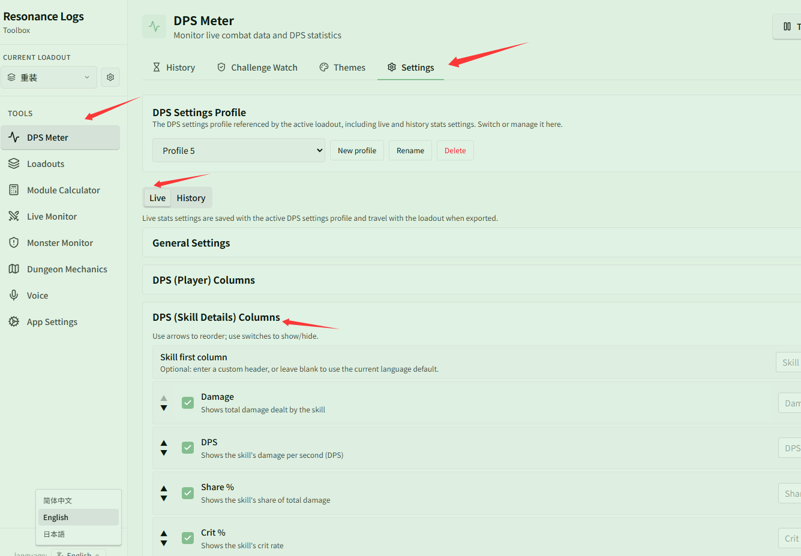
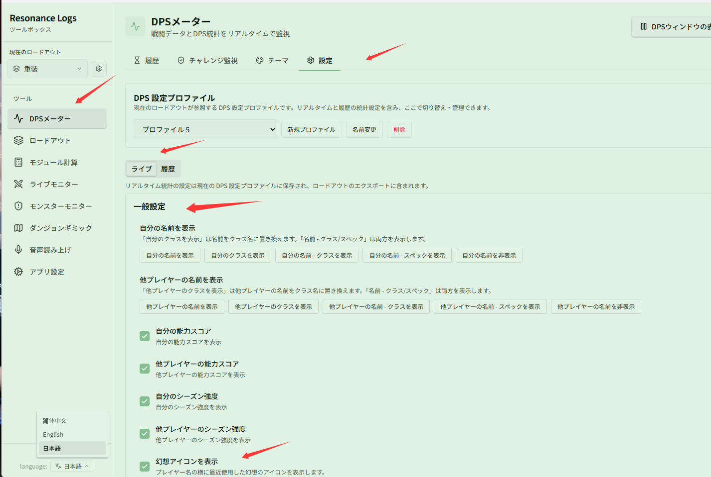
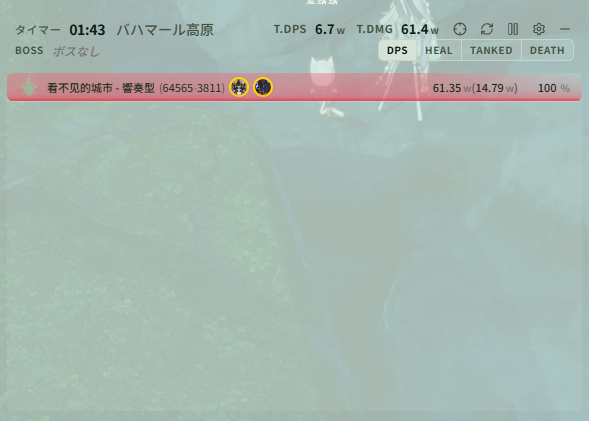

# テーブルの表示列をカスタマイズする

関連ページ：[表示設定](../settings.md)

**シナリオ**：ライブ DPS ウィンドウや履歴詳細のスキル詳細テーブルに表示する列を調整し（ダメージ、DPS、会心率だけに絞るなど）、列名を好みのカスタム見出しに変更したい。さらにスペック、能力スコア、シーズン強度、幻想アイコンなどの追加情報も表示させたい場合です。

## ステップ 1：該当テーブルの列設定を開く

**{{ui:routes.tools.dps}} → {{ui:routes.dps.settings}}** を開きます。

変更したい対象に合わせて **{{ui:settings.tabs.live}}** または **{{ui:settings.tabs.history}}** タブを選択します：
- **ライブと履歴は個別に設定**：**{{ui:settings.tabs.live}}** で変更した列構成はライブオーバーレイにのみ反映されます。履歴詳細のテーブル列を変更したい場合は、**{{ui:settings.tabs.history}}** タブで個別に設定します（死亡リプレイ列のみライブと履歴で共通です）。

**{{ui:settings.common.columns.dpsSkills}}**（またはプレイヤー列、回復列、被ダメージ列など）までスクロールします：

## ステップ 2：列の表示切替、並べ替え、カスタム列名の設定

- **表示 / 非表示**：各列のスイッチをクリックして表示・非表示を切り替えます。
- **並べ替え**：上下の矢印で列の表示順を変更します。
- **カスタム表示名**：右側の入力欄にカスタム列名を入力できます（空欄にすると現在の言語の既定の列名が使用されます）。リセットボタンをクリックすればいつでも既定の名前に戻せます。

## ステップ 3：一般設定で表示情報を設定（スペック、スコア/強度、幻想アイコン）

**{{ui:settings.tabs.live}} → {{ui:settings.common.general}}** では、プレイヤー行に表示する追加情報も設定できます：
- **名前とスペック**：**{{ui:settings.common.name.your}}** / **{{ui:settings.common.name.others}}** で「**{{ui:settings.common.name.option.yourNameSpec}}**」を選択すると、名前の横にクラススペックが表示されます。
- **能力スコアとシーズン強度**：**{{ui:settings.common.ability.your}}** や **{{ui:settings.common.seasonStrength.your}}** などをオンにすると、名前の後ろの括弧内にスコアとシーズン強度（例：`(64565-3811)`）が表示されます。
- **幻想アイコンを表示**：**{{ui:settings.live.fantasyCastIcons}}** をオンにすると、最近発動した幻想のアイコンがプレイヤー名の横に表示されます。

## 設定後の表示結果

設定が完了すると、ライブ DPS ウィンドウには選択した列が表示され、プレイヤー行にはスペック、能力スコア、シーズン強度、および幻想アイコンが表示されます：

