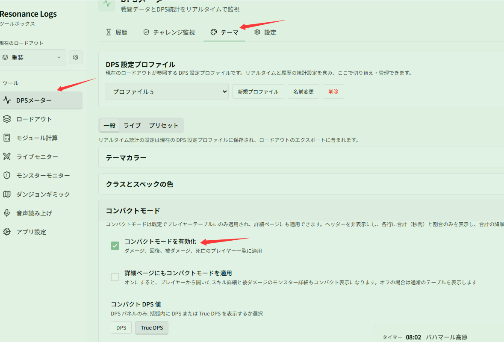
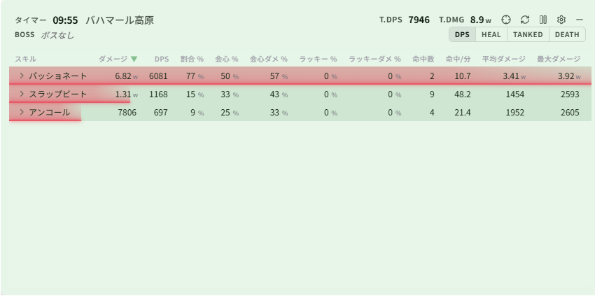
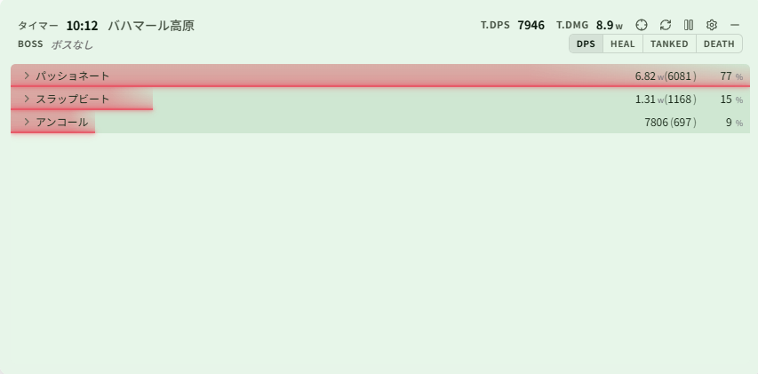

# 透明なミニマル DPS ウィンドウ

関連ページ：[テーマと外観](../themes.md)

**シナリオ**：画面の隅に半透明の小さなウィンドウを置き、全員の DPS と割合だけを表示したい。テーブルヘッダーは不要で、ゲーム操作の邪魔もしてほしくない場合です。

## ステップ 1：コンパクトモードをオンにする

**{{ui:routes.tools.dps}} → {{ui:routes.dps.themes}} → {{ui:themes.tabs.general}}** の **{{ui:themes.compact.title}}** で **{{ui:themes.compact.enable}}** をオンにし、括弧内の種類に **{{ui:themes.compact.option.tdps}}**（または **{{ui:themes.compact.option.dps}}**）を選びます。プレイヤー一覧の各行に名前、合計（DPS / True DPS）、割合のみが表示されます。

コンパクトモードは既定でプレイヤー一覧にのみ適用されます。プレイヤーをクリックしてスキル詳細（または被ダメージのモンスター詳細）を開くと、通常どおり完全なテーブルが表示されます：

詳細ページもシンプルにしたい場合は、**{{ui:themes.compact.includeDetails}}** をオンにします。スキル詳細もヘッダーなしのコンパクトな1行形式で表示されるようになります：

## ステップ 2：背景を透明にする

**{{ui:themes.tabs.general}} → {{ui:themes.section.colorThemes}} → {{ui:themes.section.customColorTheme}}** で **背景（ライブ）** を見つけ、透明度を 30%～50% に調整します。

明るい場面で文字が見えにくい場合は、**{{ui:themes.table.rowGlowOpacity}}** を少し上げてカラーバーをはっきりさせましょう。

## ステップ 3：クリックスルーをオンにする

**{{ui:themes.tabs.live}} → ライブウィンドウ表示設定 → {{ui:themes.liveDisplay.clickthrough}}** をオンにします。以降、マウス操作はウィンドウを通り抜けます。

> [!IMPORTANT]
> クリックスルーをオンにすると、マウスでウィンドウをドラッグしたりリセットしたりできなくなります。先に [アプリ設定 · ショートカット](../../app/README.md#ショートカット) で「クリックスルーの切替」と「エンカウントをリセット」を割り当て、必要なときはショートカットで操作することをおすすめします。

## 元に戻したいとき

**{{ui:themes.tabs.general}} → {{ui:themes.compact.title}}** で **{{ui:themes.compact.enable}}** をオフにし、背景の透明度を戻すか、**{{ui:themes.tabs.presets}}** でプリセットを選び直します。
