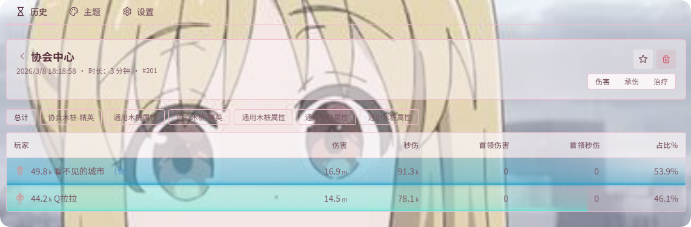

# 履歴

**{{ui:routes.tools.dps}} → {{ui:routes.dps.history}}** には自動で区切られたすべての戦闘が保存され、いつでも開いて振り返ることができます。

## 履歴一覧

- **絞り込み**：**{{ui:history.list.filters.favorite}}**、ボス、プレイヤー、エンカウントで絞り込み。**{{ui:history.list.filters.favoriteOnly}}** をクリックするとお気に入りだけを表示します。
- **一括削除**：複数の記録にチェックを入れて **{{ui:history.list.actions.delete}}** をクリック。削除は元に戻せません。
- **ページ送り**：下部で 1 ページあたりの行数を設定できます。

> [!NOTE]
> 既定では **未お気に入りの記録を 200 件** 保持します。アプリ設定で 1～2000 件に変更でき、変更は次回起動時に古い記録から時間順で整理されます。**お気に入りに追加** しておけば削除されません。

## 戦闘の詳細

任意の記録をクリックすると詳細が開きます。上部には **{{ui:history.detail.tabs.damage}}**、**{{ui:history.detail.tabs.tanked}}**、**{{ui:history.detail.tabs.healing}}**、**{{ui:history.detail.tabs.death}}** の 4 つのタブがあります。

右上の操作：

| ボタン | 機能 |
| --- | --- |
| **{{ui:history.detail.actions.addFavorite}}** | この戦闘をお気に入りに登録し、一覧ですばやく絞り込めるようにする |
| **メモを編集** | この戦闘にメモを付け、履歴一覧に表示する |
| **ウェブサイトで開く** | resonance-logs.com でこの戦闘を表示 |
| **削除** | この記録を削除 |

プレイヤーをクリックすると、スキル詳細（最大 / 最小 / 平均ダメージを含む）と、**ダメージ対象 / 回復対象 / ダメージソース** 別の内訳を確認できます。たとえば、自分のダメージが Boss に入っているのか雑魚に入っているのかを確認できます。

## タイムライン

詳細ページの **{{ui:history.timeline.title}}** は戦闘全体を時間軸で展開します：

- **曲線**：**{{ui:history.timeline.series.instant}}** はその時点の火力の上下を、**{{ui:history.timeline.series.average}}** は全体の傾向を示します。表示するメンバーの曲線を選択できます。
- **レーン**：**{{ui:history.timeline.lanes.boss}}** レーンには Boss のスキル、**{{ui:history.timeline.lanes.team}}** レーンにはメンバーの主要スキルと幻想の発動が表示されます。

操作方法：**ドラッグ** で範囲選択 · **Shift + ドラッグ** でパン · **スクロール** でズーム · **ダブルクリック** でリセット · 下端をドラッグして高さを調整。

範囲を選択すると、ページ上のダメージ統計が**選択範囲だけで再計算**されます。**{{ui:history.timeline.selection.zoomToRange}}** をクリックすると拡大表示できます。

## Buff カバー率

[Buff カバー率](../monitor/buff-coverage.md) で監視リストを設定している場合、履歴の詳細に次の内容が追加で表示されます：

- **{{ui:history.timeline.buff.title}}** 行：タイムラインのヘッダーにある **{{ui:history.timeline.buff.title}}** をクリックして展開すると（初期状態は折りたたみ）、スキルレーンと曲線の間に自分の各 Buff の有効期間が表示され、左側にカバー率が出ます。ほかのプレイヤーは隣の **{{ui:history.timeline.buff.players}}** セレクターでチェックを入れます（自分が先頭に表示され、味方レーンの選択とは独立しています）。**{{ui:history.timeline.buff.groupByPlayer}}** / **{{ui:history.timeline.buff.groupByBuff}}** でグループを切り替えられ、灰色の斜線はカバー率に含まれない非アクティブ戦闘時間です。ホバー、ドラッグ選択、ズームは上のレーンと同じです；
- **{{ui:history.buffCoverage.title}}**：1 行に 1 つの Buff で、各プレイヤーのアクティブ戦闘時間を基準にしたカバー率と発動回数。

> [!NOTE]
> カバー率データは v0.2.3 から記録されています。それ以前の履歴にはこの内容はありません。

監視リストの設定から戦闘後の振り返りまでの流れは、[例：パーティの強化 Buff 稼働率を振り返る](../monitor/examples/buff-coverage.md) を参照してください。

## 履歴ページの表示設定

レーンの行の高さ、曲線の高さ、瞬間 DPS の集計時間、履歴テーブルの列は、すべて **{{ui:routes.dps.settings}} → {{ui:settings.tabs.history}}** で設定します。[表示設定](./settings.md#履歴) を参照してください。

## 例

- [タイムラインで火力の空白を見つける](./examples/timeline-gaps.md)