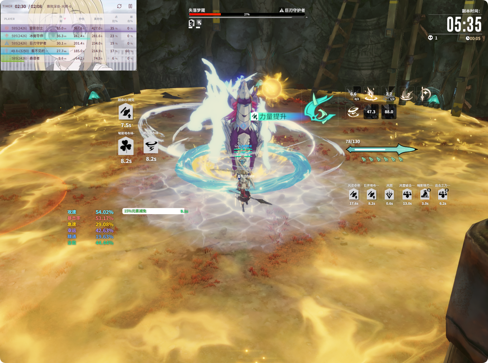

# ライブモニター

**{{ui:routes.tools.skillMonitor}}** は、ゲーム画面の上に透明なオーバーレイ（ライブモニターのオーバーレイ）を重ねて、**あなた自身**のスキル CD、リソース、Buff、因子、キャラクター属性、シールドを表示します。

## できること

- スキルバーを見なくても重要スキルのクールダウンを把握でき、CD が戻ったら音声で知らせる；
- バースト Buff、幻想の強化、料理・薬剤が切れていないかを見張る；
- 現在装備している**因子エネルギーとシーズンノード効果**を自動表示する；
- 攻撃速度・クリティカルなどの属性やシールド吸収量をリアルタイムで確認する；
- 自分の重要な強化 Buff の稼働率を集計する。

## 上部のスイッチ

**{{ui:skillMonitor.profile.title}}** カードには、現在のロードアウト、モニター設定、実際のクラスがどのタブでも表示されます。設定の選択肢にはクラス名も表示されます。ロードアウト名からクラスを推測することはありません。

複数のロードアウトが同じ設定を使う場合、選択欄の下に共有先が表示されます。**{{ui:skillMonitor.profile.copy}}** は現在のロードアウトだけに関連付けた独立したコピーを作成します。名前は後から変更できます。

クラスを変更すると、選択済みスキル、スキル音声設定、スキル枠の割り当てがクリアされます。Buff、カスタムパネル、リソース配置は保持されます。スキルや音声設定がある場合は確認が必要です。共有設定では、現在のロードアウト用にコピーするか、共有設定を変更するかを必ず選択します。

ページ上部は、どのタブでも表示されます：

| スイッチ                                                 | 役割                                                                                       |
| -------------------------------------------------------- | ------------------------------------------------------------------------------------------ |
| **{{ui:skillMonitor.main.enabled.label}}**               | マスタースイッチ。オフにするとオーバーレイはデータを受け取らなくなります                   |
| **{{ui:skillMonitor.main.autoHideInDailyScenes.label}}** | メインシティなどの日常シーンではオーバーレイを自動的に隠し、戦闘シーンに入ると再表示します |
| **{{ui:skillMonitor.layout.toggleOverlayWindow}}**       | オーバーレイの表示 / 非表示                                                                |
| **{{ui:skillMonitor.layout.editOverlayLayout}}**         | レイアウト編集に入り、各エリアをドラッグ・リサイズします                                   |

## ページ構成

| タブ                                      | オーバーレイでの表示                                                   | ドキュメント                                   | 例                                                                                                                                                                                               |
| ----------------------------------------- | ---------------------------------------------------------------------- | ---------------------------------------------- | ------------------------------------------------------------------------------------------------------------------------------------------------------------------------------------------------ |
| **{{ui:skillMonitor.tabs.skillCd}}**      | スキルのクールダウンアイコン                                           | [スキル CD](./skill-cd.md)                     | [クラススキルと幻想スキルを分けて配置する](./examples/skill-cd-regions.md)                                                                                                                       |
| **{{ui:skillMonitor.tabs.buff}}**         | 自身の Buff アイコンまたはプログレスバー                               | [Buff モニター](./buff.md)                     | [ティナの CD が戻ったら音声で知らせる](./examples/tina-cd.md) · [複合 Buff で 3 スタック監視](./examples/attribute-symphony.md) · [掛け直すべきものだけ表示](./examples/symphony-most-urgent.md) |
| **{{ui:skillMonitor.tabs.panelAttr}}**    | キャラクター属性の数値                                                 | [キャラクターパネル](./panel-attr.md)          | [バースト中にステータスを確認する](./examples/burst-attributes.md)                                                                                                                               |
| **{{ui:skillMonitor.tabs.customPanel}}**  | 因子エリア、シーズンノードエリア、自由に組み合わせた Buff とカウンター | [カスタムモニター](./custom-panel.md)          | [因子エネルギーとシーズンノードを自動表示する](./examples/factor-energy.md) · [プリセットカウンターで絶対幸運を見張る](./examples/preset-counter.md)                                             |
| **{{ui:skillMonitor.tabs.shieldDetail}}** | HP とシールドのバー                                                    | [HP/シールドエリア](./shield.md)               | [タンクはあとどれだけ耐えられるか](./examples/tank-shield.md)                                                                                                                                    |
| **{{ui:skillMonitor.tabs.buffCoverage}}** | 強化 Buff の稼働率                                                     | [バフ稼働率](./buff-coverage.md)               | [パーティの強化 Buff 稼働率を振り返る](./examples/buff-coverage.md) · [リアルタイムウィンドウで履歴戦闘のバフ稼働率を確認する](../dps/examples/live-buff-coverage.md)                            |
| **{{ui:skillMonitor.tabs.overlay}}**      | 上記各エリアを表示するかどうかを制御                                   | [ウィンドウの有効化とレイアウト](./overlay.md) | [リソース区分でクラスリソースを見る](./examples/resource-bar.md)                                                                                                                                 |

すべての設定は現在のロードアウトの **スキル監視プロファイル** に保存され、ロードアウトを切り替えれば設定一式がまとめて切り替わります。[ロードアウト](../app/loadouts.md) を参照してください。

> [!WARNING]
> ゲームの途中でアプリを開いた場合、スキル CD・属性・因子が一部しか表示されないことがあります。ゲームは変化したデータしか送らないためです。**シーンを一度切り替える**と完全に同期されます。
