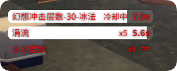
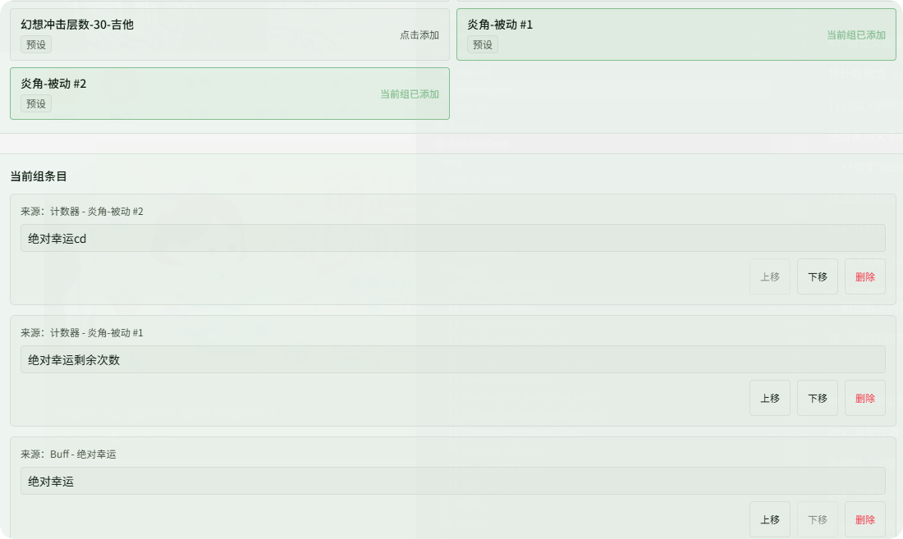
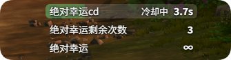

# カスタムモニター

**{{ui:routes.tools.skillMonitor}} → {{ui:skillMonitor.tabs.customPanel}}** では、オーバーレイに複数の**テキストモニターエリア**を作成できます。各エリアは独立したリストで、個別にドラッグ・リサイズ・スタイル設定ができます。

## 3 種類のモニターエリア

| 種類 | 作成方法 | 内容 | 設定は必要？ |
| --- | --- | --- | --- |
| **{{ui:skillMonitor.customPanel.kind.factor}}** | **{{ui:skillMonitor.customPanel.newFactor}}**（S3 以前のシーズン） | 現在装備している因子のエネルギー、因子 Buff 効果 | 不要。自動生成 |
| **{{ui:skillMonitor.customPanel.kind.seasonNode}}** | **{{ui:skillMonitor.customPanel.newFactor}}**（S4 以降） | 有効化済みシーズンノードの Buff 効果 | 不要。自動生成 |
| **{{ui:skillMonitor.customPanel.kind.manual}}** | **{{ui:skillMonitor.customPanel.new}}** | 手動で選んだ Buff とカウンター | 必要 |

**{{ui:skillMonitor.customPanel.newFactor}}** をクリックすると、アプリが現在のシーズンに応じて作成する種類を自動で決めます。S4 以降はシーズンノードエリア、それ以前のシーズンでは因子設定エリアになります。

> [!IMPORTANT]
> 因子やノードの発動状況を見たいなら、**因子エリアを新規作成するだけ**で十分です。旧バージョンのように「カスタムカウンタールール」で Sources と Slots を手動で組み合わせる必要はありません。

## 因子設定エリア

作成すると、現在装備している因子に基づいて項目が自動生成されます。よくあるものは次のとおりです：

- **真実因子 A / B エネルギー**：カウントの進捗；
- **真実因子 A / B Buff 効果**：因子発動後の Buff 持続時間。

項目はすべてシステムが管理します：

- マップ切り替え時にまとめて 1 回同期され、以降ゲーム内で因子パスを切り替えたり装填因子を変更したりすると、項目も自動で更新されます；
- 因子エリアには Buff やカウンターを手動で追加**できません**。

**表示名の変更：**

| 項目 | 変更場所 |
| --- | --- |
| エネルギーなどのカウント系項目 | 因子エリアを選択した状態で、**{{ui:skillMonitor.customPanel.factorSlots.title}}** で slot（名前 / 説明）を検索し、カスタム表示名を入力します。slot テンプレートごとに保存され、プロファイルを切り替えても引き継がれます |
| Buff 効果の項目 | [Buff モニター · Buff 別名設定](./buff.md#名前とアイコン)（グローバルに適用） |

## シーズンノードエリア

S4 以降、**{{ui:skillMonitor.customPanel.newFactor}}** で作成されるのはシーズンノードエリアです。有効化済みノードの Buff 効果を表示し、ノードを有効化すると自動で現れます。**表示名の設定は不要**です。

## 手動エリア

**{{ui:skillMonitor.customPanel.new}}** をクリックして作成し、中身を追加します：

- **{{ui:skillMonitor.customPanel.addBuff}}**：Buff 検索から選択し、現在のモニターエリアにだけ追加します；
- **{{ui:skillMonitor.customPanel.counter.title}}**：プリセットルールまたは自作のカスタムルールからカウンタースロットを選びます；
- **{{ui:skillMonitor.customPanel.hideWhenZero}}**：カウンターが 0 のときは場所を取りません；
- **{{ui:skillMonitor.customPanel.counter.voiceConfigure}}**：カウントが目標に達したときに読み上げます。

**{{ui:skillMonitor.customPanel.entries.title}}** では、表示名の変更、並び替え、削除ができます。

> [!NOTE]
> 同じ Buff やカウンタースロットは、**すべての**モニターエリアを通して 1 回しか使えません。ほかのエリアで使用中の項目には「すでに xxx に存在」と表示されます。

### 組み込みプリセットカウンター

発動が Buff として現れず、カウントが必要なものもあります（「数回攻撃するごとに 1 回発動」「内部クールダウン」など）。アプリには次のプリセットが組み込まれており、カウンター追加時にそのまま選べます：

| 分類 | プリセット |
| --- | --- |
| 共通 / クラス | 超越発動回数、磐石の心発動回数、狂乱斬りコンボ回数、猛撃追撃回数、花崗怒涛追撃回数、審判追撃回数 - 光盾、審判追撃回数 - 防盾 |
| 幻想衝撃 | 幻想衝撃スタック - 30 - フロストメイジ、幻想衝撃スタック - 30 - ビートパフォーマー |
| 専精パッシブ | 炎角 - パッシブ |
| モジュール / セット | N20-治療ロボットクールダウン、N20-ティナ攻撃力ダウンクールダウン |
| S4 | 重装S4・自動竜砲、重装S4・追加神影螺旋、射线S4・氷の灌注4セット、森語S4・灵感X6 蒼月の慰め |

### カスタムカウンタールール

プリセットで足りない場合は、**{{ui:skillMonitor.customPanel.rule.title}}** で自分で組み合わせられます：

1. **{{ui:skillMonitor.customPanel.rule.new}}**；
2. **{{ui:skillMonitor.customPanel.rule.sources}}** で、カウントを進めるイベントソースを選びます（複数選択可）；
3. **{{ui:skillMonitor.customPanel.rule.slots}}** で、パネルに表示するスロットを選びます（複数選択可）；
4. **{{ui:skillMonitor.customPanel.rule.name}}** を入力して保存します；
5. 手動エリアに戻り、**{{ui:skillMonitor.customPanel.counter.title}}** で保存したルールを選びます。

これは上級者向けの機能です。一般的にはプリセットか因子エリアで十分です。

## モニターエリアのスタイル

モニターエリアごとに **{{ui:skillMonitor.customPanel.style.title}}** を設定できます：行間、フォントサイズ、名前と数値の間隔、名前 / 数値 / プログレスバーの色と不透明度。

## 例

### 例：因子エネルギーとシーズンノードを自動表示する

**シナリオ**：戦闘中にいつでも因子エネルギーがどれだけ溜まったか、因子効果やシーズンノード Buff がいつ発動したかを見たいが、カウンタールールの設定方法までは調べたくない。

#### ステップ 1：因子エリアを新規作成する

1. **{{ui:routes.tools.skillMonitor}} → {{ui:skillMonitor.tabs.customPanel}}** を開きます。
2. **{{ui:skillMonitor.customPanel.newFactor}}** をクリックします。
3. **{{ui:skillMonitor.customPanel.groupName}}** に名前（例：「因子」）を付けます。

現在のシーズンに応じて、作成されるのは次のどちらかです：

- **S3 以前**：{{ui:skillMonitor.customPanel.kind.factor}}。装備中の因子のエネルギーと Buff 効果を表示；
- **S4 以降**：{{ui:skillMonitor.customPanel.kind.seasonNode}}。有効化済みノードの Buff 効果を表示。

#### ステップ 2：マップを一度切り替える

項目はゲームから同期される完全なキャラクターデータから作られます。作成後にテレポートするか、ダンジョンに一度出入りすると、因子エリアに内容が入ります。以降、ゲーム内で因子を変更したりパスを切り替えたりしても項目は自動で更新されるので、エリアを作り直す必要はありません。

#### ステップ 3：わかりやすい名前に変える（因子設定エリアのみ）

既定の名前は内部的な説明文になっていることがあるので、使い慣れた呼び方に変えられます：

- **エネルギー系の項目**：**{{ui:skillMonitor.customPanel.factorSlots.title}}** でその slot を検索し、「カスタム表示名」に「A エネルギー」などと入力します。
- **Buff 効果の項目**：**{{ui:skillMonitor.tabs.buff}} → {{ui:skillMonitor.buff.alias.title}}** でその Buff を検索し、「A 発動」などの別名を設定します。

シーズンノードエリアの名前はノード Buff からそのまま取られるため、設定は不要です。

#### ステップ 4：スタイルと位置を調整する

1. **{{ui:skillMonitor.customPanel.style.title}}** でフォントサイズを大きくし、プログレスバーの色を設定します。
2. ページ上部の **{{ui:skillMonitor.layout.editOverlayLayout}}** をクリックし、因子エリアをスキル CD の横までドラッグします。

#### 応用：ほかの Buff と並べて見る

因子エリアには項目を手動で追加できません。特定のバースト Buff も一緒に見たい場合は、**{{ui:skillMonitor.customPanel.new}}** で手動エリアをもう 1 つ作ってその Buff を入れ、レイアウトで 2 つのエリアを隣り合わせに配置してください。

### 例：プリセットカウンターで炎角の絶対幸運を見張る

**シナリオ**：炎角の専精でプレイしていて、「絶対幸運の発動まであと何回詠唱が必要か」「絶対幸運の内部クールダウン」、そして絶対幸運 Buff そのものを、オーバーレイでまとめて確認したい。

これらの情報はすべてが Buff として現れるわけではないため、カウンターが必要です。アプリには **炎角 - パッシブ** プリセットが組み込まれているので、ルールを自作する必要はありません。

#### ステップ 1：手動エリアを新規作成する

**{{ui:routes.tools.skillMonitor}} → {{ui:skillMonitor.tabs.customPanel}} → {{ui:skillMonitor.customPanel.new}}** で作成し、「炎角」と名前を付けます。

#### ステップ 2：カウンタースロットを 2 つ追加する

**{{ui:skillMonitor.customPanel.counter.title}}** で **炎角 - パッシブ** を探し、順に追加します：

| スロット | 意味 |
| --- | --- |
| **Slot 1** | スキルの詠唱完了ごとに累計し、絶対幸運の発動まであと何回かを表示 |
| **Slot 2** | 絶対幸運のクールダウン：通常は約 15 秒、特定のアクティブ Buff が有効な間は約 5 秒 |

#### ステップ 3：幸運 Buff を同じエリアに入れる

同じモニターエリアで **{{ui:skillMonitor.customPanel.addBuff}}** を使い、**絶対幸運** を検索して追加します。3 つの情報が並ぶので、リズムがひと目でわかります。

#### 結果

#### その他のプリセット

同じ方法はほかの組み込みプリセットにも使えます。例：

- **N20-ティナ攻撃力ダウンクールダウン**、**N20-治療ロボットクールダウン**：N20 モジュール効果の内部クールダウンを監視；
- **重装S4・自動竜砲**、**射线S4・氷の灌注4セット** などの S4 セット効果；
- **超越発動回数**、**幻想衝撃スタック - 30 - フロストメイジ** など。

一覧は上の [組み込みプリセットカウンター](#組み込みプリセットカウンター) を参照してください。どのカウンターでも **{{ui:skillMonitor.customPanel.counter.voiceConfigure}}** から、目標に達したときの音声通知を設定できます。
