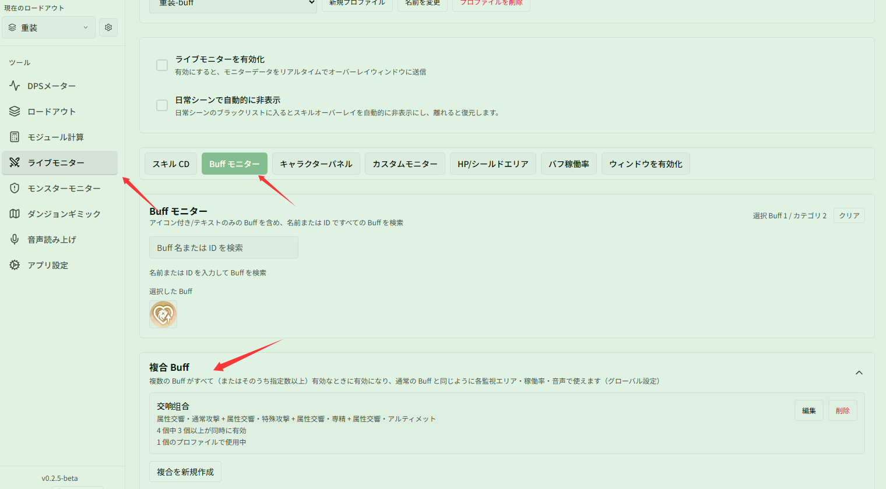
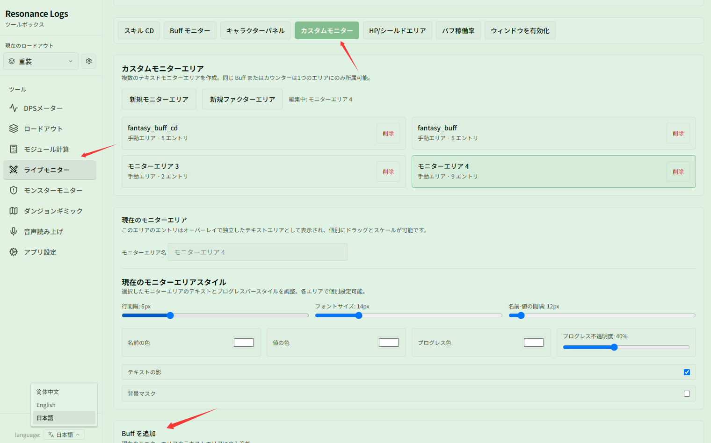

# 複合 Buff で「属性交響」の 3 スタック効果を見張る

関連ページ：[Buff モニター](../buff.md)

**シナリオ**：複数の Buff が同時に存在するときだけ特殊な効果が発動する仕組みがあります（例：「属性交響」が 3 スタック存在するときに追加で与ダメージ +20%）。3 スタックの条件を満たしたときだけオーバーレイに表示させたり、戦闘後にその有効稼働率を集計したい場合です。

## ステップ 1：複合 Buff を新規作成する

**{{ui:routes.tools.skillMonitor}} → {{ui:skillMonitor.tabs.buff}}** を開き、下部の **{{ui:skillMonitor.buff.composite.title}}** セクションまでスクロールします：

1. **{{ui:skillMonitor.buff.composite.new}}** をクリックします；
2. 複合名を入力します（例：「交響コンボ」）；
3. 4 つのメンバー Buff（「属性交響・通常攻撃」「属性交響・特殊攻撃」「属性交響・専精」「属性交響・アルティメット」）を検索して順に追加します；
4. **{{ui:skillMonitor.buff.composite.condition}}** を「4 個中 3 個以上が同時に有効」に設定します；
5. **{{ui:skillMonitor.buff.composite.save}}** をクリックして保存します。

## ステップ 2：モニターエリアに追加して監視する

保存した複合 Buff は通常の Buff と同様に各機能で扱えます：

1. **{{ui:skillMonitor.tabs.customPanel}}** タブに切り替え、対象のカスタムモニターエリアを選択します；
2. 下部の **{{ui:skillMonitor.customPanel.addBuff}}** 検索ボックスに「交響コンボ」と入力し（検索結果に「複合 Buff」と表示されます）、クリックしてエリアに追加します；
3. 戦闘中、4 種類の交響 Buff のうち 3 個以上が同時に有効になると、モニターエリアに「交響コンボ」とその残り時間・スタック数が自動表示されます。

## 補足：バフ稼働率でも集計可能

複合 Buff は **{{ui:skillMonitor.tabs.buffCoverage}}** に追加することもできます：
- **{{ui:skillMonitor.tabs.buffCoverage}}** で「交響コンボ」を検索して追加します；
- リアルタイムおよび履歴詳細で、「属性交響を 3 スタック以上維持できていた時間」と稼働率が個別に集計され、20% 与ダメージ増加効果の維持状況を振り返ることができます。
