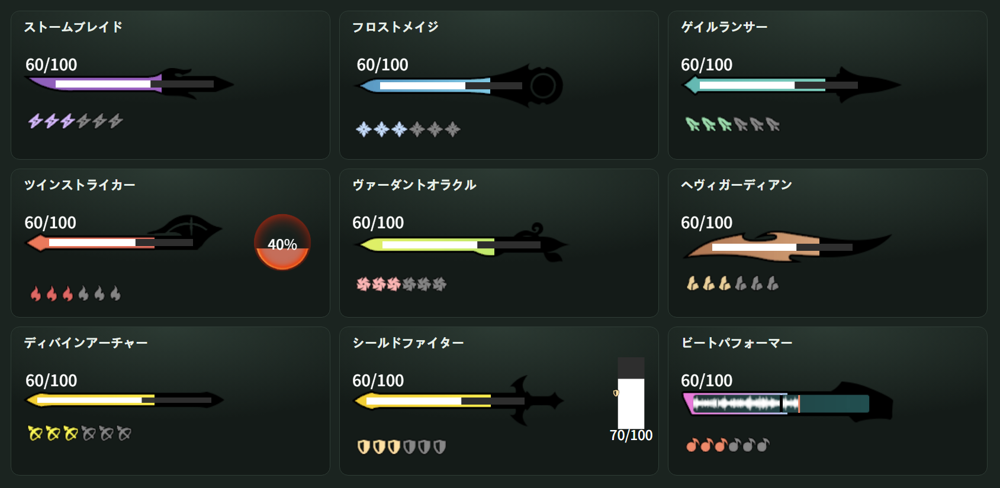
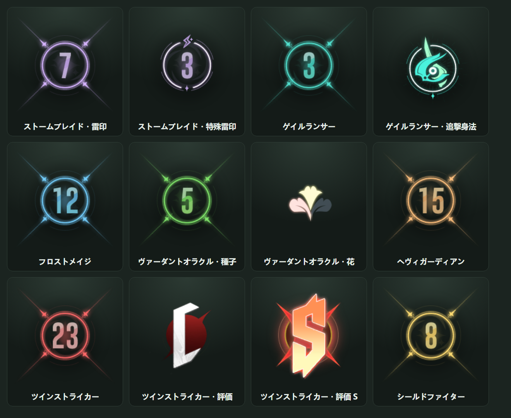
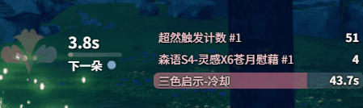

# リソース区分でクラスリソースを見る

関連ページ：[ウィンドウの有効化とレイアウト](../overlay.md)

**シナリオ**：ゲームの武器リソースバーはキャラクターから遠いので、リソースバーとリソースポイントをキャラクターのすぐ横に置き、必要な部分だけ残したいとします。ヴァーダントオラクルの森癒型なら、「三花」の次の花がいつ咲くかもはっきり見たいところです。

## ステップ 1：設定のクラスを確認する

リソースはページ上部の **{{ui:skillMonitor.profile.title}} → {{ui:skillMonitor.profile.classLabel}}** に従い、ログイン中のキャラクターから自動判定はしません。使いたいクラスになっているか確認し、違う場合はここで変更します。

> [!NOTE]
> クラスを変更すると、現在の設定の監視スキルとスキル音声がクリアされます（確認画面に件数が表示されます）。リソース配置とほかの監視内容は保持されます。

## ステップ 2：リソースモニターエリアをオンにする

1. **{{ui:routes.tools.skillMonitor}} → {{ui:skillMonitor.tabs.overlay}}** を開き、**リソースモニターエリア** をオンにします。
2. 下の **{{ui:skillMonitor.overlay.resourceSections}}** に、現在のクラスのリソースが区分ごとに並びます（リソースバー、リソースポイント、シールドバー、職業カウンターなど。ツインストライカーには赤痕オーブもあります）。必要な区分だけ残し、ほかは非表示にします。

職業カウンターは、スタック数・風紋・評価文字・花などをゲーム画面と同じ見た目で表示します。

## ステップ 3：位置を決める

1. ページ上部の **{{ui:skillMonitor.layout.editOverlayLayout}}** をクリックすると、各リソース区分を個別にドラッグ・拡大縮小できます。
2. リソースバーをキャラクターの足元に、リソースポイントをその横に置きます。数字が小さいときは **{{ui:skillMonitor.overlay.resourceTextStyle}}** で大きくします。
3. 終わったら編集を終了します。オーバーレイはクリック透過に戻ります。

## 森癒型：三花カウントダウン

ヴァーダントオラクル森癒型の「三花」は独立したリソース区分で、次の花が咲くまでのカウントダウン（最大 45 秒）と次の花の色を表示します。このカウントダウンがないとき（森癒型以外など）は表示されません。

1. 設定のクラスを **ヴァーダントオラクル** にし、**{{ui:skillMonitor.overlay.resourceSections}}** で三花の区分だけを残します。
2. 三花カウントダウンは既定では色が変わりません。花が咲く直前に強調したい場合は、**{{ui:skillMonitor.tabs.buff}} → {{ui:skillMonitor.buff.alert.title}}** で `2202716`（花の生成カウントダウン）を検索してアラートを追加し、たとえば残り 10 秒以内で赤にします。設定のクラスがヴァーダントオラクルのときは、この Buff を監視に追加しなくてもアラートを設定できます。

> [!TIP]
> 内蔵の「森癒」ロードアウトはこのとおりに設定済みで、三花カウントダウンだけを表示し、残り 10 秒以内で赤くなります。[ロードアウトのプリセット](../../app/loadouts.md#プリセット) から追加できます。
