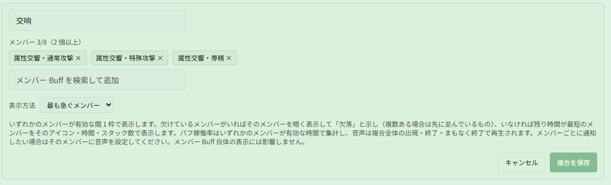
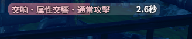
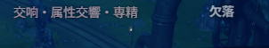

# 「最も急ぐメンバー」で掛け直すべき属性交響だけを表示する

関連ページ：[Buff モニター](../buff.md)

**シナリオ**：「属性交響」には通常攻撃・特殊攻撃・専精・アルティメットなどの種類があり、それぞれ別々に時間が進みます。そのうちいくつかを切らさず維持したいとします。種類ごとに個別に監視すると、画面に複数のカウントダウンが並び、どれを掛け直すべきかひと目でわかりません。表示は 1 行だけにして、欠けているものがあればそれを、すべて有効なら最も早く切れるものを見たい場合です。

## ステップ 1：「最も急ぐメンバー」の複合を作成する

**{{ui:routes.tools.skillMonitor}} → {{ui:skillMonitor.tabs.buff}}** を開き、下部の **{{ui:skillMonitor.buff.composite.title}}** セクションまでスクロールします：

1. **{{ui:skillMonitor.buff.composite.new}}** をクリックし、名前を入力します（スクリーンショットでは「交响」）；
2. 見張りたいメンバーを検索して追加します。例：「属性交響・通常攻撃」「属性交響・特殊攻撃」「属性交響・専精」。維持したい種類だけを追加してください；
3. **{{ui:skillMonitor.buff.composite.mode}}** で **{{ui:skillMonitor.buff.composite.modeMostUrgent}}** を選びます；
4. **{{ui:skillMonitor.buff.composite.save}}** をクリックします。

> [!TIP]
> メンバーは追加した順に並びます。複数が同時に欠けている場合は先に並んでいるものが表示されるため、真っ先に掛け直したいメンバーから追加してください。

## ステップ 2：カスタムモニターに追加する

1. **{{ui:skillMonitor.tabs.customPanel}}** タブに切り替え、対象のカスタムモニターエリアを選択します；
2. 下部の **{{ui:skillMonitor.customPanel.addBuff}}** 検索ボックスに複合名を入力し（検索結果に「複合 Buff」と表示されます）、クリックして追加します。

**{{ui:skillMonitor.tabs.buff}}** の選択済み Buff に追加しても同じように表示されます。

## 戦闘中の表示

すべてのメンバーが有効な間は、残り時間が最短のメンバーが「複合名・メンバー名」で表示されます。下図では通常攻撃が残り 2.6 秒なので、通常攻撃を掛け直すタイミングです：

欠けているメンバーがいると、行が暗くなり「欠落」と表示されます。下図では専精が切れています：

すべてのメンバーが切れると、この行は表示されません。

## 任意：切れる直前のハイライトや音声通知

- **ハイライト**：**{{ui:skillMonitor.buff.alert.title}}** で複合そのものにしきい値を設定します（例：2 秒以下で赤）。どのメンバーが表示されていても、切れそうになるとこの行がハイライトされます；
- **音声**：複合の音声は複合全体で判定されます（最初のメンバーが現れたとき、最後のメンバーが消えたとき、最後のメンバーが切れる前）。表示されるメンバーが切り替わっても読み上げは発生しません。特定のメンバーが切れそうなときに個別に聞きたい場合（例：通常攻撃が残り 1 秒で「通常攻撃」と読み上げる）は、**{{ui:skillMonitor.buff.voice.title}}** でそのメンバー自身に設定してください。

> [!NOTE]
> **{{ui:skillMonitor.buff.voice.title}}** で検索できるのは、このプロファイルのいずれかのエリアに表示されている Buff だけです。どのエリアにも単独で表示していないメンバーは、ここでは見つかりません。

## よくある質問：なぜまだ複数行表示されるのですか？

複合は 1 行だけを使いますが、メンバー Buff 自体の表示は隠しません。メンバーがほかのエリアにも個別に追加されている場合（例：[プリセット](../../app/loadouts.md#プリセット)の烈風型のカスタムモニターには、4 種類の属性交響がすでに並んでいます）、それぞれが通常どおり 1 行ずつ表示されます。1 行だけにしたい場合は、そのエリアからメンバーの項目を削除してください。

メンバーにすでに設定した音声は、項目を削除しても通常どおり読み上げられます。ただし、Buff ページの **{{ui:skillMonitor.buff.voice.title}}** の一覧には表示されなくなります。

## 「3 個同時」の稼働率を集計したい場合

最も急ぐメンバーの稼働率は、いずれかのメンバーが有効な時間で集計されるため、3 スタック効果がどれだけ続いたかはわかりません。3 スタックの与ダメージ増加の稼働率を振り返るには、有効条件を「3 個以上」にした複合を別に作成してください。手順は [複合 Buff で「属性交響」の 3 スタック効果を見張る](./attribute-symphony.md) を参照してください。2 つの複合は同時に使えます。
