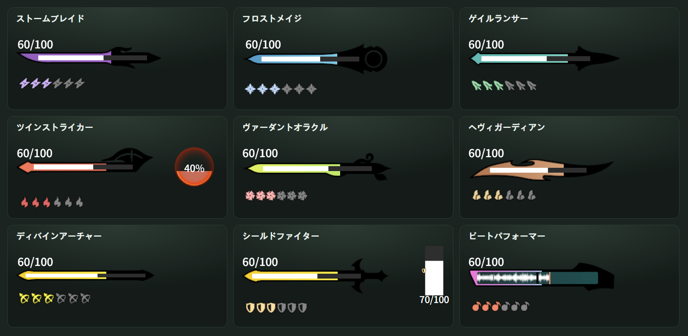
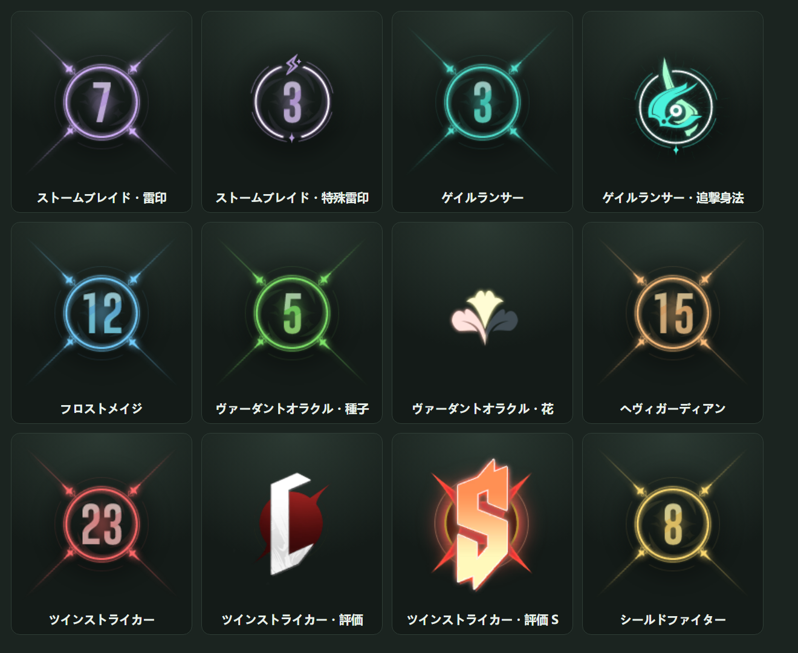
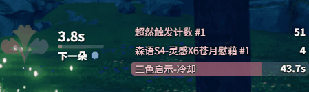
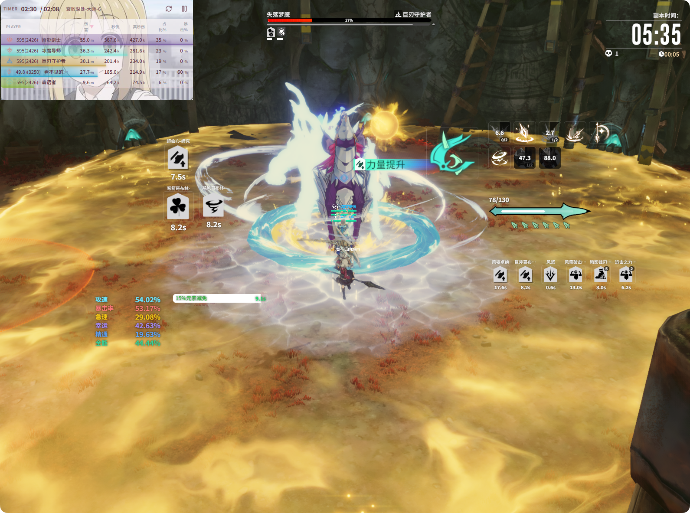

# ウィンドウの有効化とレイアウト

**{{ui:routes.tools.skillMonitor}} → {{ui:skillMonitor.tabs.overlay}}** では、ライブモニターのオーバーレイにどのエリアを表示するかを決めます。各スイッチは**プロファイルごとに保存**されるため、クラスごとのプロファイルで異なるエリアを表示できます。

## オーバーレイのエリア

| エリア | 内容の出どころ |
| --- | --- |
| **スキル CD エリア** | [スキル CD](./skill-cd.md)。各スキルエリアがそれぞれ独立したエリアになります |
| **リソースモニターエリア** | 現在のクラスのエネルギー、スタックなどのリソース |
| **キャラクター属性エリア** | [キャラクターパネル](./panel-attr.md) |
| **カスタムモニターエリア** | [カスタムモニター](./custom-panel.md)。各モニターエリアがそれぞれ独立したエリアになります |
| **HP/シールドエリア** | [HP/シールドエリア](./shield.md) |
| **バフ稼働率エリア** | [バフ稼働率](./buff-coverage.md) |

Buff アイコン（個別モードでは Buff ごと、グループモードではグループごと）は独立したエリアとしてオーバーレイに表示されます。表示するかどうかは [Buff モニター](./buff.md) での選択で決まります。

### リソース区分

**{{ui:skillMonitor.overlay.resourceSections}}** は、現在のクラスのリソースをいくつかの小さなブロックに分け、ブロックごとに**個別に表示 / 非表示・ドラッグ**できるようにします。見た目はゲーム内のリソース表示を再現しています。下図は各クラスの例です（数値は説明用）：

- **リソースバー**：ゲームの武器リソースバーです。枠の上のカラーバーはクラスバフの残り時間、白い細いバーと数字は現在のエネルギーです。ツインストライカーの赤痕オーブ、ディバインアーチャーの狼 / 鷹の枠、ビートパフォーマーの演奏バーもここに表示されます。
- **リソースポイント**：バーの下に並ぶポイント（ゲイルランサーの戦意、フロストメイジの玄氷など）。バフが必要なポイントはバフがないと表示されません。6 個を超えると 1 個だけ表示し、横に数を書きます。
- **シールドバー**：シールドファイターの「光明の盾」中に出る縦のシールドバーです（上図のシールドファイターの右側）。
- **職業カウンター**：ゲーム画面の職業カウンターです。スタック数、ゲイルランサーの風紋、ストームブレイドの特殊雷印、ツインストライカーの評価文字、ヴァーダントオラクルの花など。

- ヴァーダントオラクル森癒型の「三花」カウントダウンも独立した区分です。

**{{ui:skillMonitor.overlay.resourceTextStyle}}**（区分の切り替えボタンの下）では、リソースバー・リソースポイント・シールドバーの数字（例：`100/400`）のサイズと色を調整できます。サイズはスライダーを離したときに保存されます。職業カウンターはゲームの数字画像なので影響しません。

### 文字スタイル

**{{ui:skillMonitor.overlay.sharedTextStyle}}** では、スキル・リソース・Buff アイコン上の文字サイズと色をまとめて調整します。

## レイアウトを編集する

1. ページ上部の **{{ui:skillMonitor.layout.editOverlayLayout}}** をクリックすると、オーバーレイの各エリアに枠線が表示されます。
2. エリアをドラッグして移動し、辺や角をドラッグしてサイズを変えます。
3. 終わったら編集を終了すると、オーバーレイはクリック透過に戻ります。

> [!TIP]
> レイアウトが決まったら、ゲーム本体の UI 非表示機能でゲームの UI をしまい、オーバーレイだけを残して、スキル CD やリソースをキャラクター付近の視界の端に置くことができます。ショートカット **DPS/オーバーレイウィンドウの最小化・復元** を割り当てておけば、スクリーンショットやカットシーンのときにすべてのオーバーレイをワンキーでしまえます。[例：ワンキーですべてのオーバーレイを隠す](../app/examples/combat-shortcuts.md) を参照してください。

