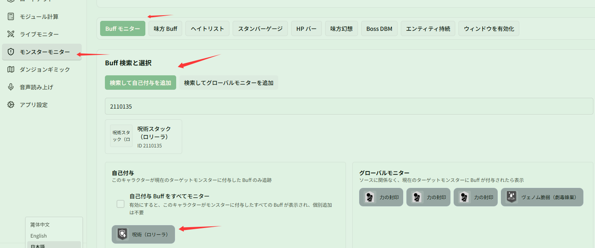

# ロリーラ幻想 Buff とスタックを監視する

関連ページ：[ターゲット Buff](../buff.md)

**シナリオ**：幻想「ロリーラ」を装備しており、発動時に Boss へ基礎被ダメージ増加（呪術（ロリーラ））とスタック式の被ダメージ増加（呪術スタック（ロリーラ））が付与されます。オーバーレイでこの 2 つの Buff の残り時間とスタック数を同時に確認し、バースト火力のタイミングを合わせたい場合です。

## ステップ 1：ロリーラの Buff を検索して「自己付与」に追加する

1. **{{ui:routes.tools.monsterMonitor}} → {{ui:monsterMonitor.tabs.buff}}** を開きます。
2. **{{ui:monsterMonitor.buffSearch.self}}** を選択した状態にします（味方のロリーラと混同しないよう、自分が付与した分だけを追跡します）。
3. 検索ボックスに ID `2110111` または **呪術（ロリーラ）** と入力して追加します。
4. 続いて ID `2110135` または **呪術スタック（ロリーラ）** と入力して追加します。

追加が完了すると、2 つの Buff が **{{ui:monsterMonitor.buffGroups.self.title}}** 一覧に表示されます。

## ステップ 2：優先度やアラートを設定する（任意）

- **優先度**：**{{ui:monsterMonitor.priority.title}}** で「呪術スタック（ロリーラ）」を上位に配置し、Debuff が多いときでもスタック数を優先して確認できるようにします；
- **アラートと音声**：**{{ui:monsterMonitor.alert.title}}** で「呪術（ロリーラ）」にカウントダウンハイライトを設定したり、**{{ui:monsterMonitor.buffVoice.title}}** で終了時の音声通知を設定できます。
