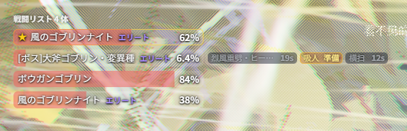

# まとめて釣ったときに全体の HP を把握する

関連ページ：[戦闘リスト](../roster.md)

**シナリオ**：タンクとしてダンジョンで大量のモンスターをまとめて釣ります。HP バーは現在のターゲットしか見えないので、交戦中のすべてのモンスターの HP と、どれが自分を狙っておらず誰を攻撃しているかを知りたいとします。エリートの危険なスキルが戻る前にも知らせてほしいところです。

## ステップ 1：戦闘リストエリアをオンにする

1. **{{ui:routes.tools.monsterMonitor}} → {{ui:monsterMonitor.tabs.overlay}}** で **戦闘リストエリア** をオンにします（既定でオフ）。
2. **{{ui:monsterMonitor.actions.editLayout}}** をクリックし、リストを画面の端へドラッグします。

## ステップ 2：タンク向けに設定する

**{{ui:monsterMonitor.tabs.roster}}** を開きます。

1. **{{ui:monsterMonitor.roster.tankMode}}** をオンにします。自分を狙っていないモンスターの数と、それらが誰を攻撃しているかがヘッダーに表示され、それらのモンスターはすべて 1 行ずつ、行末にターゲット付きで表示されます。
2. **{{ui:monsterMonitor.roster.notAttackingMeFirst}}** をオンにすると、ほかの人を狙っているモンスターが上に並び、優先して引き戻せます。
3. 同じ名前のモンスターが多いときは、**{{ui:monsterMonitor.roster.showDistance}}** をオンにして距離で見分けます。

## ステップ 3：不要なモンスターを非表示にする

一度戦ったら、**{{ui:monsterMonitor.roster.recentTitle}}** でギミックの目印やシーンオブジェクトなど HP を見る必要のないモンスターをクリックして非表示にします。非表示はモンスター ID 単位で、すべてのプロファイルとダンジョンに適用されます。

## ステップ 4：危険なスキルに注目する

1. **{{ui:monsterMonitor.roster.skills.title}}** で **{{ui:monsterMonitor.roster.skills.fromRecent}}** をクリックし、さっき戦ったエリートを開いて危険なスキルにチェックを入れます。横にクールダウン、開戦時の初回使用までの窓、詠唱時間が表示されます。
2. そのスキルの下の **{{ui:monsterMonitor.roster.skills.voiceTitle}}** を開き、**{{ui:voice.binding.event.readyIn}}** をオンにして 3 秒にし、**{{ui:voice.binding.countdown}}** にもチェックを入れます。
3. **{{ui:routes.tools.voice}} → {{ui:voice.tabs.bindings}}** を開き、**{{ui:voice.bindings.generateMissing}}** をクリックします。

## 結果

メインターゲットは一番上に固定され、Boss と注目スキルを持つモンスターは 1 行ずつ、残りの雑魚は最後の行に小さなバーとしてまとめて表示されます。行末の灰色のカウントダウンがスキルのクールダウンで、使用可能になる 3 秒前に音声とカウントダウンが流れます。

> [!NOTE]
> スキルのクールダウンは「最も早く使える時刻」の下限です。その時点で必ず使うとは限らず、スクリプトで発動するスキルは予測できません。一定周期で使われるスキルで最も正確です。
