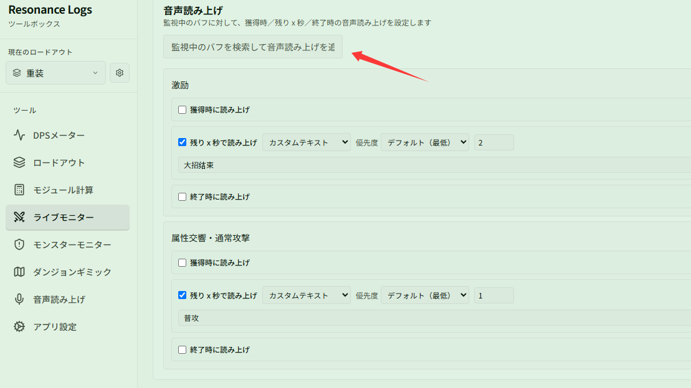
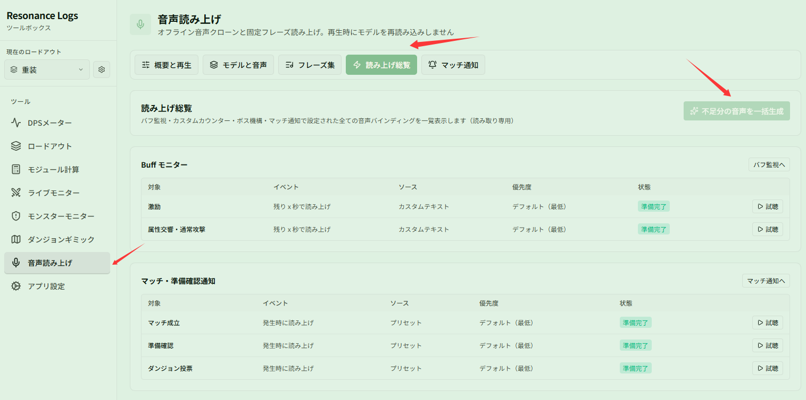

# Buff に音声読み上げを設定して一括生成する

関連ページ：[音声読み上げ](../README.md)

**シナリオ**：自身にかかる重要な Buff（「激励」や「属性交響・通常攻撃」など）が切れる直前に、カスタム音声（残り 2 秒で「大技終了」、残り 1 秒で「通常攻撃」など）で通知を受け取り、不足している音声をワンクリックで生成したい場合です。

## ステップ 1：Buff ページで音声読み上げを設定する

1. **{{ui:routes.tools.skillMonitor}} → {{ui:skillMonitor.tabs.buff}}** を開き、**{{ui:skillMonitor.buff.voice.title}}** セクションまでスクロールします。
2. 検索ボックスで監視中の Buff（「激励」や「属性交響・通常攻撃」など）を検索し、一覧に追加します。
3. **{{ui:voice.binding.event.expiring}}** にチェックを入れ、何秒前に読み上げるかを設定します（2 秒または 1 秒など）。
4. ソースを **{{ui:voice.binding.source.custom}}** に切り替え、読み上げたいテキスト（「大技終了」や「通常攻撃」など）を入力します。
5. 優先度は既定（最低）のままとするか、必要に応じて調整します。

## ステップ 2：読み上げ総覧で不足分の音声を一括生成する

新しく設定した文言や変更した文言はオフライン音声を生成する必要があります：

1. **{{ui:routes.tools.voice}} → {{ui:voice.tabs.bindings}}** を開きます。
2. 一覧に先ほど設定した項目が表示され、状態が「待機中」になっていることを確認します。
3. 右上の **{{ui:voice.bindings.generateMissing}}** をクリックすると、バックグラウンドで音声が一括生成されます。
4. 生成が完了すると状態が **{{ui:voice.bindings.status.ready}}** に変わります。右側の **{{ui:voice.bindings.tryPlay}}** をクリックして試聴できます。

