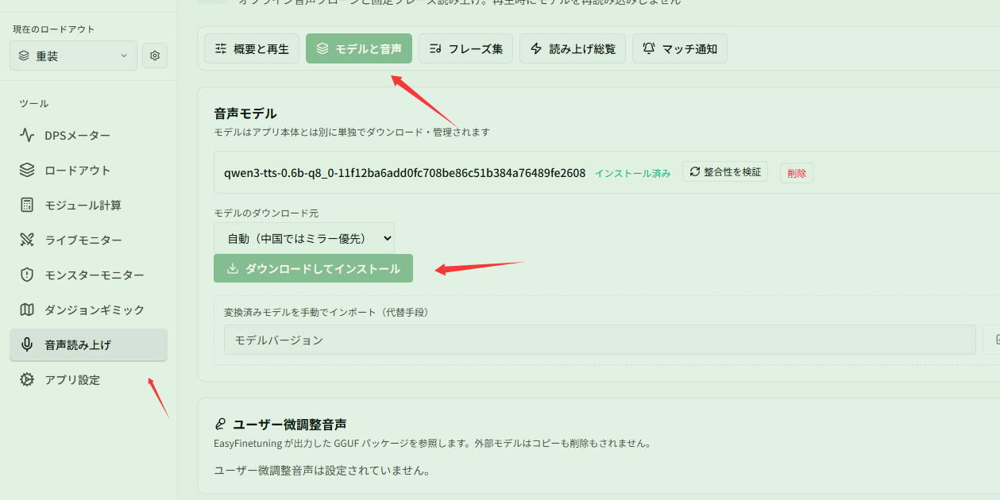
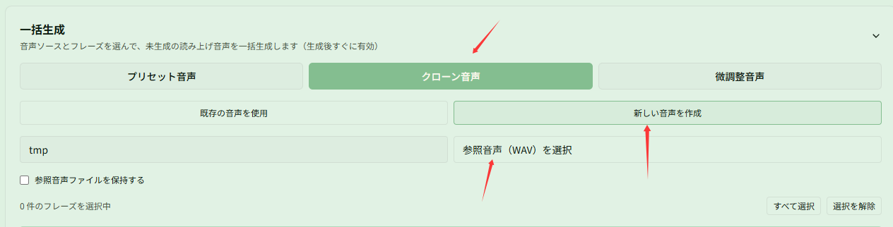
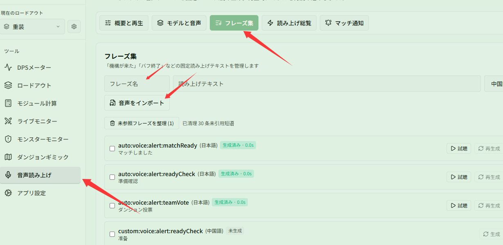

# モデルのダウンロード、音声のクローン、音声ファイルのインポート

関連ページ：[音色とフレーズ](../voices.md)

**シナリオ**：音声読み上げを好みに合わせてカスタマイズしたい場合です。オフラインモデルをインストールしてプリセット音声や新しくクローンした独自音声で読み上げを生成するか、手持ちの効果音や録音ファイルをそのまま固定フレーズとしてインポートします。

## ステップ 1：音声モデルをダウンロードしてインストールする

**{{ui:routes.tools.voice}} → {{ui:voice.tabs.model}}** で、モデルのダウンロード元を確認し、**{{ui:voice.model.install}}** をクリックします。モデルのインストールが完了すると、オフラインでの音声クローンと読み上げ生成が利用可能になります。

## ステップ 2：音声を選択または新規作成して読み上げを生成する（プリセットまたはクローン）

**{{ui:routes.tools.voice}} → {{ui:voice.tabs.phrases}}** を開き、下部の **{{ui:voice.phrases.generate.title}}** パネルを展開します：
- **プリセット音声を使用（既定）**：**{{ui:voice.phrases.generate.presetSource}}** を選択したままにします。現在の UI 言語に合わせた標準的な音声が自動で使用され、フレーズを選んですぐに生成できます；
- **新しい音声をクローン作成**：**{{ui:voice.phrases.generate.cloneSource}}** に切り替え、**{{ui:voice.phrases.generate.createNew}}** をクリックします。**{{ui:voice.phrases.generate.newProfileName}}** を入力し、**{{ui:voice.phrases.generate.pickReference}}** をクリックして 5〜10 秒程度のノイズのないキャラクター音声（WAV 形式）を選択します（必要に応じて **{{ui:voice.phrases.generate.keepReference}}** をオンにします）；
- 音声を選択したら、生成したいフレーズにチェックを入れて **{{ui:voice.phrases.generate.start}}** をクリックします。

## ステップ 3：任意の音声を固定フレーズとしてインポートする

TTS による音声合成を使わず、手持ちの効果音や通知音、外部録音ファイルをそのまま再生したい場合：
1. **{{ui:voice.tabs.phrases}}** 上部のフレーズ管理欄で **{{ui:voice.phrases.namePlaceholder}}** と読み上げテキストを入力します；
2. **{{ui:voice.phrases.import.newButton}}** をクリックし、音声ファイル（wav / mp3 / flac / ogg / m4a に対応、長さ 0.2〜30 秒）を選択します；
3. インポート完了後、状態は **{{ui:voice.phrases.status.imported}}** になります。インポートした音声はモデル不要で、各機能ページから **{{ui:voice.binding.source.phrase}}** で直接参照できます。

