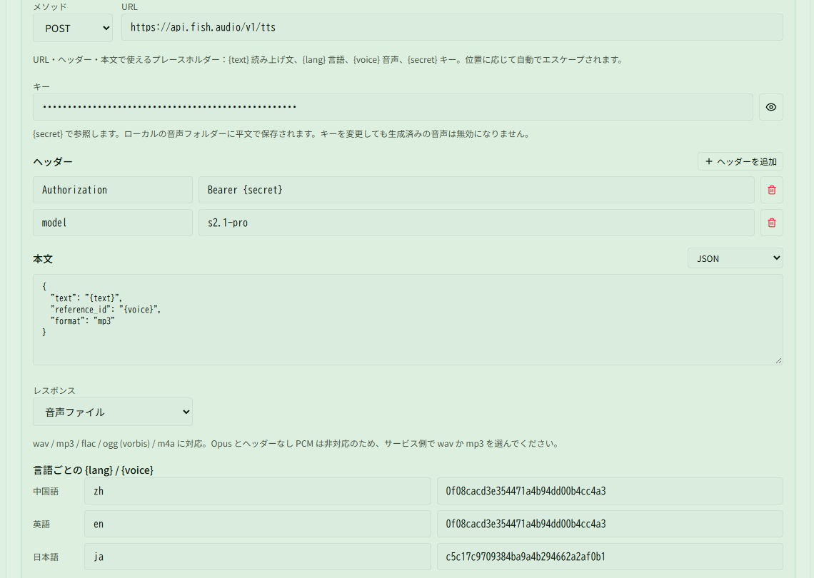

# Fish Audio のオンライン音色で読み上げを生成する

関連ページ：[音色とフレーズ](../voices.md#方法-5http-音声サービス)

**シナリオ**：この PC に音声モデルを入れたくない（または GPU がそれほど強くなく、ローカル生成が遅い）ので、[Fish Audio](https://fish.audio) の音色ライブラリにある既存の音色を使いたい。普段の読み上げは日本語の音色にし、ティナの一文だけは中国語の音色で中国語（「蒂娜好了」）を読ませたい。

音声は生成時に 1 回だけリクエストしてローカルに保存するため、ゲーム中の読み上げで通信は発生しません。HTTP サービスには音声モデルは不要ですが、**{{ui:voice.tabs.overview}}** の **{{ui:voice.overview.enabled}}** はオンにしておく必要があります。

## ステップ 1：キーと音色 ID を用意する

1. Fish Audio にログインし、**API Keys** ページでキーを作成してコピーします。API は従量課金です。料金は公式サイトで確認してください。
2. 音色ライブラリで使いたい日本語の音色を開きます。アドレスは `https://fish.audio/m/c5c17c9709384ba9a4b294662a2af0b1` のような形で、`/m/` の後ろの文字列が音色 ID です。
3. 同じ方法で中国語の音色を探し、ID を控えます。例：`0f08cacd3e354471a4b94dd00b4cc4a3`。

> [!TIP]
> この例の 2 つの ID は説明用です。自分で選んだ音色の ID に置き換えてください。

## ステップ 2：サービスを追加する

**{{ui:routes.tools.voice}} → {{ui:voice.tabs.model}}** を開き、**{{ui:voice.http.title}}** でプリセット **{{ui:voice.http.preset.openaiCompatible}}** を選んで **{{ui:voice.http.add}}** をクリックします。このプリセットはすでに POST、JSON 本文、`Bearer {secret}` 認証になっているので、次の項目だけ変更します。

| 項目 | 入力内容 |
| --- | --- |
| {{ui:voice.http.form.name}} | `fish audio` |
| {{ui:voice.http.form.concurrency}} | `2`（既定値） |
| {{ui:voice.http.form.method}} | POST |
| {{ui:voice.http.form.url}} | `https://api.fish.audio/v1/tts` |
| {{ui:voice.http.form.secret}} | ステップ 1 でコピーしたキー |
| {{ui:voice.http.form.headers}} | `Authorization` = `Bearer {secret}` はそのまま。**{{ui:voice.http.form.addHeader}}** で `model` = `s2.1-pro` を追加 |
| {{ui:voice.http.form.body}} | エンコードは JSON、内容は下記 |
| {{ui:voice.http.form.response}} | **{{ui:voice.http.form.response.audioBytes}}** |

本文：

```json
{
  "text": "{text}",
  "reference_id": "{voice}",
  "format": "mp3"
}
```

- `{text}` はフレーズの文に、`{voice}` は下で言語ごとに入力した音色 ID に置き換わります。引用符や改行は自動でエスケープされます。
- `format` は `mp3` か `wav` にします。Fish Audio は `opus` と `pcm` も返せますが、アプリはこの 2 つの形式に対応していません。
- `model` ヘッダーで使うモデルを指定します。指定できる値は [Fish Audio の API リファレンス](https://docs.fish.audio/api-reference/endpoint/openapi-v1/text-to-speech) を確認してください。

フォームの下部で、言語ごとに `{lang}` と `{voice}` を入力します。

| 言語 | `{lang}` | `{voice}` |
| --- | --- | --- |
| {{ui:voice.language.zhCN}} | `zh` | `0f08cacd3e354471a4b94dd00b4cc4a3` |
| {{ui:voice.language.enUS}} | `en` | `0f08cacd3e354471a4b94dd00b4cc4a3` |
| {{ui:voice.language.jaJP}} | `ja` | `c5c17c9709384ba9a4b294662a2af0b1` |

この本文では `{lang}` を使っていないので、値は何でもかまいません。英語用の音色が特になければ、中国語と同じ ID を入れておけます。



## ステップ 3：試聴して保存する

1. **{{ui:voice.http.form.test}}** で **{{ui:voice.language.jaJP}}** を選び、既定の文のまま **{{ui:voice.http.form.testButton}}** をクリックします。音声が流れ、下に成功と長さが表示されれば設定は正しいです。
2. **{{ui:voice.language.zhCN}}** に切り替え、中国語の文（例：「蒂娜好了」）を入力してもう一度試し、中国語の音色が使われることを確認します。
3. **{{ui:voice.http.form.save}}** をクリックします。

試聴に失敗すると、サービスが返したステータスコードと理由がフォームの下に表示されます。

| 表示 | 原因 |
| --- | --- |
| `HTTP 401` | キーが間違っているか、`Authorization` の値が `Bearer {secret}` になっていない（`Bearer` の後に半角スペースが 1 つ必要） |
| `HTTP 402` | Fish Audio アカウントの残高不足 |
| その他の `HTTP 4xx` | 音色 ID か本文の誤り。返された理由に従って修正する |
| 音声のデコードに失敗する | `format` が `opus` か `pcm` になっている。`mp3` に戻す |
| 接続失敗・タイムアウト | この PC から `api.fish.audio` に接続できない。ネットワークを確認する |

## ステップ 4：既定で Fish Audio を使う

1. **{{ui:voice.tabs.phrases}}** を開き、**{{ui:voice.phrases.generate.title}}** で **{{ui:voice.phrases.generate.httpSource}}** を選び、「fish audio」を選択します。
2. 生成するフレーズにチェックを入れ、**{{ui:voice.phrases.generate.start}}** をクリックします。
3. この選択は保存されます。以降 **{{ui:voice.tabs.bindings}}** で **{{ui:voice.bindings.generateMissing}}** をクリックしたときも Fish Audio で生成されます。

各フレーズは自分の言語の行の音色を使います。アプリが日本語表示なら、自動生成とカスタムテキストの読み上げはどれも日本語のフレーズなので、日本語の行の音色が使われます。

## ステップ 5：ティナの一文だけ中国語の音色にする

1. **{{ui:routes.tools.skillMonitor}} → {{ui:skillMonitor.tabs.buff}}** を開き、**{{ui:skillMonitor.buff.voice.title}}** を展開して「時間凝固（ティナCD）」を探します（設定方法は [ティナの CD が戻ったら音声で知らせる](../../monitor/examples/tina-cd.md) を参照）。
2. **{{ui:voice.binding.event.lost}}** で文言のソースを **{{ui:voice.binding.source.custom}}** にし、「蒂娜好了」と入力します。
3. **{{ui:voice.binding.generationSource}}** を「fish audio」、**{{ui:voice.binding.generationLanguage}}** を **{{ui:voice.language.zhCN}}** にします。
4. **{{ui:voice.binding.generate}}** をクリックし、生成が終わったら **{{ui:voice.binding.tryPlay}}** で確認します。

この一文は中国語の行の `{lang}` と `{voice}` を使い、ほかの読み上げは引き続きステップ 4 の設定で生成されます。**{{ui:voice.binding.source.auto}}** の読み上げも **{{ui:voice.binding.generationSource}}** を個別に選べますが、**{{ui:voice.binding.generationLanguage}}** を変えられるのは **{{ui:voice.binding.source.custom}}** だけなので、ここではカスタムテキストを使います。元に戻すときは **{{ui:voice.binding.generationSource}}** を **{{ui:voice.binding.generationDefault}}** に戻します。

## 注意点

- フレーズ 1 つにつきリクエストは 1 回です。文に `${阶数}` を含めると複数のフレーズ（階級ごとに 1 つ）に展開され、その分リクエストも増えます。[幻想階級プレースホルダー](../playback.md#幻想階級プレースホルダー) を参照してください。
- 音色 ID、`model`、本文、URL を変更すると、このサービスで生成した音声は **{{ui:voice.phrases.status.stale}}** と表示され、再生成が必要になります。キーだけを変更した場合は再生成は不要です。
- 一括生成中に `HTTP 401` や `HTTP 402` が返ると、生成はすぐに止まります。生成済みの音声は残ります。サービス混雑時の `HTTP 429` / `HTTP 503` は自動で再試行されます。頻繁に出る場合は **{{ui:voice.http.form.concurrency}}** を `1` にしてください。
- サービスとキーはこの PC にだけ保存され、[ロードアウトの共有](../../app/examples/share-loadout.md) には含まれません。メンバーがロードアウトをインポートすると、ステップ 5 の読み上げの **{{ui:voice.binding.generationSource}}** は **{{ui:voice.binding.generationUnavailable}}** と表示されます。メンバー自身がサービスを追加し、選び直す必要があります。
